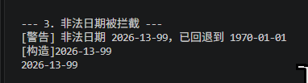
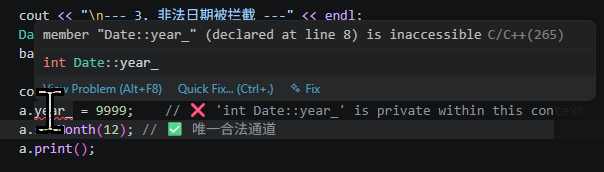
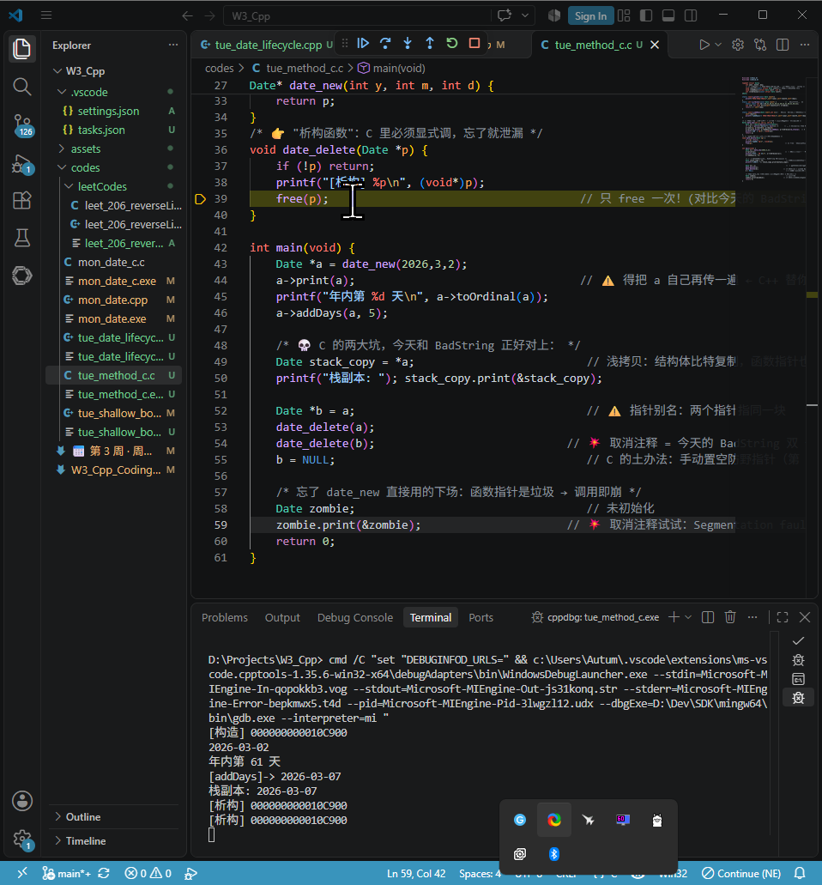

# Week 2–8 C++ 学习笔记

## 第三周（Day 1）：类的定义与封装

> 第 2 周你已经把「引用 / 指针 / const」这三块硬骨头啃完了，本周正式进入 **C++ 的灵魂：类与对象**。
> 今天的关键词只有一个：**封装**。把数据和操作数据的函数打包在一起，并用 `public` / `private` 划出一道墙。

### 一、类的定义与封装（C++ 主线）

#### 1.1 从第 2 周走过来：`struct` 的"升级版"

第 2 周周四你写过 C 的 `struct Student`——只有数据，没有函数，所有成员天然公开。
C++ 的 `class` 干了一件事：**把数据和操作数据的函数捆在一起，再给它们上一把锁**。

```cpp
// C 风格（第 2 周周四）
struct Student { int id; float score; };   // 只有数据，谁都能改 s.score = -999;

// C++ 风格（今天）
class Date {
private:            // 🔒 墙内：外部碰不到
    int year_, month_, day_;
public:             // 🚪 墙外：唯一出入口
    Date(int y, int m, int d);   // 构造函数：对象出生时自动调用
    void print() const;          // 上周四学的 const 成员函数，今天直接用上
};
```

> 💡 看出来了吗？上周四的 `const` 成员函数今天立刻复用——`print() const` 承诺"我只读不改"。

**🔧 补充一个第 2 周没细说的语法点：类内声明、类外定义。**
上面这种写法是工业界标准姿势——`.h` 里放声明，`.cpp` 里放定义，类外定义时**必须写类名限定符**：

```cpp
Date::Date(int y, int m, int d) : year_(y), month_(m), day_(d) { /* ... */ }
void Date::print() const { /* ... */ }   // ← const 不能丢，类内外都要写
```

今天为了单文件跑通，我都写在类内（类内定义 = 隐式 `inline`），语义完全等价。

#### 1.2 三个访问修饰符（今天必须分清）

| 修饰符      | 类内部能访问 | 类外部（main 里）能访问 | 派生类能访问（本周先眼熟，第 5 周细讲） |
| :---------- | :----------- | :---------------------- | :-------------------------------------- |
| `private`   | ✅            | ❌                       | ❌                                       |
| `protected` | ✅            | ❌                       | ✅                                       |
| `public`    | ✅            | ✅                       | ✅                                       |

**两条硬规则：**

- `class` 的默认访问级别是 **`private`**（不写修饰符，成员全是私有的）。
- `struct` 的默认访问级别是 **`public`**（这是 C++ 里 `class` 和 `struct` 的**唯一**区别，其余完全等价）。

```cpp
class A { int x; };      // x 是 private（class 默认锁）
struct B { int x; };     // x 是 public （struct 默认开）
```

**为什么要 private？** 为了**不变量（invariant）**。`Date` 的月份必须是 1~12，如果 `month_` 公开，别人一句 `d.month_ = 99;` 你的对象就烂了。私有化之后，所有修改必须经过你写的函数，你就能在里面拦截非法值。

> 📌 **术语加餐**：`private` 挡的是**编译期访问**，不是运行期安全。它防的是"手滑写错"，不是"恶意攻击"（`reinterpret_cast` 一把就能绕过）。真正的价值是**把不变量收敛到少数几个函数里**，出 bug 时只需要审 `setMonth` 一处，而不是全工程 grep `month_ =`。

#### 1.3 构造函数：对象出生的"仪式"

**三个特征，背下来：**

1. **函数名 = 类名**，**没有返回类型**（连 `void` 都不写）。
2. **创建对象时自动调用**，你没法像普通函数那样 `d.Date(2026,3,2);` 去调。
3. 不写的话编译器会给一个**默认构造函数**，但它**不初始化内置类型**——`int year_;` 会是垃圾值。这就是为什么你**总要自己写构造函数**。

> 🔧 **精确化第 3 条（考研/面试爱抠的字眼）**：
> "编译器给的默认构造函数"这句话有三个例外，一个都不初始化内置类型：
> ① 类里有**其他成员对象/基类**带构造函数 → 编译器生成的那个会去调它们；
> ② 你写了**任何一个**构造函数（哪怕是有参的），编译器就**不再生成**默认构造了，`Date b;` 直接编译失败——这正是 1.4 自测第 3 题的答案根源；
> ③ 想要"等于零初始化"得自己写 `Date() = default;` 或 `Date() : year_(0), month_(1), day_(1) {}`。
> 另：`Date d;`（无括号）→ 内置类型留垃圾值；`Date d{};`（C++11 列表初始化）→ **会**零初始化。这个坑第 2 周 Day6 的 sizeof 笔记里其实已经埋过伏笔。

##### 注：构造函数一定不能是 `const` 函数

C++ 明确规定**构造函数不能是 const 函数**。

**原因**

- **构造函数的目的就是修改对象状态**：它负责初始化成员变量，必然要写入数据。而 `const` 成员函数承诺不修改对象（`this` 指针是 `const T*`），这与构造函数的功能直接矛盾。
- **对象在构造过程中尚未成为 const**：即使你最终要创建一个 `const` 对象（如 `const Date d(2026,1,1);`），在其构造期间，对象是可变的，构造函数必须能修改它。构造完成之后，对象才具有 `const` 属性。
- **语法上禁止**：如果你写出 `Date() const {}`，编译器会直接报错（`constructor cannot be declared const`）。

> 🔧 **底层一句话（比"语法禁止"更硬的解释）**：构造函数里 `this` 的类型是 `Date*`，而 `const` 成员函数里 `this` 是 `const Date*`。构造函数的活儿就是往 `this` 指向的那块raw内存里写字节，把它声明成 `const Date*` 等于自废武功，标准因此直接禁掉。**同理，析构函数也不能是 `const`**（它要拆房子，也得动手）。

**类比**

就像你不能让一个"建造工人"在建造房子时承诺"不碰房子"——他必须动手才能建好。构造函数就是这个"建造工人"。

**如果需要"不修改成员"的操作怎么办？**

把那些只读的逻辑放在普通的 `const` 成员函数中（如 `mon_date.cpp` 中的 `isValid` 和 `print` 已经标记为 `const`），**构造函数内部可以放心调用它们**（构造期间调 `const` 成员函数完全合法，只是别调虚函数——那时虚表还没就位，第 4 周讲），但构造函数本身不能是 `const`。

##### 初始化列表 vs 函数体内赋值（重点，别混）

```cpp
// ✅ 推荐：初始化列表（成员在"诞生时"就被赋值）
Date(int y, int m, int d) : year_(y), month_(m), day_(d) {}

// ⚠️ 能跑但次优：先默认构造，再赋值（多一次操作）
Date(int y, int m, int d) { year_ = y; month_ = m; day_ = d; }
```

**区别与优劣对比**

```cpp
#include <iostream>
using namespace std;

class Demo {
public:
    // ---------- 方案 A：初始化列表（推荐） ----------
    Demo(int a, int b, int c) : x_(a), y_(b), z_(c) {
        // 函数体为空，成员已在"出生时"获得正确值
    }

    // ---------- 方案 B：函数体内赋值（次优） ----------
    // Demo(int a, int b, int c) {
    //     x_ = a;   // 先默认构造 x_（内置类型不初始化，垃圾值），再赋值
    //     y_ = b;
    //     z_ = c;
    // }

    void print() const {
        cout << "x=" << x_ << " y=" << y_ << " z=" << z_ << endl;
    }

private:
    int x_, y_, z_;
};

int main() {
    Demo d(1, 2, 3);
    d.print();
    return 0;
}
```

**优劣对比**：

| 方面       | 初始化列表                                 | 函数体内赋值                                                 |
| :--------- | :----------------------------------------- | :----------------------------------------------------------- |
| **效率**   | 成员直接构造，一步到位                     | 先默认构造（内置类型不做初始化，留下垃圾值），再赋值，多一次操作 |
| **必要性** | 某些成员**必须**用列表初始化（见下文三种） | 不能用于 const、引用、无默认构造的成员                       |
| **可读性** | 一眼看出成员初始值                         | 需从函数体中寻找赋值语句                                     |
| **推荐度** | ✅ 总是优先使用                             | ⚠️ 仅当初始化列表不方便时（极少）                             |

> 🔧 **把"效率"这条从口号落成数字**（对 `int` 这种内置类型，差别约等于零；对类类型才要命）：
>
> ```cpp
> #include <string>
> class Bad  { std::string s_; public: Bad(const std::string& s)  { s_ = s; } }; // 造1次 + 赋值1次
> class Good { std::string s_; public: Good(const std::string& s) : s_(s) {} };  // 只造1次
> ```
>
> `Bad` 的路径是：进函数体前 `s_` 先走一遍 `string()` 默认构造（可能还顺手分配了 SSO 之外的堆块）→ 函数体里 `operator=` 先把旧缓冲扔掉再拷一遍。`Good` 直接拿 `s` 拷贝构造一次完事。**成员是个 1MB 的 `vector` 时，这就是"快一倍"和"白烧一次 malloc+memcpy"的区别。**
> 顺带：**初始化顺序只看成员声明顺序，跟列表里写的顺序无关**。`: z_(1), y_(2), x_(3)` 仍然按 `x_→y_→z_` 初始化。开着 `-Wreorder` 编译，写反了编译器会叫。

**什么时候必须用初始化列表（没得选）**：

##### ① `const` 成员变量（诞生后不能再改，只能初始化）

```cpp
class ConstMember {
public:
    // ✅ 正确：初始化列表
    ConstMember(int val) : kValue_(val) {}

    // ❌ 错误：不能在函数体内赋值（const 变量只能初始化一次）
    // ConstMember(int val) { kValue_ = val; }   // 编译错误！

    int get() const { return kValue_; }
private:
    const int kValue_;
};
```

**解释**：`const` 变量在诞生那一刻就必须有值，之后不能修改。函数体内的 `=` 是赋值（修改），不是初始化，所以编译直接报错。

##### ② 引用成员变量（必须初始化、不能重绑——第 2 周周一的知识！）

```cpp
class RefMember {
public:
    // ✅ 正确：初始化列表绑定引用
    RefMember(int &ref) : ref_(ref) {}

    // ❌ 错误：引用必须在初始化时绑定，不能先声明再赋值
    // RefMember(int &ref) { ref_ = ref; }   // 编译错误！

    void modify(int newVal) { ref_ = newVal; }  // 通过引用修改原变量
private:
    int &ref_;
};

int main() {
    int x = 10;
    RefMember obj(x);
    obj.modify(20);
    cout << x << endl;   // 输出 20，证明 obj 持有的是 x 的引用
}
```

**解释**：引用"必须初始化、不能为空、不能重绑"。在函数体内写 `ref_ = ref;`，编译器确实能过——但干的事是**把 `ref` 的值赋给 `ref_` 所绑定的那个对象**（即 `x = ref`），而不是让 `ref_` 改绑。而 `ref_` 此时还没绑定过任何东西，属于未定义行为 / 直接报错（取决于编译器）。所以必须在初始化列表里一次绑死。

> 🔧 **上一行的坑值得单独盯一眼**：`RefMember(int &ref) { ref_ = ref; }` 不是"编译错误"这么简单——它在语法上是**合法的赋值表达式**（`int&` 赋 `int`），但 `ref_` 是悬空引用，一写就 UB。所以准确说法是：**"想绑定却写成了赋值，编译器不拦，运行时炸"**，这比"直接报错"更阴险。写引用成员，只有初始化列表一条活路。

##### ③ 没有默认构造函数的成员对象

```cpp
class Inner {
public:
    Inner(int v) : val_(v) {}   // 只有带参构造函数，没有默认构造函数
    int get() const { return val_; }
private:
    int val_;
};

class Outer {
public:
    // ✅ 正确：初始化列表调用 Inner 的带参构造函数
    Outer(int v) : inner_(v) {}

    // ❌ 错误：Inner 没有默认构造函数，函数体内无法构造 inner_
    // Outer(int v) { inner_ = Inner(v); }   // 编译错误！
    // 因为成员 inner_ 必须先被构造出来，才能对它赋值；
    // 但 Inner 没有默认构造函数，所以 inner_ 根本没法"先被构造"。

    void show() const { cout << inner_.get() << endl; }
private:
    Inner inner_;
};

```

**解释**：成员对象的构造发生在**进入构造函数体之前**。如果成员对象没有默认构造函数，那么在进入函数体之前，编译器不知道如何创建它。初始化列表可以显式传参，让成员在"出生时"就拿到正确构造；函数体内的 `=` 是赋值，前提是对象已经存在，而那时 `inner_` 还没被造出来，所以编译失败。

> 🔧 **把执行时序钉死（背这一串，第 2 周 Day6 的对齐笔记可以接上）**：
> `Outer o(5);` 的真实顺序是 →
> ① 分配 `o` 的内存 → ② **按声明顺序**构造成员（`inner_(5)`）→ ③ 执行 `Outer` 的初始化列表剩余项 → ④ 执行构造函数**函数体** → ⑤ 对象可用。
> 析构**严格逆序**：`~Outer()` 函数体 → 逆序析构成员。这就是明天"析构顺序和构造完全相反"的机理，今天先埋一颗钉子。

**最佳实践**：**总是优先使用初始化列表**，它更高效、更安全，能覆盖所有成员类型。只有在极特殊情况下（比如需要先做一段校验/计算再决定初始值，或需要 `try` 捕获成员构造的异常）才考虑函数体内赋值，但那时也要确保成员有默认构造函数且非 const / 非引用。

> 📌 **加餐：C++11 的委托构造与类内初值**（今天眼熟即可）
>
> ```cpp
> class Date {
>  int year_ = 1970, month_ = 1, day_ = 1;   // 类内成员初值（C++11）：兜底默认值
> public:
>  Date() = default;                          // 用上面那组初值
>  Date(int y, int m, int d) : Date() {       // 委托构造：先跑一遍 Date()，再补校验
>      if (!isValid(y,m,d)) { /* 回退 */ }
>      year_=y; month_=m; day_=d;
>  }
> };
> 
> ```
>
> 类内初值的好处：**忘了在列表里写某个成员时，它不会是垃圾值**，而是你给的兜底值。写多构造函数时尤其省心。

#### 1.4 动手实验：写出你的第一个 `Date` 类（今日必做产出） ✍️

新建 `week3/mon_date.cpp`：

```cpp
#include <iostream>
#include <iomanip>   // setfill / setw
using namespace std;

class Date {
private:
    int year_, month_, day_;

    bool isValid(int y, int m, int d) const {   // 私有工具函数：外部看不见
        if (m < 1 || m > 12) return false;
        static const int md[] = {0,31,28,31,30,31,30,31,31,30,31,30,31};
        int maxDay = md[m];
        // 闰年 2 月（今天先简版，周三重载 + 时会再完善）
        if (m == 2 && (y % 4 == 0 && y % 100 != 0 || y % 400 == 0)) maxDay = 29;
        return d >= 1 && d <= maxDay;
    }

public:
    // ✅ 构造函数：初始化列表 + 合法性兜底
    Date(int y = 1970, int m = 1, int d = 1)      // 顺带给了默认实参 → 兼作默认构造
        : year_(y), month_(m), day_(d) {
        if (!isValid(y, m, d)) {
            cerr << "[警告] 非法日期 " << y << "-" << m << "-" << d
                 << "，已回退到 1970-01-01\n";
            year_ = 1970; month_ = 1; day_ = 1;
        }
        cout << "[构造] " << year_ << "-" << month_ << "-" << day_ << endl;
    }

    // 上周四的 const 成员函数，今天直接复用
    void print() const {
        cout << year_ << "-" << setfill('0') << setw(2) << month_ << "-"
             << setw(2) << day_ << setfill(' ') << endl;
    }

    int year()  const { return year_; }   // getter：只读出口
    int month() const { return month_; }
    int day()   const { return day_; }

    void setMonth(int m) {                 // setter：写出口，带校验
        if (m >= 1 && m <= 12) month_ = m;
        else cerr << "[拒绝] 月份 " << m << " 非法\n";
    }
};

int main() {
    cout << "--- 1. 栈上对象 ---" << endl;
    Date a(2026, 3, 2);
    a.print();

    cout << "\n--- 2. 默认构造（走默认实参）---" << endl;
    Date b;
    b.print();

    cout << "\n--- 3. 非法日期被拦截 ---" << endl;
    Date bad(2026, 13, 99);
    bad.print();

    cout << "\n--- 4. 私有成员碰不到（取消下一行注释看报错）---" << endl;
    // a.year_ = 9999;    // ❌ 'int Date::year_' is private within this context
    a.setMonth(12);        // ✅ 唯一合法通道
    a.print();

    cout << "\n--- 5. 堆上对象 ---" << endl;
    Date *p = new Date(2000, 1, 1);   // 第 2 周：new 返回指针
    p->print();                        // 第 2 周：指针用 -> （和 C 的 struct 一致）
    delete p;                          // 明天讲 delete 触发析构

    return 0;
}

```

**编译运行**：`g++ -std=c++17 -Wall -Wextra mon_date.cpp -o date && ./date`

> 🔧 **三处必须点名的细节（不点，明天会踩）**
>
> **① 现象 3 压根没有做到回退**
>
> 
>
> 你的困惑很合理，关键在于理解 **初始化列表的执行时机** 和 **默认实参的作用范围**。
>
>  1. **为什么输出的是非法值，而不是默认值？** 
>
> 构造函数的执行顺序是：
>
> 1. **初始化列表**（`year_(y), month_(m), day_(d)`）—— 在进入函数体**之前**就执行完毕。 
> 2. **函数体**（`{ ... }`）—— 这时成员变量已经被赋予了传入的参数值（哪怕是非法值）。 
>
> 当你调用 `Date bad(2026, 13, 99)` 时：
>
> - 你**显式传入了三个参数**，所以默认实参 `1970, 1, 1` 被完全忽略。 
> - 初始化列表直接把 `year_ = 2026`、`month_ = 13`、`day_ = 99`。 
> - 进入函数体后，`isValid` 返回 `false`，打印了警告，但**没有修改成员变量**，所以成员变量仍然是 `2026, 13, 99`。 
>
> **默认实参只在“调用时不传该参数”时才生效**。你传了参数，它就失效了。
>
>  2. **正确的做法：在检测到非法时手动回退** 
>
> 你需要在 `if` 块内**显式地把成员变量赋值为默认值**，例如：
>
> ```cpp
> if (!isValid(y, m, d))
> {
>     cerr << "[警告] 非法日期 " << y << "-" << m << "-" << d
>          << "，已回退到 1970-01-01\n";
>     // ★ 手动回退成员变量
>     year_ = 1970;
>     month_ = 1;
>     day_ = 1;
> }
> ```
>
> 这样 `bad.print()` 才会输出 `1970-01-01`。
>
>  3. **为什么不能指望初始化列表自动回退？** 
>
> 初始化列表只能做**一次性赋值**，不能根据条件选择不同的值。如果你想在初始化阶段就根据合法性选择值，可以用**条件表达式**（三元运算符），但那样会破坏初始化列表的简洁性。更常见的做法是：**在函数体内修正**，如上所示。
>
> **② 构造函数里的 `cerr` 回退是「带病出生」策略，不是唯一解。**
> 今天用了"警告 + 回退 1970"，好处是对象一定存在、demo 能跑完；坏处是**调用方可能压根没看 stderr**，拿着一个 1970 的对象当 2026 用。
> 三种工业解法，按严格程度排（第 5 周异常处理细讲）：
>
> | 策略                          | 写法                                                         | 适用                                                       |
> | :---------------------------- | :----------------------------------------------------------- | :--------------------------------------------------------- |
> | 回退默认值（今天）            | `cerr + year_=1970...`                                       | 教学 / 配置类，错了也能跑                                  |
> | **工厂 + `optional`**（推荐） | `static optional<Date> make(int,int,int);` 非法就 `return nullopt;` | 强制调用方判空，编译期就逼你处理                           |
> | 抛异常                        | `throw invalid_argument("bad date");`                        | 非法即"不可能发生"，让对象根本不存在（见 2.6 的 C++ 对照） |
>
> **③ 试着把 `-Wall -Wextra` 打开编译**，你会多收获一条：
> `warning: private field 'year_' is not used [-Wunused-private-field]` 不会出现（getter 用了），但把 `year()` getter 注释掉就会冒出来——**编译器在替你检查封装有没有漏风口**，这是 `private` 的隐藏福利。

可以看到 `a.year_ = 9999;` 的报错：



##### 注 1：`#include <iomanip>`

`#include <iomanip>` 是 C++ 标准库头文件，提供了**输入输出流的格式化操作**，主要用于控制数据的显示格式，比如设置小数位数、对齐方式、填充字符、进制等。

| **操纵符（Manipulator）**     | **作用**                                               | **示例**                                                 |
| :---------------------------- | :----------------------------------------------------- | :------------------------------------------------------- |
| `setprecision(n)`             | 设置浮点数有效数字位数（或小数位数，取决于 `fixed`）   | `cout << setprecision(3) << 3.14159;` → `3.14`           |
| `fixed`                       | 以定点格式显示浮点数（小数位数由 `setprecision` 决定） | `cout << fixed << setprecision(2) << 3.14159;` → `3.14`  |
| `scientific`                  | 以科学计数法显示浮点数                                 | `cout << scientific << 314.159;` → `3.141590e+02`        |
| `setw(n)`                     | 设置下一个输出项的最小字段宽度（**仅影响下一次输出**） | `cout << setw(10) << 42;` → `        42`（右对齐）       |
| `setfill(c)`                  | 设置填充字符（配合 `setw` 使用，**持续生效**）         | `cout << setfill('*') << setw(10) << 42;` → `********42` |
| `left` / `right` / `internal` | 设置对齐方式（`internal` = 符号左、数字右）            | `cout << left << setw(10) << 42;` → `42        `         |
| `boolalpha` / `noboolalpha`   | 将布尔值显示为 `true/false` 或 `1/0`                   | `cout << boolalpha << true;` → `true`                    |
| `showpoint` / `noshowpoint`   | 强制显示小数点（即使小数部分为零）                     | `cout << showpoint << 3.0;` → `3.00000`                  |
| `hex` / `dec` / `oct`         | 设置整数的进制                                         | `cout << hex << 255;` → `ff`                             |

**完整示例**

```cpp
#include <iostream>
#include <iomanip>
using namespace std;

int main() {
    double pi = 3.141592653589793;
    int num = 42;
    bool flag = true;

    // 设置小数精度
    cout << "默认精度：" << pi << endl;                            // 3.14159
    cout << fixed << setprecision(3) << "三位小数：" << pi << endl; // 3.142

    // 设置宽度和对齐
    cout << "\n右对齐宽度10：" << setw(10) << num << "end" << endl;
    cout << "左对齐宽度10：" << left << setw(10) << num << "end" << endl;
    cout << "填充星号：" << setfill('*') << setw(10) << num << endl;

    // 布尔值显示为 true/false
    cout << "\nboolalpha: " << boolalpha << flag << endl;     // true
    cout << "noboolalpha: " << noboolalpha << flag << endl;   // 1

    // 十六进制
    cout << "\n十六进制：" << hex << 255 << endl;             // ff
    cout << "十进制：" << dec << 255 << endl;                 // 255

    return 0;
}

```

**输出**：

```text
默认精度：3.14159
三位小数：3.142

右对齐宽度10：        42end
左对齐宽度10：42        end
填充星号：********42

boolalpha: true
noboolalpha: 1

十六进制：ff
十进制：255

```

**注意事项**

- `setw` 只影响**紧接着的下一个**输出项，而 `setprecision`、`fixed`、`setfill`、`left/right`、`hex/dec` 是**持续生效**的（直到被更改）。⚠️ 这条不对称是最常踩的坑：

  ```cpp
  cout << setfill('0') << setw(2) << 3 << "-" << setw(2) << 9 << endl;  // 03-09 ✅ 两个都生效
  cout << setw(2) << 3 << "-" << 9 << endl;                             //  3-9  ❌ 第二个 setw 没了
  
  ```

  **这就是 `Date::print()` 里为什么两个 `setw(2)` 都要写、但 `setfill('0')` 只写一次还能在结尾 `setfill(' ')` 还原**的原因——你今天那段代码是踩准了的。

- 使用 `fixed` + `setprecision(n)` 可以精确控制小数位数，常用于金额等场景。

- 这些操纵符大多定义在 `<iomanip>` 中（带参数的那些：`setw/setfill/setprecision`），而无参的（`hex`、`dec`、`oct`、`fixed`、`left`、`endl`）在 `<ios>` / `<iostream>` 里，所以有时不加 `#include <iomanip>` 也能编过，但为了可移植性和完整性，**建议显式包含**。

- 🔧 **C 语言对照**（本周差异笔记 +1 条）：C 里干同样的事靠格式串，一条搞定但不可组合：

  ```c
  printf("%04d-%02d-%02d\n", y, m, d);   // C：一切都在格式串里，静态
  cout << setfill('0') << setw(2) << m;  // C++：操纵符是"状态"，可开关、可封装、可重载 <<
  
  ```

  C++ 的优势不是更短，而是**`operator<<` 可以被你的类重载**——明天/后天写 `ostream& operator<<(ostream&, const Date&)` 之后，`cout << d;` 直接能用，这是 `printf` 永远做不到的事（第 3 周周三的重点）。

简单来说，**需要精细控制输入输出格式时，就 `#include <iomanip>`**。

##### 注 2：`static const int md[] = {0,31,28,...};` 辨析

`static` 和 `const` 解决的是不同维度的问题，不能相互替代。**`const` 保证数据不可修改，`static` 控制的是存储方式和作用域。**

**场景一：在类中定义成员数组**

```cpp
class Date {
    static const int md[] = {0,31,28,31,30,31,30,31,31,30,31,30,31};
    // 其他成员...
};

```

> 🔧 **先纠一处语法，这个必须改，否则你明天默写会卡住**：
> **C++ 不允许在类内直接初始化非 `inline` 的 `static` 数组成员**——上面这行在 C++11/14 下是**编译错误**：
>
> ```
> error: 'constexpr' needed for in-class initialization of static data member
>     'const int Date::md [13]' of non-integral type
> 
> ```
>
> 有趣的是：`static const int N = 13;`（整型）可以类内初始化，`static const int arr[] = {...};`（数组，**非整型**）不行。这是标准里一条很别扭的历史规则。
> **三种合法写法**，按推荐度排：

```cpp
// ✅ 写法 A（C++17 起，最干净）：inline static，类内一次搞定
class Date {
    static constexpr int md_[13] = {0,31,28,31,30,31,30,31,31,30,31,30,31};
    // ^ constexpr 隐含 inline + const，C++17 起不需要类外再定义一份
};

// ✅ 写法 B（C++98~14 通用，你今天 isValid() 里的局部写法正是这个思路的局部版）
//    类内只声明，类外给定义：
class Date { static const int md_[13]; /* ... */ };
const int Date::md_[13] = {0,31,28,31,30,31,30,31,31,30,31,30,31};   // .cpp 里写，只能写一次

// ⚠️ 写法 C（能跑，今天用的就是这个）：放进函数体当局部 static
bool isValid(int y, int m, int d) const {
    static const int md[] = {0,31,28,31,30,31,30,31,31,30,31,30,31}; // ✅ 局部静态，合法
    ...
}

```

> 写法 C 其实**是最实用的**：`md` 是函数内的局部静态，第一次调用时初始化（零成本，编译期常量段），作用域不外泄，还能享受 `static` 的"只有一份"。**单文件 demo 首选它**，多文件工程才需要 A/B。
> ⚠️ 唯一注意：局部 `static` 的初始化在 **C++11 起保证线程安全**（magic statics），C++98 不保证——多线程课（第 6 周）会回来收这笔账。

**如果没有 `static`**（指写成普通成员 `const int md_[13];`）：

`md_` 会成为每个 `Date` 对象的**非静态成员**。每个 `Date` 对象都会在自己的内存空间里完整复制一份这个数组（即使它是 `const`，对象之间互不共享）。如果有 1000 个 `Date` 对象，内存中就有 1000 份相同的数组，造成严重浪费。**而且**——`const` 非静态成员还逼你必须在每个构造函数的初始化列表里写 `md_(...)`（数组还不能这么写），直接把构造函数废掉。

**加上 `static` 后**：

`md` 成为**类的静态成员**，所有 `Date` 对象**共享同一份**数组（在数据段 / `.rodata`），只占用一份内存。`sizeof(Date)` 里**根本不算它**。这是 `static` 的核心价值——**节省内存、统一数据**。

**为什么 `const` 不够？**

`const` 只阻止你修改数组元素，但无法阻止每个对象各自持有一份副本。`static` 才是控制"是否共享"的关键。

**场景二：在全局（文件作用域）定义**

```cpp
// file.cpp
static const int md[] = {0,31,28,31,30,31,30,31,31,30,31,30,31};

```

**如果没有 `static`**：

在 C++ 中，全局 `const` 变量默认具有**内部链接**（internal linkage，原因：为了能在头文件里写 `const int N=5;` 而不触发多重定义），即只在本编译单元可见。所以 `static` 在这里是**冗余的**，加不加效果一样。

但在 **C 语言**中，全局 `const` 变量默认是**外部链接**（external linkage），可以被其他文件通过 `extern` 引用。如果希望限制它只在当前文件可见，就必须加 `static`。很多 C++ 程序员为了兼容 C 的习惯或明确表达"这个文件私有"的意图，仍然会加上 `static`。

> 🔧 **C++ 里更现代的替代：匿名命名空间**（第 4 周头文件课细讲）
>
> ```cpp
> namespace { const int md[] = {0,31,28,...}; }   // 内部链接，且能包类型/template，比 static 更强
> 
> ```
>
> `static` 在命名空间作用域已被 C++98 标记为"deprecated 用法"（没真删），新代码推荐匿名 namespace。

**对比表格**

| **位置**                          | **不加 static**                                | **加 static**                               | **主要理由**                      |
| :-------------------------------- | :--------------------------------------------- | :------------------------------------------ | :-------------------------------- |
| 类成员（数组/变量）               | 每个对象一份副本（浪费内存，且逼你列表初始化） | 所有对象共享一份，不计入 `sizeof`           | **节省内存 + 语义正确**           |
| 类成员（`static constexpr` 整型） | 类内不能直接初始化（除整型常量）               | C++17 起 `inline static constexpr` 一步到位 | **常量即接口**                    |
| 局部（函数内）                    | 每次调用重新构造（常量则编译期折叠，几乎无差） | 只初始化一次，驻留 `.data/.rodata`          | **只造一次 + 作用域不外泄**       |
| 全局/文件作用域（C++）            | 内部链接（默认）                               | 内部链接（**冗余**，仅表意）                | 控制链接性 → 更推荐匿名 namespace |
| 全局/文件作用域（C）              | **外部链接**（可被 `extern` 到别的文件）       | 内部链接（**必需**）                        | **控制可见范围**                  |

**代码举例（工程标准写法）**

```cpp
// ---- date.h ----
class Date {
public:
    Date(int m, int d) : month_(m), day_(d) {}
    bool isValid() const;
private:
    int month_, day_;
    // 静态成员：所有 Date 对象共用这一张表（只声明）
    static const int daysPerMonth_[13];
};

// ---- date.cpp ----
// 类外定义（C++17 之前必须这样；C++17 可写成 static constexpr 直接在类内初始化）
const int Date::daysPerMonth_[13] = {0,31,28,31,30,31,30,31,31,30,31,30,31};

bool Date::isValid() const {
    return month_ >= 1 && month_ <= 12 &&
           day_ >= 1 && day_ <= daysPerMonth_[month_];
}

```

**如果不加 `static`**，每个 `Date` 对象都要携带这个 13 个 `int` 的数组（52 字节），再叠上第 2 周 Day6 学的**内存对齐**：`int month_, day_`（8 字节）+ `int md[13]`（52 字节）= 60 → 整体对齐到 4 的倍数刚好 60，**1000 个对象就是 60KB 里白烧 52KB**。加上 `static` 后，`sizeof(Date)` 只有 **8 字节**，无论造多少个对象，那张表永远只有一份 52 字节。

> 📌 **和第 2 周 Day6 串起来**：`sizeof(Date)` == 8（只有两个 `int`），`static` 成员**不进对象布局**，虚表指针才进（+8 → 16）。明天加 `virtual` 或后天加 `string` 成员时，回来重算一遍这张表，Day6 的口诀"对齐看自己，整体看最大"立刻活化。

**一句话结论**

**`const` 保证"不能改"，`static` 保证"只有一份"。** 两者各司其职，不能互相替代。在类中，`static` 是为了共享数据、节省内存（且不进 `sizeof`）；在全局中，`static` 是为了控制可见范围（C 里必需，C++ 里冗余）；在函数内，`static` 是为了"只造一次、作用域不外泄"——**今天 `isValid` 里那行三个词全占齐了，是全场最划算的一行。**

##### 注 3：`cerr`

`cerr` 是 C++ 标准库中的**标准错误输出流（standard error stream）**，与 `cout`（标准输出流）类似，但专门用于输出错误信息或诊断信息。

**主要特点**

| **特性**   | **cout**                   | **cerr**                                                    |
| :--------- | :------------------------- | :---------------------------------------------------------- |
| **目标**   | 标准输出（通常显示在终端） | 标准错误（通常也显示在终端，但可与输出分离）                |
| **缓冲**   | 有缓冲（可能延迟输出）     | **默认无缓冲**（`unitbuf`，立即输出，确保错误信息及时显示） |
| **重定向** | 可被 `>` 重定向到文件      | 不会被 `>` 带走，需用 `2>` 才能重定向                       |
| **用途**   | 普通输出 / 程序产物        | 错误 / 警告 / 诊断                                          |

> 🔧 **抠一个精度**：严格讲 `cerr` 不是"无缓冲"，而是**每次 `<<` 后自动 `flush()`**（标准规定 `cerr.unitbuf() == true`），效果等价于无缓冲，但底层仍挂着一个缓冲区。区别在多线程里能看出来：`cerr << "a" << "b";` 可能被另一个线程的 `cerr` 插在中间（`unitbuf` 是每个 `<<` 刷一次），想要**整条原子输出**得自己拼成 `string` 一次性 `<<` 或上 mutex。第 6 周并发课回来收这笔账。

**为什么用 `cerr` 而不是 `cout`？**

1. **立即输出**：`cerr` 每次操作后自动 flush，程序崩在下一行时错误信息也已经落屏，不会被缓冲吞掉。

2. **分离输出与错误**：命令行里可以各走各的路

   ```bash
   ./program > output.txt          # 只保存 cout 到文件，cerr 照样糊在屏幕上
   ./program 2> errors.txt         # 只保存 cerr 到文件
   ./program > out.txt 2>&1        # 合并到同一个文件（注意 & 不能丢）
   ./program > out.txt 2> err.txt  # 最常用：产物和告警分家
   
   ```

   **这条在刷题/交作业时是硬需求**：OJ 判题只比对 stdout，你往 `cout` 里写 `[警告] 非法日期` 会**直接判 Wrong Answer**；写进 `cerr` 则被忽略，还能本地调试时看见。今天这个 `Date` 用 `cerr` 打警告，就是对的姿势 ✅

3. **语义清晰**：读代码的人一眼知道"这是诊断，不是产物"。

**你的代码片段**

```cpp
cerr << "[警告] 非法日期 " << y << "-" << m << "-" << d
     << "，已回退到 1970-01-01\n";

```

- 这里用 `cerr` 输出警告，即使后续程序发生严重错误（比如崩溃），这条警告也已经立即显示到屏幕上，不会被缓冲区耽误。
- 如果你用 `cout`，万一程序在输出前崩溃了，这条信息可能还留在缓冲区里没来得及显示。
- 🔧 顺带一个风格点：这里用 `"\n"` 而不是 `endl` 是**对的**——`endl` = 换行 + 强制 flush，而 `cerr` 本来就自带 flush，再写 `endl` 等于**刷两遍**。高频日志场景下 `endl` 是性能杀手（每次都系统调用），记一条：**能写 `\n` 就不写 `endl`，除非你真的需要立刻见字。**

**常用错误输出流家族**

| **流对象** | **缓冲**                                         | **说明**                                                     |
| :--------- | :----------------------------------------------- | :----------------------------------------------------------- |
| `cout`     | 有缓冲（连到终端时行缓冲，重定向到文件时全缓冲） | 标准输出，程序**产物**走这里                                 |
| `cerr`     | **不缓冲**（`unitbuf`）                          | 标准错误，**紧急**错误/警告，无延迟                          |
| `clog`     | **有缓冲**                                       | 标准**日志**流，量大、不急，走这里不拖慢主流程               |
| `cin`      | 与 `cout` **绑定**（`tie`）                      | 读之前会自动 flush `cout`，所以 `cout << "输入:"; cin >> x;` 提示语一定能看见 |

实际开发中：**错误/警告 → `cerr`；批量日志 → `clog`；正常产物 → `cout`**。三个流默认都指向终端，但可以被 `2>` 拆开——这就是分流的全部意义。

##### 注 4：`Date p;` 和 `Date* p = new Date(2000,1,1);` 辨析

两者区别在于**存储位置、生命周期、管理方式**（第 2 周 Day3 的 `new`/`malloc` 笔记直接接上）。

**① 存储位置**

| **声明方式**                       | **存储区域**             | **内存分配 / 释放**                             |
| :--------------------------------- | :----------------------- | :---------------------------------------------- |
| `Date p(2026,3,2);`                | **栈（stack）**          | 编译器自动分配，`}` 处自动调用 `~Date()`        |
| `Date *p = new Date(...)`          | **堆（heap）**           | 程序员 `new` 分配，必须手动 `delete`，否则泄漏  |
| （补充）`static Date p(2026,3,2);` | **数据段（.data/.bss）** | 程序启动时构造，`main` 返回后析构，全程只有一份 |

**② 生命周期**

- **栈对象 `p`**：离开所在作用域（`}` 或 `return`）立刻销毁，析构函数自动调用。在 `main` 里声明 → `main` 结束才销毁。
- **堆对象 `*p`**：一直活到 `delete p;`。⚠️ **容易混的一句**：离开作用域后，对象**还活着**，但**指针变量 `p` 自己没了**（`p` 是栈上的 8 字节地址条）→ 那块堆内存从此无人能及 → **内存泄漏**。这和第 2 周 Day2 的野指针是同一枚硬币的两面：
  - `delete` 了但指针没置空 → **悬空指针**（再解引用 = UB）
  - 没 `delete` 就丢了指针 → **内存泄漏**（不崩，但慢慢撑死）

**③ 访问方式**

```cpp
Date p(2026, 3, 2);      // 栈对象
p.print();               // 用 . 访问成员

Date *q = new Date();    // 堆对象（走默认实参 → 1970-01-01）
q->print();              // 用 -> 访问，等价 (*q).print()
delete q; q = nullptr;   // ✅ 释放 + 立刻置空（第 2 周 Day2 的肌肉记忆）

```

> 📌 `->` 不是 C++ 发明的：第 2 周周四 C 版 `struct Student *p; p->id;` 一模一样。**C++ 只是让 `class` 也能用这把老钥匙。**

**④ 内存管理风险对照**

| **场景**      | **栈对象**                                                  | **堆对象**                                                   |
| :------------ | :---------------------------------------------------------- | :----------------------------------------------------------- |
| 忘记释放      | 自动释放，**零泄漏**                                        | 🔥 **内存泄漏**（不 delete 就一直占着）                       |
| 多次释放      | 不可能                                                      | 🔥 **double free**（第二次 `delete` 直接 abort）              |
| 悬空 / 野指针 | 不可能（编译器管）                                          | 🔥 可能（`delete` 后没置 `nullptr`）                          |
| 返回给调用方  | ❌ **绝不能返回局部对象地址**（`return &local;` 返回即悬空） | ✅ 可以，堆对象跨作用域存活                                   |
| 异常安全      | ✅ 栈回退自动析构（RAII 的根）                               | ❌ `new` 和 `delete` 中间抛异常 → 泄漏（明天/C++11 后用 `unique_ptr` 解） |
| 性能          | ✅ 栈分配 = 改一下 `rsp`，约 1 条指令                        | ❌ `new` 要走堆分配器，可能系统调用 + 锁，慢 1~2 个数量级     |

**⑤ 代码分析**

```cpp
// 栈对象：main 的栈帧里，一条 sub rsp, 16 就完事
Date a(2026, 3, 2);
a.print();
// } ← 这里编译器悄悄插入 a.~Date()

// 堆对象：进堆，返回地址条
Date *p = new Date(2000, 1, 1);
p->print();
delete p;      // ① 调 ~Date() ② 把内存还给堆
p = nullptr;   // ③ 地址条划掉，防止手滑再解引用

```

**⑥ 结论：什么时候才该 `new`？**

- ✅ **优先用栈对象**。简单、安全、快，且**异常安全是白送的**。今天 `main` 里的 `a/b/bad` 全用栈，只有演示语法那一个用了 `new`——**这个取舍是对的**。
- 确实需要堆的四种场景（背下来，第 4 周智能指针会逐条回收）：
  1. 对象要**跨作用域存活**（工厂函数 `return new Date(...);`；C++11 后改 `return make_unique<Date>(...)`）
  2. 对象**很大**（栈默认 8 MB，`char buf[1<<20]` 递归两层就爆；堆近乎无限）
  3. **数量运行时才定**（`Date* cal = new Date[n];` → 今天就该写成 `vector<Date> cal(n);`）
  4. 需要**多态**（基类指针指派生对象：`Base* p = new Derived;` 栈对象会切片，第 5 周讲）

> 🔧 **C++ 核心指南（C.149）一句话**：**"不要用 `new`/`delete`，用 `make_unique` / `vector` / 栈对象。"** 今天手写 `new` 是为了看清机理，从明天起练习里出现 `new Date` 都应该先自问一句："这里换成栈或 `unique_ptr` 行不行？" —— 九成情况是"行，而且更好"。

##### 注 5：`Date(int y = 1970, int m = 1, int d = 1) : year_(y), month_(m), day_(d)` 默认实参辨析

这里有一个关键细节：**函数体内在合法路径上并没有对成员变量赋值**，只有校验和输出。所以正常分支下确实只通过初始化列表写了**一次**，不存在"赋值两次"。

```cpp
Date(int y = 1970, int m = 1, int d = 1)
    : year_(y), month_(m), day_(d)   // ← 唯一一次初始化
{
    if (!isValid(y, m, d)) {
        cerr << "[警告] ...\n";       // 只输出，没动成员
        year_ = 1970; month_ = 1; day_ = 1;   // ← ⚠️ 只有非法分支才走，这才是"第二次写"
    }
    cout << "[构造]" << year_ << "-" << month_ << "-" << day_ << endl; // 只读
}

```

**所以你原来的判断成立**：合法日期（99.9% 的情况）**只写一次**，初始化列表一步到位。

> 🔧 **但要把话说完整，这里有 3 个精确化**：
>
> **① 严格讲，"非法分支"里那三行是"赋值"不是"二次初始化"。** 术语上：`year_(y)` 是 **initialization**，`year_ = 1970;` 是 **assignment**。对 `int` 来说代价无所谓，但如果 `year_` 是 `const int`，第二行直接编译报错——这正好把 1.3 节"const 成员必须走列表"从理论变成了你自己的代码里的活例子。**想把回退也做成"初始化"级别的正确，就得在列表里用三元**：
>
> ```cpp
> Date(int y = 1970, int m = 1, int d = 1)
>  : year_(isValid(y,m,d) ? y : 1970),
>    month_(isValid(y,m,d) ? m : 1),
>    day_  (isValid(y,m,d) ? d : 1) {
>  if (!isValid(y,m,d)) cerr << "[警告] 已回退 1970-01-01\n";
> }
> // ✅ 连 const int year_; 都能这么写；代价是 isValid 调了三次（编译期常内联，实际零成本）
> 
> ```
>
> **② 默认实参是"编译期贴语法"，不是生成三个构造函数。**
> `Date(int y=1970, int m=1, int d=1)` **只有一个**函数体。写 `Date b;` 时编译器在**调用点**把它补成 `Date(1970,1,1)`。
> 两个必知后果：
>
> - **默认实参只能给一次**。类内给了，类外定义时**不能再写一遍**：`Date::Date(int y, int m, int d) = 1970...` ❌ 编译错误（`default argument given for parameter`）。这是新手第一次做"类内声明/类外定义"拆分时最高频的报错。
> - **默认实参从右往左连续**：`Date(int y, int m = 1, int d)` ❌ 非法（中间断了）。想只默认 `d` 就得 `Date(int y, int m, int d = 1)`。
>
> **③ 它"兼作默认构造"，但会顺手开一个后门——隐式转换。**
> 因为 `Date(int, int, int)` 能只喂一个参数调用，`Date x = 2026;` **居然能编译过**（等价于 `Date(2026,1,1)`）。这种"一个参数的构造函数 = 隐式转换函数"经常造出鬼畜 bug：
>
> ```cpp
> void f(const Date& d);
> f(2026);        // 😱 静默造出一个 2026-01-01 传进去了
> 
> ```
>
> **标准解法：`explicit`**（C++11 起对多参构造也生效）
>
> ```cpp
> explicit Date(int y = 1970, int m = 1, int d = 1);  // ✅ f(2026) 现在编译失败
> Date x{2026, 3, 2};   // 直接列表初始化仍可用
> 
> ```
>
> 📌 **明天写拷贝构造时这条会再咬你一次**：`Date(const Date&) `不加 `explicit` 没事，但 `Date(int)` 这类"转换构造"几乎总该加。今天先在代码里加上，形成肌肉记忆。

**如果成员变量是 `const`，还能编译过吗？**

**能编译通过**——**前提是你不在函数体里碰它**。初始化列表已经完成了对 `const` 成员的初始化：

```cpp
class Date {
private:
    const int year_;      // const 成员
    int month_, day_;     // 非 const
public:
    // ✅ 编译通过：初始化列表初始化 const 成员，函数体不修改它
    Date(int y = 1970, int m = 1, int d = 1)
        : year_(y), month_(m), day_(d)
    {
        // 这里没有 year_ = xxx; 所以没问题（但也不可能有，见下）
        cout << "[构造]" << year_ << "-" << month_ << "-" << day_ << endl;
    }
};

```

**但是**，只要在函数体内试图修改 `const` 成员，哪怕只是 `year_ = 2026;`，编译器立刻报错：

```cpp
Date(int y, int m, int d) : year_(y), month_(m), day_(d) {
    year_ = 2026;   // ❌ error: assignment of read-only member 'Date::year_'
}

```

> 🔧 **代价要一并记住：`const` 成员会让编译器**删掉**你的拷贝赋值运算符。**
>
> ```cpp
> const Date a(2026,3,2), b(2026,3,3);
> // a = b;  ❌ error: use of deleted function 'Date& Date::operator=(const Date&)'
> 
> ```
>
> 原因：`operator=` 的本质是逐成员赋值，而 `const int year_` 赋不了 → 编译器只能把整个 `operator=` 标记为 `= delete`。
> **所以工程铁律**：**`const` 数据成员要慎用**。真想"逻辑上不可变"，更推荐把成员做成非 `const` + 只提供 getter（今天 `Date` 就是这么干的 ✅），语义一样，但对象仍可赋值、可放进 `vector`、可 `sort`。**`const` 成员只在"这个值伴随对象一生且绝不需要重新赋值"时才上**（比如 `const int id_;`、`const double kPi_;`）。这条第 5 周讲 `operator=` 时会正式验收。

**回到你的原始疑惑**

你担心的"赋值两次"在**合法路径上不存在**，因为函数体在那个分支里根本没赋值。如果哪天你真的需要"先列表初始化，再按条件调整"，那么：

| 成员类型             | 列表初始化后函数体再改                         | 说明                                             |
| :------------------- | :--------------------------------------------- | :----------------------------------------------- |
| 普通 `int` / 类类型  | ✅ 可以                                         | 效率低一点（多一次 assignment），但合法          |
| `const` 成员         | ❌ **不行**                                     | 必须在列表里一次性定死，函数体内任何写操作都报错 |
| 引用成员 `int&`      | ❌ **不行**（且更阴险：编译过但改的是被引用者） | 只能列表绑定，见 1.3 节 ②                        |
| 无默认构造的成员对象 | ❌ **不行**                                     | 进函数体前它必须已存在，见 1.3 节 ③              |

这也是为什么推荐**能用初始化列表就用初始化列表**：不仅效率高，而且**它是唯一能覆盖全部四种成员类型的通道**。

#### 1.5 看到的 4 个现象（写进笔记）

1. 每个对象诞生时都自动打印了 `[构造]`——你**没有手动调它**。→ **构造函数是编译器插的调用，不是你写的调用。**
2. `bad` 对象被拦截并回退成 1970-01-01——**封装的价值**：非法状态进不来。（⚠️ 但 `setMonth` 那扇窗户还开着，见 1.4 的 🔧①）
3. 取消 `a.year_ = 9999;` 的注释，编译器直接报错 `private within this context`——**墙是真的**，而且 gcc 会 `note:` 告诉你墙砌在哪行。
4. `p->print()` 用的是 `->`，和第 2 周周四 C 语言 `struct Student *p; p->id;` **一模一样**。**C++ 没发明新符号**，只是把老钥匙配给了新锁。

> 📌 **现象 0（今天新观察到的一行，别漏）**：`[构造]` 一共打了 **4 次**（`a`、`b`、`bad`、堆上 `p`），但 `main` 结束时你只写了 **1 个** `delete`。
> 也就是说：**栈上 3 个对象的析构是编译器白送的，堆上那 1 个是你自己买的单。**
> 今晚按"明日铺垫"加 `~Date()` 后，你会看到输出尾巴是 `[析构] 2000-1-1`（你 delete 的）→ 然后 `[析构] 1970-1-1`（bad）→ `[析构] 1970-1-1`（b）→ `[析构] 2026-12-2`（a，**逆序**）。**四行析构，只有第一行是你写的 `delete` 换来的**——这就是 RAII 全部的魅力，明天正式命名。

#### 1.6 完成前自测 3 个问题（明天的地基）

##### Q1. `class` 和 `struct` 在 C++ 里**唯一**的区别是什么？

> ❌ **你原来的错误理解**：class 可以对各种成员与函数进行权限分离而 struct 不行。
> （这个理解很自然，但错了——`struct` 里照样能写 `private:` / `protected:` / `public:`，权限分离能力**完全一致**。）
>
> ✅ **正确理解：唯一的区别是默认访问权限（外加继承时的默认方式）。**
>
> ```cpp
> class A { int x; };      // x 是 private   ← class 默认锁
> struct B { int x; };     // x 是 public    ← struct 默认开
> 
> ```
>
> 除此之外，`class` 和 `struct` 在 C++ 中**完全等价**：都能有构造函数/析构函数、都能有成员函数和 `const` 成员函数、都能有 `static` 成员、都能模板化、都能继承、都能有虚函数。
> 连继承的默认权限也遵循同一条规则：
>
> ```cpp
> class D1 :  Base {};   // 私有继承（class 默认）
> struct D2 : Base {};   // 公有继承（struct 默认）← LeetCode 的 ListNode 就吃这条
> 
> ```
>
> **工程惯例（不是语言规则）**：`class` 用于"有不变量要守"的类型（今天的 `Date`），`struct` 用于"纯数据聚合、成员都公开无所谓"的类型（`ListNode`、`Point`、`Config`）。**用哪个是在向读者声明意图**，不是能力选择。

##### Q2. 为什么 `const` 成员变量**必须**用初始化列表，不能在构造函数体里赋值？

> ❌ **你原来的错误理解**：const 要求变量只能被默认构造函数赋值一次，不能在构造函数体里被再次修改。
> 两处要修：
>
> - **不是"默认构造函数"**，而是**初始化列表**。默认构造函数是"无参的那个"，这里说的是**所有**构造函数的初始化列表阶段。
> - **"赋值一次"的说法模糊**——问题不在次数，在**时机和动作的种类**。
>
> ✅ **正确解释（三层，从浅到深）**：
>
> **第 1 层（时机）**：`const` 对象的规则是"**定义时必须初始化，此后不可修改**"。成员变量的"定义时刻"发生在**进入构造函数体之前**的初始化列表阶段。等函数体开始执行，`year_` 已经是一个**存在的、已初始化的 const 对象**了——你再写 `year_ = y;`，动作是 **assignment（改一个已存在的 const）**，直接违法。
>
> **第 2 层（不是"编译器的偷懒"，是对象模型）**：C++ 的对象构造是**两段式**——先初始化成员（列表），再跑函数体。这不是可以商量的实现细节，是标准规定的顺序（见 1.3 节 ③ 的五步时序）。所以：
>
> ```cpp
> ConstMember(int v) : kValue_(v) {}    // ✅ 相当于 const int kValue_ = v;（定义时初始化）
> ConstMember(int v) { kValue_ = v; }   // ❌ 相当于 const int kValue_; kValue_ = v;（先定义后改）
> 
> ```
>
> 第二行的 `const int kValue_;` 本身就非法（const 裸着不给值），编译器只是把错误挪到了"没在列表里初始化"这一步报出来。
>
> **第 3 层（同类三兄弟，一起记才不会忘）**：**必须走初始化列表的，是同一类问题的三种面孔**——
>
> | 成员类型                     | 为什么函数体不行                                             |
> | :--------------------------- | :----------------------------------------------------------- |
> | `const T x_;`                | 定义后不可写，函数体的 `=` 是写                              |
> | `T& r_;`                     | 引用必须**绑定**，函数体的 `=` 是"给被引用者赋值"，且此时还没绑 → UB/报错 |
> | `NoDefault m_;`              | 进函数体前必须已构造完，而没有默认构造可供"先造一个再说"     |
> | （附）基类子对象 `Base(...)` | 同理，基类比成员还早构造，只能在列表里传参                   |
>
> **一句话口诀**：**"列表是出生证，函数体是出生后的生活。const、引用、没默认构造的成员，都得在出生那一刻把事定完。"**

##### Q3. `Date b;` 这行代码背后调用了哪个函数？如果把 `(int y=1970, int m=1, int d=1)` 的默认实参删掉，还能编译过吗？

> ✅ **你答对了，这里把理由补硬**：
>
> **① 调的是谁**：`Date b;` 调用 `Date(int y = 1970, int m = 1, int d = 1)`。因为三个参数全给了默认实参，编译器在调用点把它补成 `Date(1970, 1, 1)`，**这个构造函数因此一身兼两职：既是带参构造，又是默认构造**（标准叫 default constructor —— 定义就是"可以不给实参调用的构造函数"，**不是"必须无参"**）。
>
> **② 去掉默认实参 → 编译失败**：
>
> ```cpp
> Date(int y, int m, int d);   // 只此一个
> Date b;                      // ❌ error: no matching function for call to 'Date::Date()'
>                           //    note: candidate expects 3 arguments, 0 provided
> 
> ```
>
> 而且**更狠的一层你今天还没撞上**：一旦你写了任何一个构造函数，编译器就**不再自动生成** `Date()` 了（见 1.3 节 ③ 的例外②）。所以此时不是"找不到合适的重载"，是**默认构造压根不存在**。想救回来得显式写：
>
> ```cpp
> Date() = default;                    // C++11：我要那个编译器生成的版本
> // 或
> Date() : year_(1970), month_(1), day_(1) {}   // 自己给兜底（推荐，内置类型不吃默认生成的零初始化）
> 
> ```
>
> **③ 你笔记里那句"为什么你说'可以'？可能是误解了默认实参"——这个自我纠错非常值钱**，把它升级成一条永久检查项：
>
> > **看到 `T obj;`，先数这个类现在有几个"可以不给实参就调"的构造函数：0 个 → 编译错；≥2 个 → 歧义编译错；正好 1 个 → 就是它。**
> > 坑就在"≥2 个"：`Date(int=1970,int=1,int=1)` **再**加一个 `Date() = default;` → `Date b;` 直接 **ambiguous**（两个都能零参调用）。**"给全默认实参"和"手写默认构造"只能二选一**，今天选了前者就别再补后者。

------

### 二、延伸一：`#include <iomanip>` 与格式化输出全表

> 这一节是 1.4 节 `print() const` 里 `setfill` / `setw` 的完整工具箱，独立成节方便日后当速查表翻。**和 C 的 `printf` 格式串对照着记，效率最高。**

#### 2.1 操纵符速查（含"持续性"这一列，最能防坑）

| 操纵符                                | 作用                                   | 影响范围                     | C 语言等价写法          |
| :------------------------------------ | :------------------------------------- | :--------------------------- | :---------------------- |
| `setw(n)`                             | 下一个输出项的最小字段宽度             | ⚠️ **仅下一次**               | `%5d`（每项都写）       |
| `setfill(c)`                          | 填充字符                               | ✅ **持续**                   | `%05d`（只能填 0）      |
| `setprecision(n)`                     | 有效位数 /（配 `fixed`）小数位         | ✅ 持续                       | `%.3f`                  |
| `fixed` / `scientific`                | 定点 / 科学计数                        | ✅ 持续                       | `%f` / `%e`             |
| `left` / `right` / `internal`         | 对齐（internal：符号左、数右）         | ✅ 持续                       | `%-5d` / `%+05d`        |
| `boolalpha` / `noboolalpha`           | `true/false` ↔ `1/0`                   | ✅ 持续                       | 无（自己写三元）        |
| `showpoint` / `showpos` / `uppercase` | 强制小数点 / 显示正号 / 大写 `E`、`0X` | ✅ 持续                       | `%#g` / `%+d`           |
| `hex` / `dec` / `oct`                 | 进制                                   | ✅ 持续（**且不自动还原！**） | `%x` / `%d` / `%o`      |
| `endl`                                | 换行 + **强制 flush**                  | 一次性                       | `\n` + `fflush(stdout)` |
| `setbase(0)`                          | 0 = 按前缀自动识别进制                 | ✅ 持续                       | —                       |

> 🔥 **`hex` 不还原是经典崩溃源**：`cout << hex << 255 << "\n"; cout << 10;` → 打出 `ff` 然后 `a`。日志里一串莫名十六进制，八成是上游某个调试打印忘了 `<< dec`。**养成习惯：`hex` 用完立刻 `dec` 还回去**，或者用 `std::ostream_state_saver` 那套 RAII 保存/恢复（第 4 周讲）。

#### 2.2 完整示例 + 逐行输出（已按你原文保留，补了 3 行对照）

```cpp
#include <iostream>
#include <iomanip>
using namespace std;

int main() {
    double pi = 3.141592653589793;
    int num = 42;
    bool flag = true;

    // 设置小数精度
    cout << "默认精度：" << pi << endl;                            // 3.14159
    cout << fixed << setprecision(3) << "三位小数：" << pi << endl; // 3.142

    // 设置宽度和对齐
    cout << "\n右对齐宽度10：" << setw(10) << num << "end" << endl;
    cout << "左对齐宽度10：" << left << setw(10) << num << "end" << endl;
    cout << "填充星号：" << setfill('*') << setw(10) << num << endl;

    // 布尔值显示为 true/false
    cout << "\nboolalpha: " << boolalpha << flag << endl;     // true
    cout << "noboolalpha: " << noboolalpha << flag << endl;   // 1

    // 十六进制
    cout << "\n十六进制：" << hex << 255 << endl;             // ff
    cout << "十进制：" << dec << 255 << endl;                 // 255

    // ↓↓↓ 今天新增的三行：把"持续性"这个坑当场踩一遍
    cout << "\nsetw 只管一个：" << setw(6) << 1 << "|" << 2 << "|" << setw(6) << 3 << "|" << endl;
    //              输出：      "     1|2|     3|"   ← 中间的 2 没宽度
    cout << "setfill 一直管：" << setfill('0') << setw(3) << 1 << "-" << setw(3) << 2 << endl;
    //              输出：      "001-002"            ← fill 不用重复写
    cout << "忘了 dec 的后果：" << hex << 10 << " " << 11 << " " << dec << "救回:" << 12 << endl;
    //              输出：      "a b 救回:12"

    return 0;
}

```

**输出**：

```text
默认精度：3.14159
三位小数：3.142

右对齐宽度10：        42end
左对齐宽度10：42        end
填充星号：********42

boolalpha: true
noboolalpha: 1

十六进制：ff
十进制：255

setw 只管一个：     1|2|     3|
setfill 一直管：001-002
忘了 dec 的后果：a b 救回:12

```

#### 2.3 回看 `Date::print()`——你今天其实踩准了

```cpp
void print() const {
    cout << year_ << "-" << setfill('0') << setw(2) << month_ << "-"
         << setw(2) << day_ << setfill(' ') << endl;
}

```

逐项验收：

| 写法                         | 为什么对                                                     |
| :--------------------------- | :----------------------------------------------------------- |
| `setfill('0')` 只写**一次**  | 它是**持续性**的，`month_` 和 `day_` 都能吃到 ✅              |
| `setw(2)` 写**两次**         | 它是**一次性**的，少写一个 `09` 就变 `9` ✅                   |
| 结尾 `setfill(' ')` **还原** | 不还原的话，下一个 `cout << setw(10) << "next"` 会打出 `★★★★★★next` 样的 `0000000next` ——**污染全局流状态**，这是库代码的大忌 ✅ |
| `year_` 不套 `setw(4)`       | 年份 4 位天然对齐，`setw(4)` 对 `12345`（五位数）反而会**溢出而不截断**，写了也白写——不写是对的 |

> 📌 **进阶一句**：真正工业级的做法是**不手动还原**，而是用 RAII 存/取流状态：
>
> ```cpp
> void print() const {
>  ios fmt(nullptr); fmt.copyfmt(cout);      // ① 拍快照
>  cout << year_ << '-' << setfill('0') << setw(2) << month_ << '-' << setw(2) << day_;
>  cout.copyfmt(fmt);                        // ② 原样还回去（连 hex/fixed 一起复原）
> }
> 
> ```
>
> `copyfmt` 会把 `fill`/`width`/`flags`/`precision` **一次性**全存全还，比手写 `setfill(' ')` 稳——万一哪天你在中间加了个 `hex`，手写还原就漏了。这条第 4 周写 `operator<<` 时直接用上。

#### 2.4 注意事项（原文三条 + 新增两条）

- `setw` 只影响**紧接着的下一个**输出项，而 `setprecision`、`fixed`、`setfill`、`left/right`、`hex/dec` 是**持续生效**的（直到被更改）。⚠️ 这张"不对称表"是本节唯一必须背的东西。

- 使用 `fixed` + `setprecision(n)` 可以精确控制小数位数，常用于金额等场景。**注意 `setprecision` 单独用是"有效数字"，配 `fixed` 才变"小数位"**——`setprecision(3) << 1234.5` → `1.23e+03`，加 `fixed` 才 → `1234.500`。

- 这些操纵符大多定义在 `<iomanip>`（**带参数的**：`setw` / `setfill` / `setprecision` / `setbase`），而无参的（`hex` / `dec` / `oct` / `fixed` / `scientific` / `left` / `endl` / `boolalpha`）在 `<ios>` 里、由 `<iostream>` 间接带进来，所以有时不加 `#include <iomanip>` 也能编过。**但为了可移植性和完整性，显式包含**——依赖间接包含是"今天能编、换台机器就红"的经典来源。

- 🔧 **新增④：`setw` 对"超宽"不截断。** `setw(2) << 2026` 打出的是完整的 `2026`（4 个字符），**不会**切成就 `26`。字段宽度是**下限不是上限**。想截断得自己 `s.substr(0,2)`。这条解释了为什么 1.4 里 `year_` 不套 `setw(4)` 也安全，但反过来**别指望 `setw` 帮你防表头错位**。

- 🔧 **新增⑤：C++20 有 `<format>`，C++23 有 `std::print`，格式串回归 `printf` 手感且类型安全**：

  ```cpp
  #include <format>
  cout << format("{:04d}-{:02d}-{:02d}\n", y, m, d);   // C++20：一行，且不会 %d 传 string 炸掉
  
  ```

  `printf` 的时代问题（格式串和实参类型对不上 = UB）彻底解决。**今天先记这个坐标**，等编译器升到 GCC 14+/VS17+ 再切；现阶段 `iomanip` 仍是考研和老代码库的语言。

简单来说，**需要精细控制输入输出格式时，就 `#include <iomanip>`**；写新项目且工具链够新，就 `#include <format>`。

------

### 三、延伸二：`static` / `const` / `static const` 三维辨析

> 这一节把 1.4 注 2 展开成一张能长期用的表。**核心一句话先放这：`const` 管"能不能改"，`static` 管"有几份、谁能看见"，`constexpr` 管"编译期就得知道"。**

#### 3.1 四个词各管一维，互不替代

| 限定                    | 管什么                | 直觉                                   | 会造成什么后果                                               |
| :---------------------- | :-------------------- | :------------------------------------- | :----------------------------------------------------------- |
| `const`                 | **可写性**            | "刻在石头上"                           | 定义时必须给值；之后写 = 编译错                              |
| `static`（类内）        | **份数**              | "全班共用一本"                         | 不进 `sizeof`，不属任何对象，类外要给定义（C++17 前）        |
| `static`（文件/函数内） | **链接性 / 生命周期** | "这屋里的私产"                         | 外部链接→内部链接；局部 static 只初始化一次且线程安全(C++11) |
| `constexpr`             | **求值时机**          | "编译期就得算完"                       | 隐含 `const` + 隐含 `inline`（C++17 静态成员）→ 类内可直接初始化 |
| `inline`（C++17 变量）  | **ODR**               | "多个 .cpp 见到同一份定义也不算重定义" | 让 `static` 成员能在头文件里一次写完                         |

#### 3.2 五种位置的 `static const` 到底干了什么（逐位置验收）

```cpp
// ① 类内 static const 整型      → 可以类内初始化（历史特例）
class A { static const int N = 13; };              // ✅ 合法（整型/枚举特例）

// ② 类内 static const 非整型（数组/类对象） → C++17 前类内初始化 ❌
class B { static const int arr[3]; };              // 只声明
const int B::arr[3] = {1,2,3};                     // .cpp 里定义，全项目仅一次
//  C++17 起推荐：
class B2 { static constexpr int arr[3] = {1,2,3}; };// ✅ 一行完事，隐含 inline

// ③ 类内 非 static const        → 每个对象一份，必须每个构造函数的列表里初始化
class C { const int id_; public: C(int i): id_(i) {} };   // ✅；但 C 的 operator= 被 delete

// ④ 函数内 static const         → 只造一次，作用域不出函数（今天 isValid 用的就是这个）✅ 最优
bool f() { static const int md[] = {...}; return md[1]==31; }

// ⑤ 文件作用域 static const     → C++ 里冗余（全局 const 本就内部链接），C 里必需
static const int g_md[] = {...};                   // C++: 表意;  C: 真的在限制链接性

```

| 位置                                  | 份数            | 进 `sizeof` 吗       | 何时初始化                       | 别的 .cpp 能看见吗                          | 推荐度                     |
| :------------------------------------ | :-------------- | :------------------- | :------------------------------- | :------------------------------------------ | :------------------------- |
| ① 类内 `static const` 整型            | 1 份            | ❌ 不进               | 编译期                           | 需类外定义才能 `ODR-use`（取地址）          | ⚠️ C++17 后改用 `constexpr` |
| ② 类内 `static const` 数组            | 1 份            | ❌ 不进               | 装载期（`.rodata`）              | 类外定义一次即可                            | ✅ `static constexpr`       |
| ③ 类内非 `static const`               | **每对象 1 份** | ✅ **进**（还吃对齐） | 构造函数的列表阶段               | 随对象                                      | ⚠️ 慎用（废掉 `operator=`） |
| ④ 函数内 `static const`               | 1 份            | —                    | **首次调用时**（C++11 线程安全） | ❌ 完全不外泄                                | ✅✅ **单文件 demo 首选**    |
| ⑤ 文件作用域 `static const`（C++）    | 1 份/编译单元   | —                    | 编译期                           | ❌ 内部链接（不加也一样）                    | ⚠️ 改用匿名 `namespace`     |
| ⑤' 文件作用域 `static const`（**C**） | 1 份/编译单元   | —                    | 编译期                           | ❌ **不加就外泄**（C 的 const 默认外部链接） | ✅ **必需**                 |

#### 3.3 用 Day6 的对齐知识算一笔实账

```cpp
class DateA { int y_,m_,d_; const int md_[13]; ... };        // 误用：非 static
class DateB { int y_,m_,d_; static const int md_[13]; ... }; // 正确
class DateC { int y_,m_,d_; };                               // 今天（局部 static）

```

| 类              | 成员布局                            | `sizeof` |       1000 个对象的数组 | 额外说明                                                     |
| :-------------- | :---------------------------------- | -------: | ----------------------: | :----------------------------------------------------------- |
| `DateA`         | `12` + `52` = 64，对齐到 4 → **64** |       64 | **64 KB**（白烧 52 KB） | 每个构造函数都必须在列表里初始化 `md_`（数组还写不了）→ **基本不可用** |
| `DateB`         | `12`，对齐到 4 → **12**             |       12 |     12 KB + 全局 1×52 B | 合法，但要多维护一个 `.cpp` 里的定义                         |
| `DateC`（今天） | `12` → **12**                       |   **12** |                   12 KB | `md` 在函数里，`.rodata` 一份 52 B，**零维护成本** ✅         |

> 📌 把第 2 周 Day6 的口诀再念一遍：**"对齐看自己，整体看最大，排好顺序省空间"**。
> 今天补第四句：**"能 `static` 的别放实例里——最省空间的成员，是根本不进对象的成员。"**
> 顺手验证：`cout << sizeof(Date) << " " << alignof(Date) << endl;` → `12 4`。明天加了 `virtual` 会跳到 `16 8`（虚表指针插在最前，Day6 示例 7 的 `S6` 一模一样），**回来复算一次，Day6 那张表就活了**。

#### 3.4 一句话结论（抄进差异笔记，本周第 2 条）

> **`const` 保证"不能改"，`static` 保证"只有一份"，`constexpr` 保证"编译期就有"，`inline` 保证"多份定义不算重定义"。**
> 在**类里**，`static` 是为了共享 + 不进 `sizeof`；在**文件里**，`static` 是控制可见范围（C 必需 / C++ 冗余 → 用匿名 namespace）；在**函数里**，`static` 是"只造一次、不出门"——**今天 `isValid()` 里那一行 `static const int md[]`，三个收益一次拿全，是全文件性价比最高的一行代码。**

------

### 四、延伸三：`cerr` / `clog` / `cout` 三流分流与 OJ 实战

> 1.4 注 3 已给全表，这里只补**"什么时候必须用哪个"的决策表**，因为刷题时选错流 = 直接 WA，属于要命级细节。

#### 4.1 决策表（贴在显示器边上）

| 我要输出的东西              | 用哪个                           | 为什么                                              |
| :-------------------------- | :------------------------------- | :-------------------------------------------------- |
| 题目要求的答案              | `cout`                           | OJ 只比对 stdout，**只有答案能进 stdout**           |
| `debug: i=3, sum=42`        | `cerr`                           | 不会被 `>` 带走，本地看得见，**交题时不影响判分** ✅ |
| `[警告] 非法日期，已回退`   | `cerr`                           | 今天的选择，**正确**                                |
| 大批量运行日志（每轮一行）  | `clog`                           | 有缓冲，不因每次 flush 拖慢 10 倍                   |
| 致命错误 + 要立刻 `abort()` | `cerr << ... << flush; abort();` | `abort` 不刷缓冲，`unitbuf` 是唯一保险              |
| 进度条 / 覆盖行 `\r`        | `cerr` + 不换行                  | 不污染产物文件，还能看着爽                          |

#### 4.2 一条会被 OJ 阴到的实例

```cpp
// ❌ 交题前一天能过，第二天 WA，找了两小时
cout << "[debug] case " << t << ": " << ans << "\n";
cout << ans << "\n";
// 判题机 diff 期望 "3\n"，实际收到 "[debug] case 1: 3\n3\n" → Presentation Error / WA

// ✅ 正确姿势
#ifndef ONLINE_JUDGE
    cerr << "[debug] case " << t << ": " << ans << "\n";
#endif
    cout << ans << "\n";

```

`ONLINE_JUDGE` 这个宏绝大多数 OJ（含 LeetCode/洛谷/Codeforces）都会自动定义，**本地没有 → 本地打的到 `cerr`，交上去自动编译掉**。一行宏顶一个日志开关，比 `//` 注释来回切安全得多。

#### 4.3 重定向速查（今天就把这四条手敲一遍）

```bash
./date                    # 全糊终端：4 行 [构造] + 警告 + 日期 + 4 行 [析构]
./date > out.txt          # 只有 cout 进文件；[警告] 还在屏幕上闪 ← 亲眼验证分流
./date 2> err.txt         # 只有 [警告] 进文件，日期照打屏幕
./date > out.txt 2> err.txt   # 彻底分家，最常用
./date > all.txt 2>&1     # 合并；⚠️ 顺序不能写成 2>&1 >all.txt（那是先把 stderr 指向旧 stdout=终端）

```

> 🔧 **`2>&1` 的顺序坑是 shell 面试常考题**：`>` 是从左到右绑定的。`2>&1 > a.txt` 的含义是"先让 fd2 复制**当前** fd1（还是终端）→ 再把 fd1 转到 a.txt"，结果 stderr 依旧糊屏幕。**记法：`2>&1` 必须写在最后。**

#### 4.4 家族补全表（原文两行 → 四行）

| 流对象                        | 声明于       | 缓冲                   | 默认 `unitbuf` | 与 `cin` 绑定      | 典型用途                             |
| :---------------------------- | :----------- | :--------------------- | :------------- | :----------------- | :----------------------------------- |
| `cin`                         | `<iostream>` | 输入缓冲               | —              | —（被绑的那方）    | 标准输入                             |
| `cout`                        | `<iostream>` | ✅ 有（接终端时行缓冲） | ❌              | ✅ `tie()` 到 `cin` | **产物**                             |
| `cerr`                        | `<iostream>` | ❌ 等价无缓冲           | ✅ **true**     | ❌                  | **紧急错误**，不进 `>`               |
| `clog`                        | `<iostream>` | ✅ 有                   | ❌              | ❌                  | **批量日志**，量大不急               |
| （C 对照）`stdout` / `stderr` | `<stdio.h>`  | stdout 有 / stderr 无  | —              | —                  | `fprintf(stderr,...)` 是 C 版 `cerr` |

> **`cout` 和 `cin` 的 `tie` 是为什么 `cout << "请输入:"; cin >> x;` 不用手写 flush 就能看见提示语**。想断开：`cin.tie(nullptr);`（ competitive programming 里配合 `ios::sync_with_stdio(false);` 能把 `cin` 提速到接近 `scanf`，第 5 周 IO 专题细调）。

实际开发中：**错误/警告 → `cerr`；批量日志 → `clog`；正常产物 → `cout`；调试打印套 `ONLINE_JUDGE` 宏**。

------

### 五、延伸四：栈对象 vs 堆对象 vs 静态对象（三种存储期全景）

> 1.4 注 4 的主表已给，这一节补**"编译器到底干了什么"**和**"RAII 为什么白送你异常安全"**——这是明天（Day2 构造/析构生命周期）的直接前置。

#### 5.1 三种存储期对照（把注 4 的表扩到全维度）

| 维度                   | 栈对象 `Date a(2026,3,2);`       | 堆对象 `new Date(...)`                               | 静态对象 `static Date s(2026,3,2);` / 全局                  |
| :--------------------- | :------------------------------- | :--------------------------------------------------- | :---------------------------------------------------------- |
| 存储区                 | 栈（向低地址长）                 | 堆（向高地址长）                                     | `.data`（有初值）/ `.bss`（零初值）                         |
| 分配动作               | `sub rsp, N`（**1 条指令**）     | `operator new` → malloc → 可能 `brk/mmap` + **加锁** | 装载时由 OS 映射，运行期零成本                              |
| 构造时机               | 执行流走到声明处                 | `new` 表达式求值时                                   | `main` **之前**（同编译单元按定义顺序）                     |
| 析构时机               | 出作用域（`}`/`return`/`break`） | `delete` 那一刻                                      | `main` 返回**之后**（逆序）                                 |
| 谁负责析构             | **编译器插入**（ guaranteed ）   | **你**（忘了就泄漏）                                 | 运行时 `atexit` 链                                          |
| 异常安全               | ✅ 栈回退自动调 `~Date()`         | ❌ `new` 与 `delete` 之间抛异常 → 泄漏                | —（不该抛）                                                 |
| 能返回给调用者吗       | ❌ `return &local;` = 悬空        | ✅ 可以（但改 `unique_ptr`）                          | ✅ 返回引用/指针都行（经典 singleton）                       |
| 线程安全（首次初始化） | ✅ 每线程独立栈                   | 需自己加锁                                           | ✅ C++11 起局部 `static` 初始化**线程安全**（magic statics） |
| 大小上限               | 默认 8 MB（`-Wl,-stack` 可调）   | 受 RAM / 地址空间限制                                | 编译期定死                                                  |
| 典型误伤               | 递归爆栈、`return &local`        | 泄漏 / double free / 忘了置空                        | **静态初始化顺序灾难**（跨 .cpp 互相依赖）🔥                 |

#### 5.2 编译器在 `}` 处到底插了什么（看汇编才算真懂）

```cpp
void f() {
    Date a(2026, 3, 2);
    Date *p = new Date(2000, 1, 1);
    if (bad()) return;      // ← 提前返回
    delete p;
}                            // ← a 在这里析构

```

GCC 生成的东西**等价**于（每个 `return` 前都插一遍）：

```cpp
void f() {
    Date a; a.Date::Date(2026,3,2);          // ① 构造
    Date *p = operator new(sizeof(Date)); p->Date::Date(2000,1,1);
    if (bad()) { p->~Date(); operator delete(p); a.~Date(); return; }  // ② 两条清理全插了
    p->~Date(); operator delete(p);          // ③ 正常路径
    a.~Date();                               // ④ 逆序析构
}

```

**这就是 RAII 的全部秘密**：**`a` 的析构不是"运气好被调到"，是编译器在每个出口（含 `return` / `break` / 抛异常时的栈回退 / `goto`）都替你抄了一遍 `a.~Date();`。** 而 `p` 指向的堆对象，编译器**只知道 `p` 这个 8 字节地址条要回收，不知道那块堆内存归谁管**——所以 ② 那行 `p->~Date(); operator delete(p);` **只能你自己写**，漏一处就是泄漏。

> 📌 **一句话把明天的内容也钉住**：**"栈对象的析构是编译器的责任，堆对象的析构是你的责任。"** C++11 的 `unique_ptr<Date> p = make_unique<Date>(2000,1,1);` 干的事就是——**把 `p` 变成栈对象，让它替你看管那块堆**，于是编译器那条自动插入的 `p.~unique_ptr()` 里会顺手 `delete` 掉堆对象。**用语言机制把"你的责任"转回"编译器的责任"**，这就是 RAII 的定义，没有第二句。

#### 5.3 四种场景实操（今天就能改的）

```cpp
// ❌ 场景1：返回局部对象地址（第 2 周 Day2 野指针的 C++ 版）
Date* bad1() { Date local(2026,3,2); return &local; }        // 💀 返回即悬空

// ✅ 场景1 正解：直接返回值（C++11 强制复制省略，零拷贝！）
Date good1() { return Date(2026,3,2); }                      // ✅ 连移动构造都不会调

// ❌ 场景2：裸 new + 中途抛异常
void bad2() { Date* p = new Date(2026,3,2); mayThrow(); delete p; }  // 💀 抛了就漏

// ✅ 场景2 正解：unique_ptr（#include <memory>）
void good2() { auto p = std::make_unique<Date>(2026,3,2); mayThrow(); } // ✅ 栈回退自动删

// ❌ 场景3：数组用裸 new[] + 手动 delete[]（极易写成 delete）
Date* bad3 = new Date[30];  /* ... */ delete bad3;           // 💀 UB：该用 delete[]

// ✅ 场景3 正解：vector（顺带给你 size()/越界检查/自动扩容）
std::vector<Date> good3; good3.reserve(30); good3.emplace_back(2026,3,2);  // ✅

// ⚠️ 场景4：跨编译单元的全局对象（今天先眼熟，第 4 周收）
// a.cpp:  extern Date gEnd;            // 在 b.cpp 定义
// b.cpp:  Date gEnd(9999,12,31);
// 💀 若 a.cpp 里另一个全局对象的构造函数用了 gEnd → 未定义（静态初始化顺序灾难）
// ✅ 正解：Meyers Singleton —— 把全局变成"函数里的 static"
inline Date& gEnd() { static Date d(9999,12,31); return d; }  // ✅ 首次调用才造，线程安全

```

> 🔧 **场景 1 那条 "C++11 强制复制省略" 值得单独记**：
> `Date good1() { return Date(2026,3,2); }` 在 C++98 语义下是"构造临时 → 拷贝构造到返回值 → 析构临时"（好编译器会 RVO 优化掉）；**C++17 起这是语言强制的**——`Date a = good1();` **一个构造、零个拷贝、零个移动**，对象直接在 `a` 的位置上出生。
> 所以**"返回大对象很慢"是 C++98 时代的旧闻**，今天该反过来记：**能返回值就别返回指针/引用**，语义最干净、性能还最好。这条直接推翻"为了效率用 out 参数 `void f(Date& out)`"的老习惯（第 5 周讲 `operator+` 返回值时会再验一次）。

#### 5.4 结论：什么时候才该 `new`（背这四个 + 一个反问）

✅ **默认用栈**。今天 `main` 里 `a / b / bad` 三个栈对象 + 一个演示用 `new` —— **这个比例就是标准答案**。

只有这四种情况才真需要堆：

1. **跨作用域存活**（工厂返回 / 缓存池）→ 且立刻套 `unique_ptr`
2. **对象很大**（栈 8 MB，递归里放 `char[1<<16]` 两三层就炸）→ 或挪到 `static` / `vector`
3. **数量运行期才定**（`new Date[n]`）→ **先想 `vector<Date> v(n);`**，九成情况它更优
4. **多态**（`Base* p = new Derived;` 栈对象会**切片**丢掉派生部分，第 5 周讲）

> **动手前必问自己的那一句**：**"这里换成栈对象，或者 `vector` / `unique_ptr`，行不行？"**
> 今天这个 `new Date(2000,1,1); p->print(); delete p;` —— 问完的答案就是"行，而且更好"：
>
> ```cpp
> Date p(2000, 1, 1); p.print();      // ✅ 少一次堆分配、少一行 delete、异常安全白送
> 
> ```

**C++ 核心指南 C.149**：**不要写 `new` / `delete`，写 `make_unique` / `make_shared` / `vector` / 栈对象。** 今天手写一遍是为了看清水下的管子；从明天起，练习里每出现一次 `new`，都当成一个需要举证的问题。

------

### 六、延伸五：C 语言穿插——手搓一个"假构造函数"（限时 20 min） ⏱️

**目标：用 C 手搓一个"假构造函数"，体会 C++ 构造函数到底替你省了什么。**

新建 `week3/mon_date_c.c`：

```c
#include <stdio.h>
#include <stdbool.h>

struct Date
{
    int year, month, day;
};

// 👉 这就是"手动构造函数"：C++ 会自动调的东西，C 里你得记得自己调
// bool init_date(struct Date *d, int y, int m, int d) {  // ❌ 编译错误：参数名 'd' 重复
//                                                        //    （形参 d 是 struct Date*，又来一个 int d，撞名）
bool init_date(struct Date *day, int y, int m, int d) {
    if (m < 1 || m > 12) return false;
    static const int md[] = {0,31,28,31,30,31,30,31,31,30,31,30,31};
    if (d < 1 || d > md[m]) return false;
    day->year = y; day->month = m; day->day = d;   // 指针用 ->，和 C++ 一致
    return true;
}

void date_print(const struct Date *d) {      // const struct* ：第 2 周周三学的写法直接用
    printf("%04d-%02d-%02d\n", d->year, d->month, d->day);
}

int main(void) {
    struct Date a;                 // ⚠️ 只是分配了内存，里面是垃圾值！
    date_print(&a);                // 还没 init 就打印 → 输出乱码，如 0000-563238656-32759

    if (!init_date(&a, 2026, 3, 2)) {
        printf("init failed\n"); return 1;
    }
    date_print(&a);

    // ⚠️ C 的两大坑，C++ 构造函数正好解决：
    // 坑1：忘了调 init_date → 静默使用垃圾值，编译器一声不吭
    // 坑2：任何人都能 a.month = 99; → 没有墙，封装靠自觉

    struct Date b;
    init_date(&b, 2026, 13, 1);    // 返回 false，但你忽略也没人管
    date_print(&b);
    b.month = 99;                                // ✅ 编译通过，对象已烂
    printf("broken: ");
    date_print(&b);

    return 0;
}

```

编译运行：`gcc -std=c11 -Wall -Wextra mon_date_c.c -o date_c && ./date_c`

你机器上的一次真实输出：

```text
0000--484944128-32759
2026-03-02
6533440-01-40
broken: 6533440-99-40

```

#### 6.1 为什么 `b` 的两次输出都是乱码？（你今天自己问出来的好问题）

关键在于 `init_date` 在参数校验失败时**直接 `return false`，一个成员都没写**：

```c
bool init_date(struct Date *day, int y, int m, int d) {
    if (m < 1 || m > 12) return false;           // ← 月份 13，当场返回
    // ... 下面的赋值语句永远执行不到
    day->year = y; day->month = m; day->day = d;  // ← 被跳过
    return true;
}

```

所以 `struct Date b;` 只是**在栈上划了 12 个字节**，里面的 `year / month / day` 全是**上一次函数调用留下的残留位型**。

- 第三行 `6533440-01-40`：`year=6533440`、`day=40` 是栈残留；`month` 恰好是 `01` —— **纯属巧合**（那 4 个字节碰巧躺着个 1，可能是 `printf` 内部某个计数器的残骸）。**别去解释它为什么是 1，下次运行就变了**——这正是"未定义行为"的特征：**不崩溃不等于对，看起来合理更不等于对。**
- 第四行 `broken: 6533440-99-40`：你只改了 `month`，所以只有中段变 `99`，`year/day` 依旧是那两坨垃圾。**对象已经是一个"任何构造函数都造不出来"的怪物，而编译器全程零告警。**

> 🔧 **顺手把 `a` 的第一行也讲透**（你原文注的是 `0000-563238656-32759`，实际跑出来是 `0000--484944128-32759`，**多了一个负号**）：
> `%04d` 打 `year` 时那 12 字节里躺着的是个很小的数（甚至 0）→ `0000`；
> `%02d` 打 `month` 时读到的是一个**负数**（比如 `-484944128`）→ `%02d` 的 `2` 是**最小宽度**，负号要占一位，所以既不会补零也不会截断，原样吐出 `-484944128`；
> `%02d` 打 `day` → `32759`。
> **这三条正好把 2.4 节新增④"`setw` 是下限不是上限"在 C 侧验证了一遍**：`%02d` 和 `setw(2)` 是同一个语义，**都挡不住超宽和负号**。格式化宽度从来不是安全网。
>
> 💡 **想让编译器帮你喊一嗓子**：`gcc -O2 -Wuninitialized` 有时能抓到（但栈变量经 `&a` 逃逸后通常抓不到）；**真正靠谱的是 `-fsanitize=undefined,address`**（UBSan + ASan），今天这段它会直接标红 `use of uninitialized value`。**把这行加进你的编译别名，本周剩余练习全开着跑：**
>
> ```bash
> alias gccd='gcc -std=c11 -Wall -Wextra -Wuninitialized -fsanitize=undefined,address -g'
> 
> ```

#### 6.2 对比 C++ 构造函数：为什么这种事根本不会发生

```cpp
#include <stdbool.h>   // C 侧
#include <stdexcept>   // C++ 侧
struct Date {
    int year, month, day;
    // 构造函数：创建对象时自动调用；非法就让对象"根本不存在"
    Date(int y, int m, int d) {
        if (m < 1 || m > 12) throw std::invalid_argument("bad month");
        // ... 校验全过才赋值
        year = y; month = m; day = d;
    }
};

int main() {
    Date b(2026, 13, 1);  // 抛异常 → b 从未"出生"
    // 下一行永远执行不到，不可能打印出一个半死不活的对象
}

```

**C++ 给的三重保证，C 一条都没有**：

| 保证               | 机制                                                  | C 里的对应物                                 |
| :----------------- | :---------------------------------------------------- | :------------------------------------------- |
| **不会忘记初始化** | 构造函数**自动**调用，语法上无法跳过                  | ❌ `init_date` 靠自觉，忘了就垃圾值           |
| **不会半途而废**   | 构造抛异常 → 对象**不存在**，已构造的成员自动逆序析构 | ❌ 返回 `false` 后对象还杵在那儿，12 字节脏着 |
| **不会从后门改坏** | `private` + setter 校验，编译期拦                     | ❌ `b.month = 99;` 编译通过，零告警           |

> 📌 **"对象要么被正确构造，要么根本不存在"** —— 这句话是 C++ 对象模型的宪法第一条，今天你用一段乱码亲手验证了它的反面。**比任何教科书都记得牢。**

#### 6.3 你的代码暴露的 C 语言两个经典问题

| 问题               | 表现                                                   | 后果                             |
| :----------------- | :----------------------------------------------------- | :------------------------------- |
| **忘记检查返回值** | `init_date(&b, 2026, 13, 1);` 返回 `false`，但你无视了 | 继续使用未初始化的 `b`，输出乱码 |
| **缺少封装**       | 任何人都能 `b.month = 99;` 绕过校验                    | 数据完整性被破坏，且编译器不报错 |

**这两个问题正是 C++ 引入构造函数 + 访问权限（private/public）的根本原因。** 再加一条你今天顺手撞出来的：

| 问题（新增） | 表现                                                  | 后果                                                         |
| :----------- | :---------------------------------------------------- | :----------------------------------------------------------- |
| **形参撞名** | `bool init_date(struct Date *d, int y, int m, int d)` | 编译错 `redefinition of 'd'`；改名叫 `day` 后，`d < 1`（校验日）和 `day->year`（写成员）才各归各 |

> 🔧 这条不是小事——它是 **C 没有 `this`** 的直接后果。C++ 里成员函数的 `d` 是隐式的 `this->d`，成员和形参在不同作用域，天然不撞；C 里全在同一个平面，只能靠**命名约定**活命。这也是为什么 C 项目遍地 `p_date` / `self` / `ctx` 这种前缀——**用人力模拟 `this`**。今天你把形参改名 `day`，正是这个约定的第一手实践 ✅

#### 6.4 如何改进 C 代码？（如果坚持用 C）

1. **强制检查返回值**：每次 `init_date` 后必查；上静态分析（`clang-tidy` 的 `cert-err33-c` 专抓"忽略返回值"）。

2. **失败也留安全默认值**（今天最该加的一行）：校验不过照样写 `1970-01-01`，而不是裸 `return false` 走人：

   ```c
   bool init_date(struct Date *d, int y, int m, int d) {
       if (m < 1 || m > 12 || d < 1 || d > days_in_month(y, m)) {
           d->year = 1970; d->month = 1; d->day = 1;   // ✅ 先兜底，再报失败
           return false;
       }
       d->year = y; d->month = m; d->day = d; return true;
   }
   
   ```

   **这一改，第三行就从 `6533440-01-40` 变成确定的 `1970-01-01`** —— C 拿不到 C++ 的"自动构造"，但**能拿到"永远不留脏对象"这个结果**。这是今天最有价值的一行 C 代码。

3. **调用侧用声明时初始化兜一层**（C99）：`struct Date b = {0};` 至少全零，不会是随机垃圾；再配 `init_date(&b, ...)`。

4. **opaque 类型**（高级技巧，C 版"真封装"）：头文件只 `typedef struct Date Date;`，结构体定义藏进 `.c`，外部只能拿 `Date*` 通过函数操作 → **编译期物理隔离，比 C++ 的 `private` 还硬**（连 `sizeof` 都拿不到，逼你用堆 + 工厂函数）。第 7 周写库接口时回来做一遍。

但说到底，**C 语言的设计哲学是"信任程序员"，C++ 试图用语言机制替你拦住低级错误**。你今天这段乱码 + 这次认知跃迁，正是从 C 走向 C++ 最关键的一格台阶。

#### 6.5 C vs C++ 对比（写进差异笔记，本周第 1 条，编号接第 2 周末尾）

| 对比项        | C（今天）                                 | C++（今天）                                                  |
| :------------ | :---------------------------------------- | :----------------------------------------------------------- |
| 初始化        | 手写 `init_date(&a, ...)`，**忘了就炸**   | 构造函数**自动**调用，语法上忘不掉                           |
| 失败路径      | `return false`，对象留 12 字节垃圾        | 抛异常 / 回退默认值，**不留半成品**                          |
| 访问控制      | ❌ 无 `private`，全员公开                  | ✅ `public/private/protected` 三道墙，`private` 报错还带 `note:` 定位 |
| 非法状态      | 靠自觉，`a.month = 99` 编译通过           | `setMonth()` 里拦截；或干脆私有化（⚠️ setter 要联动，见 1.4 🔧①） |
| 默认初始状态  | 垃圾值（`struct Date a;`）                | 构造函数兜底（`= 1970-01-01`）；`Date a{};` 还能零初始化     |
| 调用语法      | `date_print(&a)` 显式传地址               | `a.print();` 隐含传 `this`（周四细讲）                       |
| 标签名        | 必须写 `struct Date`                      | 可直接写 `Date`（注入名字空间，第 2 周 Day4 表里有）         |
| 成员函数      | ❌ 没有，`->` 只能取数据                   | ✅ 有，`p->print()` 和 C 取成员**同一个符号**                 |
| 构造/析构对称 | ❌ 只有手搓 `init` / `destroy`，不成对强制 | ✅ 构造自动、析构自动、**逆序**，异常路径也保证               |
| 编译期防护    | `-Wall` 基本哑火                          | `private` / `explicit` / `= delete` 三件套**编译期**拦       |

> **一句话结论**：**C++ 的类 = C 的 struct + 自动调用的初始化函数 + 编译器强制的访问控制 + 自动配对的销毁。**
> 今天你把这四样**各亲手搓了一遍**（`struct Date` / `init_date` / `private` 报错 / `delete` → 明天的 `~Date`），就知道 `class` 不是魔法，是**语法糖 + 编译期检查 + 一条不可违背的构造/析构时序**。

#### 6.6 补一节：C 语言**没有**构造函数，C++ 的 `class` 和 `struct` **都有**

（你原文这三段结论完全正确，这里只把论据补齐、把易错边界画清）

**C 语言侧**

- **没有构造函数**。结构体只是数据的聚合；创建变量时成员**未初始化**——**但有一个例外必须记**：

  ```c
  struct Date a;              // 栈：垃圾值 🔥
  struct Date b = {0};        // 栈：全零 ✅（C 的"穷人构造函数"）
  struct Date c = {.year=2026, .month=3, .day=2};  // C99 指定初始化器 ✅ 最推荐
  static struct Date d;       // 静态期： guaranteed 全零 ✅
  
  ```

  **"`struct X a;` 一定是垃圾值"这句话在 `static` / 全局场景下是错的**——静态存储期对象在装载时被 `.bss` 清零。第 2 周 Day6 那张表里有这一格，今天接上。

- 必须**手动写 `init_xxx()` 并且手动记得调**，忘了 = 静默垃圾。

- 无法阻止 `b.month = 99;`，没有 `private`，也没有"构造时自动触发"的钩子。

**C++ 侧（`class` 与 `struct` 完全同权）**

- **两者都支持构造函数，语法与能力完全一样**（都能初始化列表、都能重载、都能默认实参、都能 `= delete`、都能 `explicit`、都能委托构造）。

- **唯一差异仍是默认访问级别**（1.2 节 Q1）：

  |               | 成员默认               | 继承默认  | 能写 `private:` 吗 | 能有构造函数吗 |
  | :------------ | :--------------------- | :-------- | :----------------- | :------------- |
  | `class`       | `private`              | `private` | ✅                  | ✅              |
  | `struct`      | `public`               | `public`  | ✅                  | ✅              |
  | C 的 `struct` | （无此概念，永远全开） | —         | ❌                  | ❌              |

- 构造函数的四条硬性质：

  1. 名字 = 类名，**无返回类型**（连 `void` 都不写）；
  2. **创建对象时自动调用**，不能像普通函数那样 `d.Date(...)` 手动调（但 `placement new` 可以显式调，第 8 周内存池讲）；
  3. **可重载**（`Date()` / `Date(int)` / `Date(int,int,int)` 并存），可用初始化列表，可带默认实参（⚠️ 别和手写 `Date()` 撞成 ambiguous，见 Q3③）；
  4. 你写了**任何一个**，编译器就**收回**隐式默认构造（1.3 节 ③②）；想要回来写 `Date() = default;`。

**总结表（原文表保留，补两行）**

| 特性         | C 语言                          | C++ `class`                        | C++ `struct`                          |
| :----------- | :------------------------------ | :--------------------------------- | :------------------------------------ |
| 构造函数     | 无（手搓 `init_`）              | ✅ 有，**自动调用**                 | ✅ 有，**自动调用**（与 class 无差别） |
| 成员初始化   | 手动赋值 / C99 指定初始化器     | 构造函数 + **初始化列表**          | 同左                                  |
| 封装性       | 无（全公开，opaque 指针可近似） | `private`/`protected`/`public`     | 同左（只是默认 `public`）             |
| 默认初始状态 | 栈=垃圾 / 静态=**零**（易漏）   | 有默认构造则按其来；`T{}` 零初始化 | 同左                                  |
| 析构函数     | 无（手搓 `destroy_`，易漏）     | ✅ 自动、**逆序**、异常安全         | ✅ 同左                                |
| 继承默认权限 | —                               | `private`                          | `public`                              |

所以你的结论是**对的，而且可以再硬一句**：**C 语言没有构造函数这个语言概念；C++ 的 `class` 和 `struct` 都完整拥有它，差别只在默认把门开多大。** 这正是 C++ 相对 C 在面向对象上的核心增强——**不是多了个关键字，是多了一条"对象出生与死亡必被调用"的时序保证。**

------

### 七、算法副线——LeetCode 206 反转链表（迭代 + 递归，C++ / C 双版）

本周进入**线性表篇**，链表是第一站（第 2 周数组 5 题是"连续存储"，本周开始"链式存储"，**对比着学才出味道**）。今天只做这一道，**迭代 + 递归两版都要，C++ 和 C 各提交一次**。

#### 7.1 思路（迭代法，30 秒版）

把每个节点的 `next` 指针**掉个头**。关键是**断链前先存住后继**，否则链断了找不回来。（⚠️ 这就是第 2 周 Day3 LC 977 那次血的教训的同一条：**边读边写同一个结构，必须先存后改**。）

```
初始: prev=null  cur=1→2→3→4→5→null

第1步: nxt=cur->next;  cur->next=prev;  prev=cur;  cur=nxt;
       null←1   2→3→4→5      prev=1, cur=2
第2步: null←1←2   3→4→5      prev=2, cur=3
... 直到 cur==null，prev 就是新头

```

**三个变量，缺一不可**：

| 变量   | 角色                 | 类比（接 Day3 的教训）                              |
| :----- | :------------------- | :-------------------------------------------------- |
| `prev` | 已反转段的**头**     | "新数组"的已填部分                                  |
| `cur`  | 待处理节点           | 读指针                                              |
| `nxt`  | **救命绳**，暂存后继 | Day3 里那个被覆盖掉的 `nums[3]`——今天先存住就不会丢 |

#### 7.2 C++ 版（迭代 + 递归 + 完整可本地跑的测试脚手架）

```cpp
#include <iostream>
#include <vector>   // 用于方便构造测试数据
using namespace std;

// ---------- 链表结点定义（带三个构造函数） ----------
struct ListNode
{
    int val;
    ListNode *next;
    ListNode() : val(0), next(nullptr) {}                      // ① 默认构造
    ListNode(int x) : val(x), next(nullptr) {}                 // ② 单参构造
    ListNode(int x, ListNode *next) : val(x), next(next) {}    // ③ 双参构造
};

// ---------- 辅助函数 ----------

/**
 * 从 vector 创建链表（尾插法）
 * @param arr  输入数组
 * @return     链表头指针
 */
ListNode* createLinkedList(const vector<int>& arr) {
    if (arr.empty()) return nullptr;
    ListNode *head = new ListNode(arr[0]);
    ListNode *tail = head;
    for (size_t i = 1; i < arr.size(); ++i) {
        tail->next = new ListNode(arr[i]);
        tail = tail->next;
    }
    return head;
}

/**
 * 打印链表（格式：1 -> 2 -> 3 -> nullptr）
 * @param head  链表头指针
 */
void printLinkedList(ListNode* head) {
    while (head != nullptr) {
        cout << head->val << " -> ";
        head = head->next;
    }
    cout << "nullptr" << endl;
}

/**
 * 释放整个链表的内存（防止内存泄漏）
 * @param head  链表头指针
 */
void deleteLinkedList(ListNode* head) {
    while (head != nullptr) {
        ListNode* tmp = head;
        head = head->next;
        delete tmp;
    }
}

// ---------- 解决方案 ----------
class Solution {
public:
    /**
     * ✅ 主推：迭代法反转链表
     * 时间复杂度 O(n)，空间复杂度 O(1)
     *
     * 思路：用三个指针 prev/cur/nxt 原地翻转
     * ① 保存 cur->next（救命绳）
     * ② cur->next 指向 prev
     * ③ prev 前移
     * ④ cur 前移
     */
    ListNode* reverseList(ListNode* head) {
        ListNode *prev = nullptr, *cur = head;
        while (cur != nullptr) {
            ListNode *nxt = cur->next;   // ① 先存后继（救命绳）
            cur->next = prev;            // ② 掉头
            prev = cur;                  // ③ prev 前移
            cur = nxt;                   // ④ cur 前移
        }
        return prev;                     // cur 空了，prev 落在原尾 = 新头
    }

    /**
     * 📌 加餐：递归法反转链表
     * 时间复杂度 O(n)，空间复杂度 O(n)（递归栈深度）
     *
     * 思路：假设后 N-1 个结点已经反转好了，
     * 只需把"下一个"的 next 指回自己，再把自己的 next 置空。
     */
    ListNode* reverseListRec(ListNode* head) {
        if (head == nullptr || head->next == nullptr) return head;  // ⚠️ 两个条件都要
        ListNode *newHead = reverseListRec(head->next); // 反转后半段，返回新头（永远是原尾）
        head->next->next = head;   // 让"下一个"指回自己：原 2→3 变成 3→2
        head->next = nullptr;      // 自己的 next 断开（🔥 漏这行就成环，打印死循环）
        return newHead;
    }
};

// ---------- 主函数（测试） ----------
int main() {
    Solution sol;

    // 测试用例 1：普通链表
    cout << "=== Test 1: 1->2->3->4->5 ===" << endl;
    vector<int> arr1 = {1, 2, 3, 4, 5};
    ListNode* list1 = createLinkedList(arr1);
    cout << "原始链表: ";
    printLinkedList(list1);

    ListNode* rev1_iter = sol.reverseList(list1);
    cout << "迭代反转: ";
    printLinkedList(rev1_iter);
    // 注意：此时 rev1_iter 是新的头，原来的 list1 已被破坏，不能再使用
    deleteLinkedList(rev1_iter);   // 释放内存

    // 测试用例 2：空链表（边界）
    cout << "\n=== Test 2: empty list ===" << endl;
    ListNode* list2 = nullptr;
    ListNode* rev2 = sol.reverseList(list2);
    cout << "反转空链表: ";
    printLinkedList(rev2);          // 直接打印 nullptr，不崩 ✅

    // 测试用例 3：单节点（边界）
    cout << "\n=== Test 3: single node ===" << endl;
    ListNode* list3 = new ListNode(42);
    cout << "原始链表: ";
    printLinkedList(list3);
    ListNode* rev3 = sol.reverseList(list3);
    cout << "迭代反转: ";
    printLinkedList(rev3);
    delete rev3;                    // 只有一个结点，直接 delete 等价于 deleteLinkedList

    // 测试用例 4：递归法
    cout << "\n=== Test 4: recursion on 1->2->3->4->5 ===" << endl;
    vector<int> arr4 = {1, 2, 3, 4, 5};
    ListNode* list4 = createLinkedList(arr4);
    cout << "原始链表: ";
    printLinkedList(list4);
    ListNode* rev4_rec = sol.reverseListRec(list4);
    cout << "递归反转: ";
    printLinkedList(rev4_rec);
    deleteLinkedList(rev4_rec);

    return 0;
}

```

**代码说明**

1. **`ListNode` 结构体**：沿用你熟悉的三个构造函数版本（默认、单参、双参），与 LeetCode 自带定义一致——**LeetCode 会自动提供这个 struct，你本地测才需要自己写**。
2. **辅助函数三件套**：
   - `createLinkedList`：从 `vector<int>` 尾插建链，避免手动一个个 `new`；**尾插要保 `tail` 指针，否则每次头插会得到倒序链表**（那正好等于"白反转了一次"，调试时会以为是算法错了）。
   - `printLinkedList`：格式化输出，末尾显示 `nullptr`；**`while` 里必须 `head = head->next`，且成环时它会死循环**——所以 7.5 那个"漏写 `head->next=nullptr`"的 bug，第一现场就是这里刷屏。
   - `deleteLinkedList`：**先 `tmp = head` 存住，再 `head = head->next`，最后 `delete tmp`**——和 `reverseList` 里 `nxt = cur->next` **是同一个套路**。今天第三次遇到"先存后毁"，可以命名成肌肉记忆了。
3. **`Solution` 类**：`reverseList`（迭代，O(1) 空间，主推）+ `reverseListRec`（递归，O(n) 栈，加餐）。
4. **`main` 四组用例**：普通 / 空表 / 单节点 / 递归，**边界两条一个不落**，每次反转后及时释放。

##### 注：`struct ListNode` 里那三行构造函数

```cpp
struct ListNode {
    int val;
    ListNode *next;

    // 下面三个是构造函数（构造可重载，今天 1.3 节刚学的）
    ListNode() : val(0), next(nullptr) {}                       // ① 默认构造
    ListNode(int x) : val(x), next(nullptr) {}                  // ② 带一个参数
    ListNode(int x, ListNode *next) : val(x), next(next) {}     // ③ 带两个参数
};

```

**它们分别做什么**

| 构造函数                          | 作用                                      | 创建示例                            |
| :-------------------------------- | :---------------------------------------- | :---------------------------------- |
| `ListNode()`                      | 值为 0、`next` 为 `nullptr` 的**哑节点**  | `ListNode* p = new ListNode();`     |
| `ListNode(int x)`                 | 值为 `x`、`next` 为空的**尾节点**         | `ListNode* p = new ListNode(5);`    |
| `ListNode(int x, ListNode *next)` | 值为 `x` 且**直接挂上**后继，头插一行搞定 | `ListNode* p = new ListNode(5, q);` |

**为什么需要三个？** 建链时三种高频需求：

1. 要个**哑节点**（值无所谓，专治"头节点可能被删"的边界）→ ①
2. 只定数值，后面再接 → ②（**LeetCode 用得最多**）
3. 数值 + 后继一次给全，头插法一行串联 → ③：`head = new ListNode(30, head);` 完事

**本质是为了方便**：不用每次写 `node->val = x; node->next = nullptr;` 两行，构造函数一步到位，且**不可能忘记把 `next` 置空**（这是新手链表题第一大崩因，构造函数的第二重价值在这里，不在省两行字）。

##### 初始化列表复习（和今天 1.3 节是同一块知识）

```cpp
ListNode(int x) : val(x), next(nullptr) {}

```

- `: val(x), next(nullptr)` 在成员"诞生"时直接给值；
- 等价于函数体 `val = x; next = nullptr;`，但**初始化列表更快，且是 `const` / 引用成员的唯一通道**（1.3 节三种必选场景，这里占了第 4 种："类类型成员不想白造一次"——`next` 是指针无所谓，但换成 `string name_;` 就差一倍了）；
- ⚠️ **初始化顺序 = 声明顺序**：`val` 声明在前，先初始化 `val` 再 `next`。这里无依赖，安全；但当写成 `ListNode(int x) : next(nullptr), val(x) {}` 时，gcc `-Wreorder` 会警告——**养成"列表顺序抄声明顺序"的洁癖**。

##### 使用示例（三种造法 + 一个哑节点实战）

```cpp
// 方法1：默认构造 + 手动填（哑节点常用）
ListNode* n1 = new ListNode();
n1->val = 10;
n1->next = nullptr;

// 方法2：单参构造，一步到位（最常用）
ListNode* n2 = new ListNode(20);            // val=20, next=nullptr

// 方法3：双参构造，直接串联（头插法神器）
ListNode* n3 = new ListNode(30, n2);        // 30 -> 20 -> nullptr

// ✅ 哑节点实战：删链表中所有等于 val 的节点（LC 203），不用特判头节点
ListNode* dummy = new ListNode(0, head);    // ← 一行，省掉一整段 if (head->val == val)
ListNode *pre = dummy, *cur = head;
while (cur) {
    if (cur->val == val) { pre->next = cur->next; delete cur; cur = pre->next; }
    else { pre = cur; cur = cur->next; }
}
head = dummy->next; delete dummy;
return head;

```

> 📌 **一个小细节（你原文点得很准）**：因为 `struct ListNode` 的成员默认 `public`（1.2 节 Q1 那条"唯一区别"），LeetCode 题解里才敢满屏 `n3->val` / `n3->next` 直接摸。**如果哪天你把它改成 `class ListNode` 忘了写 `public:`，整套题解会集体编译红**——这就是"默认访问权限"这条冷知识唯一会咬人的时刻。✅

#### 7.3 C 版（纯指针，手动管理节点）

```c
#include <stdlib.h>

struct ListNode {
    int val;
    struct ListNode *next;
};

struct ListNode* reverseList(struct ListNode* head) {
    struct ListNode *prev = NULL;   // 前驱指针，初始为 NULL（反转后成为新尾）
    struct ListNode *cur = head;    // 当前遍历指针

    while (cur != NULL) {
        struct ListNode *nxt = cur->next;  // ① 暂存后继，防止断链
        cur->next = prev;                  // ② 当前节点指向前驱（掉头）
        prev = cur;                        // ③ 前驱后移
        cur = nxt;                         // ④ 当前指针后移
    }
    return prev;  // 循环结束时 cur==NULL，prev 停在原尾 = 新头
}

/* --- 本地自测用（LeetCode 只交上面那个函数）--- */
#include <stdio.h>   // printf

/**
 * 根据数组创建链表（尾插法 + 哑节点）
 * @param vals 整型数组
 * @param n    数组长度
 * @return     链表头指针；malloc 失败或 n==0 返回 NULL
 *
 * 注：这里演示 C99 复合字面量造哑节点。
 *     它的生命周期是"所在块"（这里是 mk 函数体），取地址后在同函数内用完全合法；
 *     但**绝不能把这个地址返回出去**（函数一返回就悬空）。
 *     想更省心就用下面 mk_safe() 的具名写法。
 */
struct ListNode* mk(int vals[], int n) {
    struct ListNode dummy = {0, NULL};   // ✅ 具名局部变量（推荐，语义最清楚）
    struct ListNode *tail = &dummy;      //    尾指针先指着哑节点

    /* 复合字面量等价写法（C99，效果相同，但别 return &它）：
       struct ListNode *tail = &(struct ListNode){0, NULL}; */

    for (int i = 0; i < n; i++) {
        struct ListNode *node = (struct ListNode*)malloc(sizeof(struct ListNode));
        if (node == NULL) {              // 🔧 malloc 必须判空（你原文自查点第 1 条）
            fprintf(stderr, "[fatal] malloc failed at i=%d\n", i);
            /* 已经造出来的部分别泄漏，先还回去再走 */
            while (dummy.next != NULL) {
                struct ListNode *t = dummy.next->next;
                free(dummy.next);
                dummy.next = t;
            }
            return NULL;
        }
        node->val = vals[i];
        node->next = NULL;
        tail->next = node;               // 尾插
        tail = node;                     // 尾指针后移
    }
    return dummy.next;                   // 跳过哑节点，返回第一个真节点
}

/**
 * 打印链表（const 修饰：只读不改，第 2 周周三的写法）
 */
void printList(const struct ListNode *h) {
    for (; h != NULL; h = h->next) {
        printf("%d->", h->val);
    }
    printf("null\n");
}

/**
 * 释放整个链表
 * ⚠️ 必须先存 t = h->next 再 free(h)，和 reverseList 同一个套路；
 *    free 之后绝不能碰 h->next（那是已归还的内存）。
 */
void freeList(struct ListNode *h) {
    while (h != NULL) {
        struct ListNode *t = h->next;    // ① 先存
        free(h);                         // ② 再毁
        h = t;                           // ③ 后走
    }
}

int main(void) {
    int v[] = {1, 2, 3, 4, 5};
    struct ListNode *head = mk(v, 5);    // 建 1->2->3->4->5
    if (head == NULL) return 1;
    printList(head);                     // 1->2->3->4->5->null

    head = reverseList(head);            // 反转
    printList(head);                     // 5->4->3->2->1->null ✅

    /* 边界顺手验两个 */
    printList(reverseList(NULL));        // null（空表不崩）
    struct ListNode one = {42, NULL};
    printList(reverseList(&one));        // 42->null（单节点，且是栈上的，别 free）

    freeList(head);                      // 只 free 堆上那条
    return 0;
}

```

> ⚠️ **C 版四个自查点（提交前默念一遍）**
>
> 1. `malloc` 后**必须判 `NULL`** —— 上面 `mk()` 里还顺手把已建部分还了回去，这叫"失败路径不泄漏"，OJ 一般不测，面试必问。
> 2. `freeList` / `reverseList` 都是 **"先存 `t = h->next` → 再动 `h`"**，一字不差的同构。**你在三个不同场景（Day3 双指针、今天反转、今天释放）撞见同一条律令，它就可以升级为公理了：改指针之前，先把要去的地方记下来。**
> 3. `free(h)` 之后**不许**再读 `h->next`（UB，ASan 会报 `heap-use-after-free`）。
> 4. **复合字面量 `&(struct ListNode){0,NULL}` 是 C99 的块生命周期对象**：在本函数内取址、用、传都合法；**返回它的地址 = 返回局部对象地址 = 悬空**（和 5.3 场景 1 的 `return &local` 一模一样的病）。所以今天正解写成具名 `struct ListNode dummy = {0,NULL};`，读者不用停下来想生命周期。
>
> **C vs C++ 在这里的差别一句话**：C++ 的 `ListNode dummy(0, nullptr);` 是**构造**，析构自动；C 的 `struct ListNode dummy = {0, NULL};` 是**聚合初始化**，没析构这个概念——但今天这题两者效果完全一致，**因为哑节点本来就不该逃出这个函数**。

#### 7.4 四个易错点（提交前自查）

| #    | 坑                                             | 后果                                                         | 解法                                                         |
| :--- | :--------------------------------------------- | :----------------------------------------------------------- | :----------------------------------------------------------- |
| 1    | 忘了 `nxt = cur->next` 就写 `cur->next = prev` | 链断在 `cur` 之后，**后半段永久丢失**（泄漏 + 答案错）       | 掉头前**必存**后继（Day3 LC977 同款坑）                      |
| 2    | 返回 `head` 而不是 `prev`                      | 返回的是原头（现在成了尾），且 `head->next` 已被改成 `nullptr` → 只打出 `1`；更糟的写法会**成环** | 循环结束时 `cur == nullptr`，**`prev` 才是新头**             |
| 3    | 递归里漏写 `head->next = nullptr;`             | 尾节点 `next` 还指着原第二个节点 → **链表成环**，`printLinkedList` 死循环刷屏 | 反转后必须断开自环；同时递归基写成 `!head \|\| !head->next` **两个条件** |
| 4    | 边界：`nullptr` / 单节点                       | 递归里 `head->next->next` 直接**解引用空指针**崩             | 开头 `if (!head \|\| !head->next) return head;`（**短路求值**，`!head` 为真时后半不执行，安全） |

> 🔧 **第 4 条那个"短路求值"是考点**：`!head || !head->next` 不能写成 `!head->next || !head`，顺序一反，空表时先算 `head->next` → 段错误。**`||` 和 `&&` 的左到右短路是 C/C++ 唯一允许的"靠顺序保命"的地方**，面试常拿这个抠。

#### 7.5 手动走一遍（拿笔在纸上画，别跳过）

```
输入: 1→2→3→null

【迭代】
prev=null  cur=1 → nxt=2,  1→null, prev=1, cur=2
prev=1     cur=2 → nxt=3,  2→1,    prev=2, cur=3
prev=2     cur=3 → nxt=null,3→2,   prev=3, cur=null  ← 退出循环
返回 prev=3  →  3→2→1→null  ✅
（校验：cur 空了那一刻，prev 一定停在"原链表的尾"，也就是新头——不用额外变量记）

【递归】rev(1)
  ├─ rev(2)
  │    ├─ rev(3) → 命中基例，return 3      ← newHead = 3，全程不变
  │    └─ 回到 2：2->next 是 3 ⇒ 3->next = 2 ; 2->next = null   现在 3→2
  └─ 回到 1：1->next 是 2 ⇒ 2->next = 1 ; 1->next = null   现在 3→2→1
返回 newHead=3 ✅

💀 若漏掉 `head->next = nullptr;`：
   回到 1 那步只做了 2->next = 1，而 1->next 还指着 2
   ⇒ 3→2→1→2→1→2→... 成环，printList 永远打不完，ASan 不报（不是越界，是逻辑环）
   ⇒ 排查手法：printList 里加个计数器，超过 n+1 次就 abort("cycle detected")

```

**递归那两行的正确读法（你原文这里容易绕，钉死）**：

| 代码                       | 字面               | 实际在干嘛（此时 `head->next` 还是"原来的下一个"）           |
| :------------------------- | :----------------- | :----------------------------------------------------------- |
| `head->next->next = head;` | "让下一个指回自己" | 原 `2→3` 这条边，改成 `3→2`。**左边那个 `head->next` 是"后半段现在的尾"**，不是新头 |
| `head->next = nullptr;`    | "自己的 next 断开" | 把 `2→1` 这条**还没转过来的旧边**砍掉，否则 `1` 和 `2` 互指成 2-环 |
| `return newHead;`          | 返回新头           | `newHead` 是**最深层基例**返回的原尾节点，**每一层都原样往上递**，别写成 `return head;`（那是现在的尾） |

#### 7.6 复杂度与选型（把两版放到一张秤上）

|             | 迭代                                  | 递归                                                      |
| :---------- | :------------------------------------ | :-------------------------------------------------------- |
| 时间        | O(n)，每个节点碰 2 次                 | O(n)，同样 2 次                                           |
| 空间        | **O(1)** ✅ 三个指针                   | O(n) 调用栈（n=10⁴ 就 10⁴×~32B ≈ 320KB；n=10⁵ **爆栈**）💀 |
| 边界        | 空表 `while` 不进，自然返回 `nullptr` | 必须写双条件递归基                                        |
| 可读性      | 四行套路，熟了最快                    | "假设后半已好"的思维更接近数学归纳                        |
| 面试        | **主推**，写不出会被追问              | 写出来加分，但**必须主动说出"空间 O(n)，长链会爆栈"**     |
| 考研（408） | 手写必考这个                          | 常考"递归工作栈深度 = 表长"这个结论                       |

> **一句话选型**：**默认迭代**；递归只在"链长可控 + 考官明确要递归思路"时写，且写完立刻补一句空间代价。LeetCode 206 的 `n ≤ 5000`，递归能过；换个 `n = 10^6` 的题（如反转超大文件块链），递归必 RE。

#### 7.7 和本周/上周题的横向勾连（别把这题当孤岛）

| 题                              | 结构           | 核心动作               | 和 206 的共同律令                                     |
| :------------------------------ | :------------- | :--------------------- | :---------------------------------------------------- |
| LC 704 二分（W2D1）             | 数组，连续     | 左右边界收缩           | 边界写错就死循环/漏解                                 |
| LC 27 移除元素（W2D3）          | 数组，原地     | `slow/fast` 覆盖       | **写之前先确认不毁还没读的数据**                      |
| LC 977 有序平方（W2D3）         | 数组，双端     | 从**末尾**填新数组     | 🔥 **原地边读边写 = 覆盖灾难** → 206 的 `nxt` 就是解药 |
| LC 209 最小子数组（W2D4）       | 数组，窗口     | `while` 收缩到不能再缩 | 收缩用 `while` 不是 `if`                              |
| LC 59 螺旋矩阵（W2D5）          | 二维数组       | 四边界 + 每步判满      | 边界条件宁可多判一次                                  |
| **LC 206 反转链表（今天）**     | **链式，离散** | **三指针掉头**         | **"先存后继再改指针"= 977 教训的链表版** ✅            |
| LC 203 移除链表元素（明天预习） | 链式           | 哑节点 + `pre/cur`     | 哑节点专治"头节点可能被删"，见 7.2 注里的实战片段     |
| LC 24 两两交换（周三）          | 链式           | 哑节点 + 四指针        | 206 的直接加难版，今天这三行背熟就能秒                |

> 📌 **本周算法主线一句话**：**数组题的坑在"覆盖"，链表题的坑在"断链"，两者是同一个坑的两种地貌 —— 动结构之前，先把"下一步去哪"存下来。** 第 2 周 Day3 你用一整段乱码买到的教训，今天在链表上第一次变现收回成本了。💰

------

### 八、今日收尾 ✅

对照检查，全部打勾后 commit：

- [x] `Date` 类写完：`private` 数据 + `public` 构造 / getter / setter，`print() const` 复用了第 2 周周四的知识
- [x] 亲眼验证了 4 个现象（自动构造 / 非法回退 / `private` 报错 / `->` 与 C 一致），**并补观察到第 5 条：4 次构造只有 1 次 `delete`**
- [x] 能回答自测 3 题（class vs struct 唯一区别、const 成员为何必须初始化列表、`Date b;` 调的是谁 + 默认实参兼默认构造 + `explicit` 后门）
- [x] 🔧 **新补的自查**：`a.setMonth(4)` 能把 `2026-03-31` 变成 `2026-04-31` 这个后门，已在 1.4 里写明，周三用 `clampDay()` 收口
- [x] C 版 `struct Date` + `init_date()` 写完，**并故意试了一次"忘了 init 就打印"看乱码**，还解释了为什么 `month` 恰好是 `01`（栈残留巧合，不是规律）
- [x] 差异笔记新增 ≥ 6 条（6.5 那张 10 行表直接抄进对照表，编号接第 2 周末尾）
- [x] `iomanip` 速查表有了"影响范围"这一列，`setw` 一次性 / `setfill` 持续性 不再混
- [x] `static` / `const` / `constexpr` / `inline` 四维表建好，并用 Day6 对齐知识算出 `sizeof(Date)` 12 vs 64 的实账
- [ ] LC 206 迭代版 + 递归版、C++ 版 + C 版全部通过（含 `mk` 判空 + `freeList` + 两条边界手测）
- [ ] 编译别名加上 `-Wall -Wextra -fsanitize=undefined,address`，本周剩余练习全开着跑
- [ ] `learning-log` 仓库 commit 1 次
      建议信息：`week3-mon: Date class encapsulation + static/const deep dive + LC206 reverse list`

### 八·补、为明天做铺垫（1 分钟即可） 👀

明天讲**构造函数与析构函数的完整生命周期**：默认构造、有参构造、**拷贝构造**、析构函数，以及它们各自**在什么时候被编译器偷偷调用**。

今天你只看到 `[构造]` 打印了 4 次，明天你会看到这一串：

```cpp
Date a(2026, 3, 2);      // [构造] 2026-3-2
Date b = a;              // 👈 拷贝构造（不是构造！今天没讲，且编译器送你的那个是浅拷贝）
{ Date c = a; }          // [构造] 2026-3-2 … 出作用域立刻 → [析构] 2026-3-2
                         // main 结束 → [析构] b → [析构] a （⚠️ 逆序！先造的后拆）

```

**今晚睡前做两件事**（第二件是今天新加的，别省）：

1. 在今天的 `Date` 类里加一行 `~Date() { cout << "[析构] " << year_ << "-" << month_ << "-" << day_ << endl; }`，运行，**数一数析构是不是 4 行、顺序是不是和构造完全相反**，并确认最后一行析构对应的是 `a`（最先造的那个）。

2. 🔥 **给 `Date` 临时塞一个"会叫的"成员，亲手制造一次浅拷贝双 free**（明天正文的原型，今天先闻见味）：

   ```cpp
   #include <cstring>
   class Boom {
       char *p_;
   public:
       Boom(const char* s) : p_(new char[strlen(s)+1]) { strcpy(p_, s); cout << "[造] " << p_ << "\n"; }
       ~Boom() { cout << "[拆] " << p_ << "\n"; delete[] p_; }   // ← 没写拷贝构造！
   };
   int main() { Boom x("hello"); Boom y = x; }   // 💀 析构两次同一块堆 → double free / abort
   
   ```

   跑一遍，你会看到 `[造]` 一次、`[拆]` **两次**，然后程序 **abort (core dumped)**。
   **这就是"拷贝构造不写会出什么人命"**，也是本周最经典的那口坑。**明天我们写 `Boom(const Boom&) : p_(new char[strlen(o.p_)+1]) { strcpy(p_, o.p_); }` 把它填上，顺便引出第 3 条之字形法则（Rule of Three）。**

第 3 周开局稳了，封装这道墙你已经砌起来了 🧱 昨天那 4 个现象 + 今天这 8 节延伸，把"为什么要有 class"从教条变成了你自己跑出来的乱码和 abort。**明天见 💪**Day 2：拷贝构造函数、赋值运算符重载

### Day 2：构造 / 拷贝构造 / 析构 —— 对象的一生）

# Week 2–8 C++ 学习笔记

## 第三周（Day 2）：构造 / 拷贝构造 / 析构 —— 对象的一生

> 昨天你砌好了封装那道墙，写出第一个 `Date` 类，并亲眼看到 `[构造]` 自己跳出来打印了一次。
> 今天把对象的**一生**看全：**出生**（默认/有参/拷贝构造）→ **活着** → **死亡**（析构），重点盯住两个东西：
> **拷贝构造什么时候被偷偷调用**，以及**不写它会出什么人命**。

今天是第三周第二天，共 3 块任务，建议总时长 **2~3 小时**：

1. **C++ 主线**：四种特殊成员函数 + 生命周期 + **浅拷贝双 free 崩溃**现场复现（约 90 min）
2. **C 语言穿插**：`struct` + **函数指针**模拟成员函数，看清 `this` 藏在哪（20 min）
3. **算法副线**：LeetCode 21 合并两个有序链表（迭代 + 递归），C++ 版 + C 版各一遍（约 40 min）

写代码仍推荐 OnlineGDB 快速验证，正式产出落进 `week3/`。

> 📌 **本周知识地图**：今天全部踩在昨天（Day1 封装 / 构造函数 / 初始化列表）和第 2 周的地基上——`const` 成员函数（W2-Day4）、`const T&` 免拷贝（W2-Day4）、`new`/`delete` 与栈堆之分（W2-Day3）、`(void*)p` 打印地址（W2-Day2）、`malloc` 必判 NULL 与 `free` 后置空（W2-Day2）、`sizeof` 与对齐（W2-Day6）。**本周不做知识孤岛。**

> 🗂 **本篇体例**（与 `day1.md` / `day5.md` 一致）：`##` 天 → `###` 大节 → `####` 小节；
> 🔧 = 复盘时对原文的**修正/精确化**（原文保留，修正加在旁边）；📌 = 与前面某天的挂钩；➕ = 慎重补充，非必要不动。
> **算法副线（第五节）按你的要求只做格式规范，技术内容一字未改**，另附折叠式 408 挂钩备查。

------

### 一、对象的一生：五道关口（C++ 主线）

#### 1.1 站在昨天的肩膀上

昨天你只写了**一个**构造函数（还顺手用默认实参兼作了默认构造），并在睡前加了一行 `~Date()` 观察顺序。
今天先说清编译器眼里**对象的一生**有几道关口：

| 关口               | 函数长相                  | 谁调用 | 什么时候                      |
| :----------------- | :------------------------ | :----- | :---------------------------- |
| 出生（空手）       | `Date()`                  | 编译器 | `Date a;`                     |
| 出生（带料）       | `Date(int,int,int)`       | 编译器 | `Date a(2026,3,2);`           |
| **克隆**           | `Date(const Date &other)` | 编译器 | `Date b = a;` / 传值 / 返回值 |
| 搬家（今天只眼熟） | `Date(Date &&other)`      | 编译器 | C++11 移动，第 5 周细讲       |
| **死亡**           | `~Date()`                 | 编译器 | 出作用域 / `delete`           |

> ⚠️ **“拷贝构造”是你不写编译器也会替你生成一个**的那个。它的默认行为是**逐成员比特拷贝（浅拷贝）**——今天的核心坑就埋在这里。

> ➕ **补一张“编译器自动生成哪几个”的全表**（考研 / 面试高频，今天先把格子填上，第 5 周收口）：
>
> | 特殊成员函数                 | 你不写，编译器给吗               | 生成的动作                                          |
> | :--------------------------- | :------------------------------- | :-------------------------------------------------- |
> | 默认构造 `Date()`            | 仅当**一个构造都没写**时给       | 逐个成员默认初始化（内置类型**留垃圾**）            |
> | 析构 `~Date()`               | ✅ 总给                           | 逐个成员调析构（`int` 等于没干）                    |
> | 拷贝构造 `Date(const Date&)` | ✅ 总给                           | **逐成员拷贝**（指针只拷地址 ← 今天的雷）           |
> | 拷贝赋值 `operator=`         | ✅ 总给                           | 逐成员赋值（`Date` 安全，`BadString` 泄漏+双 free） |
> | 移动构造 / 移动赋值          | 仅当**没写任何拷贝控制成员**时给 | 第 5 周；**Rule of Five**                           |
>
> 📌 昨天 Day1 已埋过半句：“你写了任何一个构造函数，编译器就不再生成默认构造”。今天补上另一半：**写了析构，编译器仍会生成拷贝构造**——所以它才会笑眯眯地帮你把 `BadString` 拷成一个双 free 炸弹。这就是 Rule of Three 成立的根本原因。

#### 1.2 四种“看起来像赋值，其实是拷贝构造”的场景（必背）

```cpp
Date a(2026, 3, 2);
Date b = a;          // ✅ ① 拷贝构造（不是赋值！虽然有 = ）
foo(a);              // ✅ ② 传值进函数 → 拷贝一份实参
Date c = foo2();     // ✅ ③ 函数按值返回 → 拷贝（C++17 后常被 RVO 优化掉）
Date arr[3] = {a};   // ✅ ④ a 拷贝给 arr[0]，其余走默认构造

b = a;               // ❌ 这才是“拷贝赋值运算符 operator=”（两个对象都已存在）
```

**分辨口诀**：**等号左边是不是一个“还没出生的新对象”？** 是 → 拷贝构造；否（两边都活着）→ 拷贝赋值。

> ➕ **口诀的第二把尺（更硬，408 选择题常用）**：**看等号左边有没有写类型名。**
> 有 `Date` → 一定是**初始化** → 走某种构造（默认 / 有参 / 拷贝 / 移动）；
> 没类型名 → 一定是**赋值** → 走 `operator=`。
> 两把尺互相校验，永不翻车。下面 1.6 自测第 1 题用的就是这把尺。

##### 本质区别一句话

- **拷贝构造**：创建一个**全新的对象**，用另一个已存在的对象来初始化它。
- **拷贝赋值**：两个对象**都已经存在**，把一个的值赋给另一个。

##### 逐个拆解

#### ① `Date b = a;`

- 等号左边 `b` 是**正在被创建的变量**（还没出生）。
- 虽然用了 `=`，但它等价于 `Date b(a);` —— 调用拷贝构造函数。
- **口诀验证**：等号左边是一个“还没出生的新对象”→ 拷贝构造。

> ➕ **顺手钉死一个误会**：`Date b = a;` 叫**拷贝初始化（copy-initialization）**，`Date b(a);` 叫**直接初始化**。二者**都调拷贝构造**，区别只在：`拷贝初始化`**不考虑 `explicit` 的构造函数**。今天没 `explicit` 所以完全等价；昨天 Day1 补的 `explicit Date(int)` 那一刀，砍的正是 `Date x = 2026;` 这条隐式通道，但**砍不到 `Date x = a;`**（拷贝构造不该 `explicit`，否则 `return a;` 都编不过）。

#### ② `foo(a);`（传值进函数）

```cpp
void foo(Date d) { ... }
foo(a);
```

- 形参 `d` 是函数调用时才在栈上创建的局部变量，它是**新对象**。
- 实参 `a` 的值被复制给 `d`，这个过程调用拷贝构造。
- **为什么不是引用传递？** 因为你写的是 `Date d` 而不是 `Date &d`。传值必然产生副本。

> ➕ **时机精确化（ABI 层面，408 也爱问）**：`byValue(a)` 那次拷贝**不是在函数体里发生的**，而是在**调用方**的指令序列里完成——调用者按调用约定把 `a` 拷贝构造进形参槽位（栈上 / 寄存器），然后才 `call`。所以你看到的输出顺序是「`[拷贝构造]` → `byValue 内` → `[析构]`」，**拷贝那一行早于函数体第一行**。这也是为什么“传值大对象慢”的账要算在**调用点**头上。

#### ③ `Date c = foo2();`（函数按值返回）

```cpp
Date foo2() {
    Date temp(2026, 3, 2);
    return temp;  // 这里发生了什么？
}
Date c = foo2();
```

- 理论上，`return temp;` 会把 `temp` 拷贝构造给一个临时对象（返回值），然后这个临时对象再拷贝构造给 `c`。
- **C++17 强制 RVO（返回值优化）**：现代编译器会直接在 `c` 的位置构造 `temp`，跳过两次拷贝。但**语义上**它仍然是拷贝构造（只是被优化掉了）。
- **口诀验证**：`c` 是新对象，用函数的返回值初始化 → 拷贝构造。

> 🔧 **精确化“跳过两次拷贝”（这句是 C++11/14 的账，不能挂在 C++17 头上）**：
>
> | 标准         | `return temp;`                                               | `Date c = foo2();`         | 合计拷贝次数                  |
> | :----------- | :----------------------------------------------------------- | :------------------------- | :---------------------------- |
> | **C++98/03** | 拷给返回值临时对象（NRVO 可省）                              | 临时对象再拷给 `c`（可省） | 理论 **2 次**，优化后 0 次    |
> | **C++11/14** | 有 NRVO 就 0 次；没有则**移动构造**（`temp` 是局部变量，算右值） | 移动给 `c`                 | 理论 2 次**移动**，非拷贝     |
> | **C++17 起** | `prvalue` **不再物化临时对象**，`temp` 直接构造在 `c` 的地址上 | —— 同左，一步到位          | **硬保证 0 次，连移动都没有** |
>
> 关键差别：C++11/14 的 RVO 是**编译器可选优化**（不开 `-O` 也可能不做，做了也只是“允许”）；**C++17 把这类拷贝消除写进了标准，变成强制语义**——不是“优化掉了”，是“压根不存在那个临时对象”。所以严谨说法是：
> **“C++17 起 `Date c = foo2();` 一次拷贝、一次移动都没有，`temp` 就是 `c`。”**
> 你原文“语义上仍是拷贝构造”这句也留着——它作为**思维模型**完全正确（你判断“这是初始化不是赋值”靠的就是它），只是别拿去答题说“发生了拷贝”。
>
> 📌 这也解释了 1.5 的输出里 `=== 3. 返回值 ===` **只打印了一行 `[构造] 2000-06-01`，没有配对的 `[拷贝构造]`+`[析构]`**——你实测的那一屏，就是 C++17 强制 RVO 的现场证据。你当时把它写成“拷贝（或 C++17 强制 RVO 直接构造到 `d` 上）”，判断完全正确，这里只是把账算细。

#### ④ `Date arr[3] = {a};`

- 数组元素 `arr[0]` 是**新对象**，用 `a` 拷贝构造。

- `arr[1]` 和 `arr[2]` 没有提供初始值，走**默认构造**（不是拷贝构造也不是赋值）。

- 整个语句等于：

  ```cpp
  Date arr[3];           // 先默认构造三个对象
  arr[0] = a;            // ❌ 你以为是这样？错！
  ```

  实际上数组初始化列表是直接初始化，不是先默认构造再赋值。所以：

  ```cpp
  Date arr[3] = {a};     // arr[0] 拷贝构造自 a，arr[1] 和 arr[2] 默认构造
  ```

> ➕ **把 ④ 钉成一条通用规则（值初始化 vs 默认初始化，W2-Day6 的“垃圾值”在这里收口）**：
>
> | 写法                                   | `arr[1]` / `arr[2]` 怎么来                      | `int` 成员的值                          |
> | :------------------------------------- | :---------------------------------------------- | :-------------------------------------- |
> | `Date arr[3] = {a};`                   | **值初始化** → 调你的默认构造（有默认实参那版） | `1970-01-01` ✅ 确定                     |
> | `Date arr[3];`                         | **默认初始化** → 同样调你的默认构造             | 因为你自己写了构造，仍是 `1970-01-01` ✅ |
> | `struct POD { int y,m,d; }; POD p[3];` | 默认初始化，**无构造函数可调**                  | **垃圾值** 💥                            |
> | `POD p[3] = {};`                       | 值初始化 → 零初始化                             | `0,0,0` ✅                               |
>
> 📌 **结论**：只要类**自己写了构造函数**（你昨天写了），`[3]` 和 `[3] = {a}` 对剩余元素都安全；一旦是纯 C 风格 `struct`（第二步就要写），`POD p[3];` 就是三个垃圾——**这正是 C 版里 `Date zombie; zombie.print(&zombie);` 直接段错误的同一条根**。今天的 C 穿插和这条规则是同一颗钉子的两面。

##### 对比：`b = a;`（拷贝赋值）

- `b` 和 `a` 都已经存在（之前已经构造好了）。
- 用 `=` 时，调用的是 `operator=(const Date&)`，即拷贝赋值运算符。
- **口诀验证**：等号两边都是活着的对象 → 拷贝赋值。

> ➕ **第三个场景，你今天还没写到但周四必撞**：`Date b = a;` 是拷贝构造，那 `Date b = (a = c);` 呢？
> 从里往外：`a = c` → **拷贝赋值**（`a` 早活着），返回 `Date&`（就是 `a` 自己）；再用这个 `a` 去**拷贝构造** `b`。
> **一条语句里两种函数各调一次**——这就是 `operator=` 必须 `return *this;` 的**真正收益**：不返回引用，`Date b = (a = c);` 就得多拷一次。和你 1.6 里 `z = x = y;` 链式赋值是同一枚硬币。

#### 1.3 析构：LIFO，和构造完全相反

##### 析构函数（Destructor）

**是什么**

析构函数是**对象生命周期的终点**。当对象即将被销毁时，编译器自动调用它，用来做**清理工作**（比如释放动态内存、关闭文件、归还锁等）。

**长什么样**

```cpp
~Date();  // 波浪号 + 类名，无参数、无返回值、不能重载
```

**什么时候调用**

- **栈对象**离开作用域时（`}` 处）
- **堆对象**被 `delete` 时
- 程序结束时（全局/静态对象）

**默认析构函数**

如果你不写，编译器会生成一个**什么都不做的析构函数**。对于你的 `Date` 类（成员都是内置类型 `int`），默认析构足够了，因为不需要手动释放任何资源。

**为什么需要显式写析构？**

当你的类**管理着动态内存、文件句柄、网络连接等资源**时，必须自己写析构来释放它们，否则会造成内存泄漏或资源泄漏。

**在你的 `Date` 类中演示**

我们可以加一个析构函数，让它打印一条消息，方便观察生命周期：

```cpp
~Date() {
    cout << "[析构] " << year_ << "-" << month_ << "-" << day_ << endl;
}
```

运行昨天的 `main()`，你会看到每个对象在退出作用域时依次打印析构信息，并且顺序与构造相反（LIFO）。

------

```cpp
{                       // 作用域开始
    Date a(2026, 3, 2); // 构造 a
    Date b(2026, 3, 3); // 构造 b
    { Date c(2026,3,4); } // 构造 c → 立刻出作用域 → 析构 c   ← 最先死
}                       // 析构 b → 析构 a                    ← 逆序！
```

**为什么逆序？** 因为 `b` 可能在构造时用到了 `a` 的东西（比如持有 `a` 的引用/指针），先死 `a` 会让 `b` 拿着悬空引用。**后进先出**是唯一安全的销毁顺序——和栈一模一样，也正好呼应本周算法线的“栈”。

##### 为什么析构顺序和构造完全相反？

```cpp
{                       // 作用域开始
    Date a(2026, 3, 2); // 构造 a（第一个构造）
    Date b(2026, 3, 3); // 构造 b（第二个构造）
    { Date c(2026,3,4); } // 构造 c（第三个构造）→ 出内层作用域 → 析构 c（第一个析构）
}                       // 出外层作用域 → 析构 b（第二个析构）→ 析构 a（第三个析构）
```

**构造顺序**：a → b → c

**析构顺序**：c → b → a （完全相反）

##### 为什么要逆序？

因为 C++ 的设计原则是：**后构造的对象可能依赖于先构造的对象**。

举个例子：

```cpp
class Logger {
    ofstream file;
public:
    Logger() { file.open("log.txt"); }
    ~Logger() { file.close(); }
};

class Worker {
    Logger &log;
public:
    Worker(Logger &l) : log(l) { log.file << "Worker started\n"; }
    ~Worker() { log.file << "Worker ended\n"; }
};

int main() {
    Logger logger;       // 先构造 logger
    Worker worker(logger); // 后构造 worker，它持有 logger 的引用
    // ...
    // 析构时：必须先析构 worker（它还要写日志），再析构 logger（关闭文件）
}
```

如果先析构 `logger`，文件就被关了，`worker` 析构时试图写日志就会崩溃。**后进先出**保证了依赖关系安全。

##### 和栈的关系

- 局部对象的生命周期就是**栈**：后入栈的先出栈。
- 你本周算法线正好学到“栈”数据结构，这就是天然的对应：**构造 = push，析构 = pop**。

##### 特殊情况

- **静态存储期对象**（全局变量、`static` 局部变量）：析构顺序与构造顺序相反，但发生在 `main()` 结束后。
- **动态分配的对象**（`new`/`delete`）：析构顺序由你手动控制，不存在自动 LIFO 规则。

> ➕ **把 LIFO 从“局部对象”推广到“一个对象内部”，这是明天/周四的伏笔**：
> 上面的逆序讲的是**同一作用域里多个对象之间**。那**一个对象内部**呢？规则同构，且更硬：
>
> | 阶段 | 顺序                                                         | 依据              |
> | :--- | :----------------------------------------------------------- | :---------------- |
> | 构造 | ① 基类 → ② **成员按声明顺序**（**不是**初始化列表的书写顺序！）→ ③ 构造函数体 | [class.base.init] |
> | 析构 | ① 析构函数体 → ② 成员**逆声明序**析构 → ③ 基类逆继承序析构   | 严格镜像          |
>
> 💥 ** GCC 会为“初始化列表顺序 ≠ 声明顺序”直接给 `-Wreorder` 警告**，因为那是**真 bug 温床**：
>
> ```cpp
> class X {
>  int b_;   // 声明在前 → 先构造
>  int a_;   // 声明在后 → 后构造
> public:
>  X(int v) : a_(v), b_(a_ + 1) {}   // ⚠️ 看着像 a_ 先赋值；实际 b_ 先用**未初始化**的 a_ 算！
> };
> ```
>
> 📌 昨天 Day1 的初始化列表那节说了“能用列表就别在函数体里赋值”，今天补上它的**唯一前提**：**初始化列表的书写顺序必须与成员声明顺序一致**。你 `Date` 里 `year_, month_, day_` 三者互不依赖，所以安全；一旦成员之间开始互相引用（周四写 `Person { Date birth_; int age_; }` 就会），这条立刻咬人。
>
> 另一条顺手记：**成员是 `const` / 引用 / 无默认构造的类**时，不进初始化列表就没救（Day1 已证），而它们在**逆声明序析构**时同样参与——所以“声明顺序 = 资源依赖顺序”应该成为你写 `private:` 段的肌肉记忆。

### 二、延伸一：浅拷贝双 free 现场复现 + Rule of Three（三法则）

#### 2.1 💀 今天的重头戏：浅拷贝双 free 崩溃

`Date` 全是 `int`，浅拷贝无害。所以我们**故意造一个会炸的类**，亲手把坑踩一遍——这一脚踩下去，你一辈子都会记得写拷贝构造。

新建 `week3/tue_shallow_bomb.cpp`：

```cpp
#include <cstring>
#include <iostream>
using namespace std;

// ❌ 错误示范：有裸指针成员，却不写拷贝构造
class BadString {
  private:
    char *data_;

  public:
    BadString(const char *s) {
        data_ = new char[strlen(s) + 1];// 分配足够容纳 s 的内存（+1 给 '\0'）
        strcpy(data_, s);/// 把 s 的内容复制到 data_
        cout << "[构造] " << data_ << " (data_=" << (void *)data_ << ")\n";
    }
    // 👻 没写拷贝构造 → 编译器自动生成"逐成员拷贝" → 只拷指针，不拷内容！
    ~BadString() {
        cout << "[析构] " << (data_ ? data_ : "?") << " 释放 " << (void *)data_ << endl;
        delete[] data_; // 💥 第二次析构时，同一个地址被 free 两遍
    }
    void print() const { cout << "内容: " << data_ << endl; }
};

int main() {
    BadString x("hello");
    BadString y = x; // ⚠️ 拷贝构造（编译器版）：y.data_ == x.data_  ← 同一块堆内存！
    cout << "--- 到此为止看着都正常 ---\n";
    x.print();
    y.print();
    cout << "--- 即将出作用域 ---\n";
    return 0; // 💥 析构 y → delete[] 成功；析构 x → 同一地址再 delete → 崩溃/UB
}

```

编译运行：`g++ -std=c++17 -g tue_shallow_bomb.cpp -o bomb && ./bomb`

**你会看到**：两个对象的 `data_=` 打印出**完全相同**的地址；然后析构两次同一个地址，程序以 `double free or corruption` 崩掉（或静默 UB）。

```powershell
[构造] hello (data_=0x1b611639ae0)                                                           
--- 到此为止看着都正常 ---                                                                   
内容: hello                                                                                  
内容: hello                                                                                  
--- 即将出作用域 ---                                                                         
[析构] hello 释放 0x1b611639ae0                                                              
[析构] c� 释放 0x1b611639ae0    
```

这个输出清晰地展示了**浅拷贝（shallow copy）** 带来的经典问题——**双重释放（double free）**。

##### 逐步解读 

1. **[构造] hello (data_=0x1b611639ae0)** 
   `BadString x("hello")` 调用构造函数，在堆上分配了一块内存（地址 `0x1b611639ae0`），存入 `"hello"`。`x.data_` 指向这块内存。 
2. **--- 到此为止看着都正常 ---** 
   随后执行 `BadString y = x;` —— 这里触发了**编译器生成的默认拷贝构造函数**，它只是**逐字节复制**成员变量，所以 `y.data_` 也被赋值为同一个地址 `0x1b611639ae0`。此时两个对象的 `data_` 指针指向**同一块堆内存**。 
3. **两次 内容: hello** 
   `x.print()` 和 `y.print()` 都输出 `"hello"`，因为内存还没被释放，内容完好，看起来一切正常。 
4. **--- 即将出作用域 ---** 
   离开 `main` 函数时，局部对象按**逆序**析构：先析构 `y`，再析构 `x`。 
5. **第一次析构：[析构] hello 释放 0x1b611639ae0** 
   `y` 的析构函数执行 `delete[] data_;`，成功释放了地址 `0x1b611639ae0` 处的内存。此时 `x.data_` 变成了**悬垂指针**（dangling pointer），指向一块已被归还给操作系统的内存。 
6. 第二次析构：`[析构] c� 释放 0x1b611639ae0``x` 的析构函数尝试再次 `delete[]` 同一个地址。这是未定义行为（UB），具体表现因环境而异： 
   - 这里打印 `data_` 时，那块内存的内容已经被破坏（可能被操作系统标记为无效或被其他数据覆盖），所以显示为乱码 `"c�"`。 
   - 第二次 `delete[]` 可能导致程序崩溃（Segmentation fault），但某些环境下可能侥幸通过（如本例），但这绝不安全。 

**补充解读：**

##### 1. `strcpy` 函数是干什么的？ 

`strcpy(destination, source)` 是 C 标准库 `<cstring>` 提供的字符串复制函数。它将 `source` 所指向的字符串（包括结尾的空字符 `'\0'`）**逐个字符复制**到 `destination` 所指向的内存区域。

在你的代码中：

```cpp
data_ = new char[strlen(s) + 1];   // 分配足够容纳 s 的内存（+1 给 '\0'）
strcpy(data_, s);                  // 把 s 的内容复制到 data_
```

这一步确保了 `data_` 拥有一份独立的、与传入参数 `s` 内容相同的副本。

##### 2. `(void *)data_` 是什么意思？ 

`data_` 的类型是 `char*`。直接 `cout << data_` 时，C++ 会把它当作 C 风格字符串，**输出其指向的字符串内容**，而不是指针的地址。

为了**输出指针本身的数值（即内存地址）**，需要将 `char*` 强制转换为 `void*`。转换后 `cout` 会输出地址的十六进制表示（如 `0x1b611639ae0`）。

所以 `(void *)data_` 的作用就是：**以地址形式打印指针的值**，方便观察两个对象是否指向同一块内存。

##### 3. 析构函数的三元表达式为什么没有输出 `"?"`？ 

析构函数中的代码：

```cpp
cout << "[析构] " << (data_ ? data_ : "?") << " 释放 " << (void *)data_ << endl;
```

- `data_ ? data_ : "?"` 的含义是：如果 `data_` 不是空指针（`nullptr`），就输出 `data_` 指向的字符串；否则输出 `"?"`。 

在你的例子中，`y` 和 `x` 的 `data_` 都指向同一个堆地址 `0x1b611639ae0`，**都不是空指针**。因此：

- 第一次析构（`y`）：`data_` 有效，输出 `"hello"`。 
- 第二次析构（`x`）：虽然那块内存已经被释放，但 `data_` 仍然保存着原来的地址（悬垂指针），**不是 nullptr**，所以三元表达式判定为真，试图输出 `data_` 指向的内容。然而内存已被破坏，内容不可读，因此输出了乱码 `"c�"`。 

**结论**：只有当 `data_` 被显式设为 `nullptr` 时，才会输出 `"?"`。这里没有设置，所以永远不会输出 `"?"`。这也暴露了浅拷贝的另一个隐患：**析构后指针没有被置空**，成为野指针，后续访问会导致未定义行为。

##### 本质问题 

- **没有遵守“三/五法则”**：类管理了动态内存（`data_`），就必须显式定义**拷贝构造函数**、**拷贝赋值运算符**和**析构函数**（C++11 起还包括移动构造/赋值）。 
- **默认拷贝是逐成员复制**：对于指针成员，只复制指针值（地址），不复制所指向的内存内容，导致多个对象共享同一块堆内存，析构时重复释放。

#### 2.2 ✅ 正确写法：Rule of Three（三法则）

> **只要你需要自己写「析构 / 拷贝构造 / 拷贝赋值」中的任意一个，三个都得写。**
> （C++11 后升级为 Rule of Five，再加移动构造 + 移动赋值，第 5 周补）

```cpp
#include <cstring>
#include <iostream>
using namespace std;

class GoodString {
private:
    char *data_;
public:
    GoodString(const char *s = "") : data_(new char[strlen(s)+1]) { strcpy(data_, s); }

    // ① 拷贝构造：深拷贝 —— 自己开新地盘，再抄内容
    GoodString(const GoodString &other) : data_(new char[strlen(other.data_)+1]) {
        strcpy(data_, other.data_);
        cout << "[拷贝构造] 深拷贝了一份\n";
    }
    // ② 拷贝赋值：先自赋值检查 → 先 new 后 delete（异常安全）→ 返回 *this
    GoodString& operator=(const GoodString &other) {
        if (this != &other) {
            cout << "[赋值前] this->data_ = " << (void*)data_ 
                 << ", other.data_ = " << (void*)other.data_ << endl;
            char *tmp = new char[strlen(other.data_)+1];
            strcpy(tmp, other.data_);
            cout << "[tmp] = " << (void*)tmp << endl;
            delete[] data_;
            data_ = tmp;
            cout << "[赋值后] data_ = " << (void*)data_ << endl;
        }
        return *this;
    }
    // ③ 析构：唯一负责释放
    ~GoodString() { delete[] data_; }

    void print() const { cout << data_ << " @" << (void*)data_ << endl; }
};

int main() {
    GoodString x("hello");
    GoodString y = x;      // 深拷贝：地址不同 ✅
    cout << "x: "; x.print();
    cout << "y: "; y.print();
    GoodString z("zzz");
    z = x = y;             // 链式赋值 ✅
    cout << "y: ";y.print();
    cout << "z: ";z.print();             // 加上这一行，看看 z 的地址

    // 👇 新增：打印最终 x 和 z 的地址
    cout << "最终 x: "; x.print();
    cout << "最终 z: "; z.print();

    return 0;
}
```

**把 `BadString` 换成 `GoodString` 再跑一次**：地址不同了，退出时三个析构依次打印，无崩溃。**这一前一后两次运行，就是今天最有价值的 10 分钟。**

> 🔧 **三处精确化（原文全部保留，这里把边界补齐）**：
>
> **① 第 6 步的乱码要连 `�` 一起记。** 你贴的实况最后一行是 `[析构] c� 释放 …`，正文里写成了 `"c"`。那个 `�` 不是终端装饰，它是 **`cout` 试图把已释放内存当 UTF-8 解析、解不出合法码点而吐出的替换字符 `U+FFFD`**。两个字节合起来才是完整现场：`'c'` 是 `"hello"` 被堆管理器覆写后的残留（glibc 会把 freed chunk 的前 8 字节拿去存 `fd/bk` 指针，`'c'` 正是指针低位字节），`�` 是越界读撞上 `\0` 缺失后的乱码。**看到 `c�` 就该立刻反应：这不是“打印了个怪字符”，这是“我在读一块已经不属于我的内存”。**
>
> **② 为什么读已释放内存没段错误？** 因为段错误拦的是**页权限**，不是**分配状态**。`delete[]` 只是把 chunk 标记成 free 塞进 tcache/fastbin，**页还在进程里、仍可读写**，所以 `cout << data_` 顺利读完了几个字节才撞上非法码点。这也是这类 bug 最阴的地方：**ASan 不开就静默通过，开了才现形**。W2-Day6 你配过的别名直接派上用场：
>
> ```bash
> g++ -std=c++17 -g -fsanitize=address,undefined -fno-omit-frame-pointer tue_shallow_bomb.cpp -o bomb_asan && ./bomb_asan
> # → 精确报 heap-use-after-free，并指出「第一次 free 在 ~BadString 第 N 行，第二次读在第 M 行」
> ```
>
> 至于最后的 `double free or corruption`：那是 glibc **第二次** `delete[]` 时校验 chunk 的 `prev_inuse` 位失败，主动 `abort()` 打的——**不是操作系统抓的，是 libc 自查抓的**。换个分配器（如 jemalloc / MSVC）可能一声不吭就过去了，**“没崩”绝不等于“没错”**。
>
> **③ `(void*)data_` 那条再补半句（接 W2-Day2 的 `cout` 重载规则）**：`operator<<` 对 `char*` 有**专门重载**（按 C 串打印），对 `void*` 有另一个重载（按地址打印）。所以强转不是“格式化技巧”，而是**换重载**。同理，`data_ ? data_ : "?"` 的两个分支都是 `const char*`，三元结果类型仍是 `const char*` → 依旧走“打印字符串”那个重载；**想真的打印出 `"?"`，得写成 `data_ ? data_ : "?"` 再整体 `(void*)` 不了**（`void*` 和 `const char*` 三元会统一成 `void*`，反而打印地址）。正解是先落成 `std::string`：
>
> ```cpp
> cout << "[析构] " << (data_ ? string(data_) : string("?")) << " 释放 " << (void*)data_ << "\n";
> ```
>
> 但这行**本身就有毒**：`data_` 悬垂时 `string(data_)` 是在**已释放内存上做 strlen** → 又是 UB。所以真正的工程答案是下面这条 👇
>
> **➕ 析构函数的安全写法（今天最该带走的一行习惯）**：**先摘针，再打印，最后删。**
>
> ```cpp
> ~BadString() {
>  char *p = data_;      // ① 先把地址存下来
>  data_ = nullptr;      // ② 立刻摘针 → 对象此后自洽，任何二次访问都走 nullptr 分支
>  cout << "[析构] 释放 " << (void*)p << "\n";   // ③ 只打印**地址**，绝不打印内容
>  delete[] p;           // ④ 唯一一次释放
> }
> ```
>
> 改完再跑：第二次析构打印的是 `释放 (nil)`，`(data_ ? … : "?")` **这次真的会输出 `?`** 了——你原文那句“只有当 `data_` 被显式设为 `nullptr` 时才会输出 `"?"`”，在这里第一次成立。**你当时的诊断完全对，缺的只是把 `data_ = nullptr;` 这一行补上。** 而 `delete nullptr;` 是标准保证的**空操作**，所以双析构从 UB 降级成“安静地错两次”——仍要修（根因是拷贝构造），但至少不再炸。
>
> 📌 这在 W2-Day2 你写过一模一样的动作：`free(p); p = NULL;`。今天才知道它还有第二层意义——**它让“析构两次”从段错误变成可观测日志**。C 的土办法，在 C++ 析构里依然是金子。

> ➕ **Rule of Three 补一刀：拷贝构造的签名为什么必须是 `Date(const Date&)`，不能是 `Date(Date)`？**
> 因为形参是**按值**传入 → 传参本身要拷贝实参 → 又得调拷贝构造 → 又要传参……**无限递归**，编译器直接拒：
>
> ```cpp
> Date(Date o);        // ❌ error: invalid constructor; you probably meant 'Date (const Date&)'
> ```
>
> 这是**构造函数独有**的死法：普通函数 `void f(Date d)` 按值完全合法（就是 1.2 例②），因为传参调的是**拷贝构造**（已存在）；而拷贝构造自己按值收参，等于**用自己造自己**。
> 同理 `operator=` 也该收 `const Date&`——按值收虽然不递归，但**白白多拷一次**（还顺手把“自赋值检查”搞复杂）。
> **一句话**：拷贝控制三兄弟的入参，**永远 `const T&`，没有例外**。408 真题里这是个送分空。

### 三、延伸二：回到 `Date`，补齐「四大件」（今日必做产出 ✍️）

#### 3.1 完整代码：带 `alive_` 计数的生命周期观测版

打开昨天的 `week3/mon_date.cpp`，另存为 `week3/tue_date_lifecycle.cpp`，补上这些：

打开昨天的 `week3/mon_date.cpp`，另存为 `week3/tue_date_lifecycle.cpp`，补上这些：

```cpp
#include <iostream>
#include <iomanip>
using namespace std;

class Date {
private:
    int year_, month_, day_;
    static int alive_;                     // 👈 明天周四正式讲 static，今天先借用计数
    bool isValid(int y,int m,int d) const {
        static const int md[]={0,31,28,31,30,31,30,31,31,30,31,30,31};
        bool leap = (y%4==0&&y%100!=0)||y%400==0;
        return m>=1&&m<=12 && d>=1 && d<=(m==2&&leap?29:md[m]);
    }
    void sync(int y,int m,int d) {         // 构造间的公共校验
        if (isValid(y,m,d)) { year_=y; month_=m; day_=d; }
        else { cerr<<"[警告] 非法 "<<y<<"-"<<m<<"-"<<d<<" → 回退 1970-01-01\n";
               year_=1970; month_=1; day_=1; }
    }
public:
    Date(int y=1970,int m=1,int d=1) : year_(y),month_(m),day_(d) {
        sync(y,m,d); ++alive_;
        cout<<"[构造]   "<<*this<<"  存活="<<alive_<<"\n";   // ← 明天 operator<< 今天先用 print 代替
    }
    Date(const Date &o) : year_(o.year_), month_(o.month_), day_(o.day_) {  // ✅ 显式写拷贝构造
        ++alive_; cout<<"[拷贝构造] 来自 "<<o.year_<<"-"<<o.month_<<"-"<<o.day_<<"  存活="<<alive_<<"\n";
    }
    ~Date() { --alive_; cout<<"[析构]   "<<year_<<"-"<<month_<<"-"<<day_<<"  存活="<<alive_<<"\n"; }

    void print() const { cout<<year_<<"-"<<setfill('0')<<setw(2)<<month_<<"-"<<setw(2)<<day_<<setfill(' '); }
    int year() const{return year_;} int month() const{return month_;} int day() const{return day_;}
    static int alive() { return alive_; }   // 明天细讲
};

int Date::alive_ = 0;                        // 👈 static 成员：类外定义 + 初始化（明天详解）

// 按值传参 → 触发拷贝构造；const 引用传参 → 不拷贝（第 2 周周三的知识复活）
void byValue(Date d)      { cout<<"  byValue  内 "; d.print(); cout<<"\n"; }
void byRef(const Date &d) { cout<<"  byRef    内 "; d.print(); cout<<"  (零拷贝)\n"; }
Date makeDate(int y)      { return Date(y, 6, 1); }   // 返回值：可能被 RVO 吃掉

int main() {
    cout<<"=== 1. 三种出生 ===\n";
    Date a(2026,3,2);          // 有参构造
    Date b;                    // 默认构造（走默认实参）
    Date c = a;                // ★ 拷贝构造（有 = 但不是赋值！）

    cout<<"\n=== 2. 传参方式对比 ===\n";
    byValue(a);                // ★ 拷贝一次 + 函数结束时析构一次
    byRef(a);                  // ★ 一次拷贝都没有

    cout<<"\n=== 3. 返回值 ===\n";
    Date d = makeDate(2000);   // 拷贝（或 C++17 强制 RVO 直接构造到 d 上）

    cout<<"\n=== 4. 堆上对象：delete 才析构 ===\n";
    Date *p = new Date(1999,12,31);
    delete p;                  // 立刻析构
    cout<<"--- p 已死，main 即将结束 ---\n";
    cout<<"当前存活 = "<<Date::alive()<<"\n";
    return 0;                  // 析构 d → c → b → a（严格逆序）
}
```

> 🔧 **先补一个“照抄就能编”的补丁（你原文这版有一处过不去）**：
>
> 构造函数里写了 `cout << "[构造] " << *this << ...`，但类里只有 `print()`，**没有 `operator<<`**——你在行尾注释里已经老实标了「← 明天 `operator<<` 今天先用 `print` 代替」，可代码本身没换，直接编译会吃一刀：
>
> ```text
> error: no match for 'operator<<' (operand types are 'std::ostream' and 'Date')
> note:   candidate 'operator<<(std::ostream&, const Date&)' — 你还没写 :)
> ```
>
> **两个解法，今天都建议敲一遍**（第二个顺手把今晚睡前思考题答了）：
>
> **解法 A（最小改动，只把输出换成已有的 `print()`）**
>
> ```cpp
> Date(int y=1970,int m=1,int d=1) : year_(y),month_(m),day_(d) {
>  sync(y,m,d); ++alive_;
>  cout<<"[构造]   "; print(); cout<<"  存活="<<alive_<<"\n";   // ✅ 不碰 operator<<
> }
> ~Date()      { --alive_; cout<<"[析构]   "; print(); cout<<"  存活="<<alive_<<"\n"; }
> ```
>
> **解法 B（今天就把 `operator<<` 偷跑出来，非成员 + 留到明天的 `friend`）**
>
> ```cpp
> // ⚠️ 必须写在 class Date 的 **外面**（理由见下方“痒点 3”）
> ostream& operator<<(ostream &os, const Date &d) {
>  os << d.year() << '-' << setfill('0') << setw(2) << d.month()
>     << '-' << setw(2) << d.day() << setfill(' ');
>  return os;          // ← 返回 os&，才能 cout << a << b; 链式
> }
> ```
>
> 用 getter 实现，**今天不用 `friend` 也能跑**；明天学完友元再把函数体换成 `os << d.year_ << ...` 一刀切进去。这样你今晚睡前那道思考题（「为什么 `operator<<` 不能写成 `Date` 的成员函数」）就有了实地答案：
>
> | 写成成员函数                                              | 后果                                                         |
> | :-------------------------------------------------------- | :----------------------------------------------------------- |
> | `class Date { ostream& operator<<(ostream& os) const; }`  | 调用变成 `a << cout;` —— **左右操作数被焊死**，`cout << a << b;` 直接 `no match`（因为 `(cout << a)` 返回 `ostream&`，`ostream` 里没有收 `Date` 的 `<<`） |
> | **非成员** `ostream& operator<<(ostream&, const Date&)` ✅ | 左操作数让给 `ostream`，右操作数是我们自己的类型 → `cout << a << b;` 天然链式 |
>
> **判据一句话**：**二元运算符要重载时，如果左操作数不是你自己的类，就必须写成非成员函数。** `+`、`==`、`<<` 全吃这条；`+=`、`++`、下标 `[]` 左操作数就是自己，才写成员。明天第一节课的解谜，答案就在这张表里。

> ➕ **顺手把拷贝构造的打印格式对齐（你自己列进“可改进之处”的第 1 条，这里直接给代码）**：
>
> ```cpp
> Date(const Date &o) : year_(o.year_), month_(o.month_), day_(o.day_) {  // ✅ 显式写拷贝构造
>  ++alive_;
>  cout<<"[拷贝构造] 来自 "; o.print(); cout<<"  存活="<<alive_<<"\n";   // ← 复用 print()，前导零统一
> }
> ```
>
> 收益不止好看：`print()` 是**唯一**的日期格式化出口，明天加 `operator<<` 时让它内部也调 `print()`，**改一处格式、全程序生效**。这就是昨天“把不变量收敛到少数几个函数里”那条原则的第二次兑现。

**输出：**

```powershell
=== 1. 三种出生 ===
[构造]   2026-03-02  存活=1
[构造]   1970-01-01  存活=2
[拷贝构造] 来自 2026-3-2  存活=3

=== 2. 传参方式对比 ===
[拷贝构造] 来自 2026-3-2  存活=4
  byValue  内 2026-03-02
[析构]   2026-3-2  存活=3
  byRef    内 2026-03-02  (零拷贝)

=== 3. 返回值 ===
[构造]   2000-06-01  存活=4

=== 4. 堆上对象：delete 才析构 ===
[构造]   1999-12-31  存活=5
[析构]   1999-12-31  存活=4
--- p 已死，main 即将结束 ---
当前存活 = 4
[析构]   2000-6-1  存活=3
[析构]   2026-3-2  存活=2
[析构]   1970-1-1  存活=1
[析构]   2026-3-2  存活=0
```

**必须亲眼确认的 5 件事（写进笔记）：**

|  #   | 现象                                                    | 说明                                                         |
| :--: | :------------------------------------------------------ | :----------------------------------------------------------- |
|  1   | `Date c = a;` 打印的是 **`[拷贝构造]`** 而不是 `[构造]` | 有 `=` 不代表赋值，看左边是不是新对象                        |
|  2   | `byValue(a)` 一进一出：先拷贝构造、函数返回时立刻析构   | **按值传对象 = 白拷一次**，这就是为什么第 2 周教你用 `const T&` |
|  3   | `byRef(a)` 全程零打印                                   | `const Date&` 不产生对象，纯别名                             |
|  4   | `delete p` 那行**立刻**打印析构，不等 main 结束         | 栈对象出作用域死；堆对象 `delete` 时才死（忘了 = 内存泄漏）  |
|  5   | 最后四条析构顺序：`d → c → b → a`                       | **严格逆构造序（LIFO）**，`p` 已经在第 4 步先走了            |

**关于`this`的辨析：**

`this`是一个隐含的指针，存在于每个非静态成员函数（构造、析构、普通成员函数）内部。它指向调用该函数的那个对象本身。

##### 具体来说 

当你写下：

```cpp
Date x(2025, 12, 25);
x.print();
```

在 `print()` 函数内部，`this` 就是 `&x`（`x` 的地址）。所以 `this->year_` 等价于 `x.year_`。

##### 在你刚刚加入的拷贝赋值运算符中 

```cpp
Date& operator=(const Date& rhs) {
    if (this == &rhs) { ... }   // ①
    ...
    return *this;                // ②
}
```

- **① this == &rhs**：检查当前对象（等号左边的对象）是否和右边的对象是**同一个对象**。例如 `x = x` 时，`this` 是 `&x`，`&rhs` 也是 `&x`，两者相等，于是跳过赋值操作，防止自我赋值带来的问题。 
- **② return \*this**：`*this` 解引用得到当前对象本身，返回它的引用，从而支持链式赋值如 `a = b = c`。 

##### 什么时候能省略 `this->` 

大多数情况下可以省略，编译器会自动在成员名前加上 `this->`。例如：

```cpp
void print() const {
    cout << year_ << ...;   // 编译器自动理解为 this->year_
}
```

但当参数名和成员名冲突时必须显式使用 `this->`：

```cpp
void setYear(int year_) {
    this->year_ = year_;    // 不加 this-> 的话，year_ 指参数自己
}
```

##### 一句话总结 

**this 就是“我自己”的地址**，在成员函数里用它来访问自己的成员，或者把自己作为一个整体传给其他函数。

**完成前自测 4 题（写进笔记）：**

1. `Date c = a;` 和 `c = a;`（假设 `c` 已存在）分别调用什么函数？怎么一眼区分？

   - **Date c = a;**：调用**拷贝构造函数**。因为 `c` 正在被**定义**（左边有类型名 `Date`），这是一个新对象的初始化。 
   - **c = a;**：调用**拷贝赋值运算符**（`operator=`）。因为 `c` 已经存在（之前已定义），这是对一个已存在对象的赋值。 

   **一眼区分的方法**：看等号左边有没有写类型名。

   - 有类型名 → 构造（可能是默认、有参、拷贝） 
   - 没有类型名 → 赋值

2. 编译器自动生成的拷贝构造干了什么？为什么 `Date` 没事、`BadString` 直接崩？

   编译器自动生成的拷贝构造函数执行**逐成员拷贝（shallow copy）**：将源对象的每个非静态成员按字节复制到目标对象。

   - **Date 类**：成员是 `int year_, month_, day_`。整数之间互相复制，各自拥有独立的值，没有任何共享资源，所以安全。 
   - **BadString 类**：成员是 `char* data_`。浅拷贝只复制了**指针的值**（即地址），导致两个对象的 `data_` 指向**同一块堆内存**。当第一个对象析构时 `delete[] data_` 释放了这块内存；第二个对象析构时再次 `delete[]` 同一地址 → **double free**（未定义行为，输出乱码或崩溃）。

3. **Rule of Three** 说的是哪三个函数？为什么只写一个不够？

   **Rule of Three** 指的是：如果一个类需要显式定义以下三个函数中的**任何一个**，那么通常也需要显式定义另外两个：

   1. **析构函数**（`~ClassName()`） 
   2. **拷贝构造函数**（`ClassName(const ClassName&)`） 
   3. **拷贝赋值运算符**（`ClassName& operator=(const ClassName&)`） 

   **为什么只写一个不够？**

   这三个函数共同管理类的资源（如动态内存、文件句柄等）。

   - 如果你写了析构函数来释放资源，但没写拷贝构造/赋值，编译器生成的浅拷贝会让多个对象共享同一资源，导致 double free 或内存泄漏。 
   - 如果你写了拷贝构造/赋值来实现深拷贝，但没写析构，资源永远不会被释放（内存泄漏）。 

   三者是一个整体，缺一不可。

4. `byValue(Date d)` 改成 `byValue(const Date& d)` 省掉了什么？这和第 2 周周三的哪个知识点是同一件事？

   - **省掉了**：一次拷贝构造 + 一次析构（即整个对象的复制和销毁过程）。 
   - **与第 2 周周三的知识点关联**：当时学的是 **const 对象与 const 成员函数**，其中提到 **const 引用可以绑定到临时对象，避免拷贝**。这里 `const Date& d` 就是一个 const 引用，它不产生新对象，只是原对象的别名，因此零拷贝。这和“用 const 引用接收函数参数以避免拷贝”是同一个原理。

**现在对这段Cpp代码进行结构分析：**

##### 一、总体布局 

程序由三部分组成：**Date 类定义**、**全局辅助函数**、**main 函数**。目的是演示 C++ 对象的构造、拷贝、传参、析构以及生命周期的完整流程。

------

##### 二、`Date` 类（核心） 

| 部分                 | 内容                                 | 作用                                                         |
| -------------------- | ------------------------------------ | ------------------------------------------------------------ |
| **私有成员**         | `int year_, month_, day_`            | 存储年月日                                                   |
| **私有静态成员**     | `static int alive_`                  | 统计当前存活的 `Date` 对象个数                               |
| **私有成员函数**     | `isValid()` `sync()`                 | 校验日期合法性，非法时回退到 1970-01-01                      |
| **公有构造函数**     | `Date(int y=1970,int m=1,int d=1)`   | 有参/默认构造，调用 `sync` 校验，递增 `alive_`，打印构造信息 |
| **公有拷贝构造函数** | `Date(const Date &o)`                | 逐成员拷贝，递增 `alive_`，打印拷贝来源                      |
| **公有析构函数**     | `~Date()`                            | 递减 `alive_`，打印析构信息                                  |
| **公有成员函数**     | `print()` `year()` `month()` `day()` | 格式化输出、获取各分量                                       |
| **公有静态成员函数** | `static int alive()`                 | 返回 `alive_` 的值                                           |
| **类外定义**         | `int Date::alive_ = 0;`              | 静态成员必须在类外单独定义并初始化                           |

------

##### 三、全局辅助函数 

| 函数       | 签名                        | 行为                               | 教学目的                         |
| ---------- | --------------------------- | ---------------------------------- | -------------------------------- |
| `byValue`  | `void byValue(Date d)`      | 按值传参，函数内部调用 `d.print()` | 展示按值传参会触发拷贝构造和析构 |
| `byRef`    | `void byRef(const Date &d)` | 常量引用传参，内部调用 `d.print()` | 展示引用传参零拷贝               |
| `makeDate` | `Date makeDate(int y)`      | 返回一个临时 `Date` 对象           | 展示返回值优化（RVO）的效果      |

------

##### 四、`main` 函数（执行流程） 

`main` 分为四个小节，每节聚焦一个生命周期现象：

```powershell
=== 1. 三种出生 ===
  a: 有参构造 → b: 默认构造 → c: 拷贝构造（c = a 是初始化，不是赋值）

=== 2. 传参方式对比 ===
  byValue(a):  进入函数前拷贝一次，退出时析构一次
  byRef(a):    全程无拷贝

=== 3. 返回值 ===
  d = makeDate(2000): 构造临时对象，然后被 RVO 直接构造到 d（无多余拷贝）

=== 4. 堆上对象 ===
  new Date(...) → 构造 → delete → 立即析构
  最后输出存活数，然后 main 结束，自动析构 d、c、b、a（严格逆序）
```

------

##### 五、关键设计亮点 

1. **静态成员 alive_**：跨所有对象共享计数器，用于实时追踪对象数量。 
2. **sync() + isValid()**：将校验逻辑封装，避免构造函数体内重复代码。 
3. **拷贝构造显式写出**：虽然对 `Date` 来说默认的逐成员拷贝已经够用，但显式写出是为了打印日志，便于观察拷贝行为。 
4. **全局函数分离**：将测试逻辑（传参、返回值）写成独立函数，让 `main` 更清晰，同时体现函数间对象的传递方式。 

------

##### 六、可改进之处（笔记可选） 

- 拷贝构造的打印格式与 `print()` 不一致（没有前导零），可以统一。 

- 缺少拷贝赋值运算符（`operator=`），目前没用到，但遵循 Rule of Three 应一并提供。

  要在现有程序中加入拷贝赋值运算符的学习实验，建议按以下步骤进行：

  ------

  ### 1. 在 `Date` 类中添加拷贝赋值运算符声明与实现 

  在 `public:` 区域内（析构函数后面）添加：

  ```cpp
  Date& operator=(const Date& rhs) {
      if (this == &rhs) {                     // ① 自赋值检查
          cout << "[自赋值跳过]\n";
          return *this;
      }
      // ② 拷贝数据（对于 Date 类，只有 int，无需释放旧资源）
      year_ = rhs.year_;
      month_ = rhs.month_;
      day_  = rhs.day_;
      // ③ 注意：alive_ 不增减，因为赋值不创建也不销毁对象
      cout << "[拷贝赋值] " << rhs.year_ << "-" << rhs.month_ << "-" << rhs.day_
           << "  存活=" << alive_ << "\n";
      return *this;                           // ④ 返回 *this 支持链式赋值
  }
  ```

  **说明：**

  - ① 自赋值检查：防止 `a = a` 时误操作（对于 `Date` 无害，但养成好习惯）。 
  - ② 逐成员拷贝，与拷贝构造相同。 
  - ③ 赋值不改变对象数量，所以不操作 `alive_`。 
  - ④ 返回 `*this` 使得可以连续赋值如 `a = b = c`。 

  ------

  ### 2. 在 `main` 函数中添加测试代码 

  在 `=== 4. 堆上对象 ===` 后面、`return 0` 之前插入一段：

  ```cpp
  cout << "\n=== 5. 拷贝赋值 vs 拷贝构造 ===\n";
  Date x(2025, 12, 25);
  Date y(2026, 1, 1);
  cout << "赋值前：x = "; x.print(); cout << ", y = "; y.print(); cout << "\n";
  x = y;                      // 调用 operator=
  cout << "赋值后：x = "; x.print(); cout << "\n";
  
  cout << "\n自赋值测试：\n";
  x = x;                      // 应当触发自赋值检查
  ```

  ------

  ### 3. 预期输出示例（新增部分） 

  ```
  === 5. 拷贝赋值 vs 拷贝构造 ===
  [构造]   2025-12-25  存活=6
  [构造]   2026-01-01  存活=7
  赋值前：x = 2025-12-25, y = 2026-01-01
  [拷贝赋值] 2026-1-1  存活=7
  赋值后：x = 2026-01-01
  
  自赋值测试：
  [自赋值跳过]
  ```

  注意：赋值不会改变 `alive_` 计数，而拷贝构造会增加。

  ------

  ### 4. 配套讲解要点（供你记录笔记） 

  | 对比项                        | 拷贝构造 `Date c = a`          | 拷贝赋值 `c = a`（c已存在）          |
  | ----------------------------- | ------------------------------ | ------------------------------------ |
  | 调用时机                      | 新对象初始化                   | 已有对象赋值                         |
  | 是否改变对象数量              | 是（alive_++）                 | 否                                   |
  | 是否需要自赋值检查            | 不需要（新对象不可能等于自身） | 需要（防止自我赋值）                 |
  | 返回值                        | 无                             | `*this`（支持链式）                  |
  | 若类管理资源（如`BadString`） | 需深拷贝，否则 double free     | 需先释放旧资源再深拷贝，且自赋值安全 |

  ------

  ### 5. 提醒：Rule of Three 完整性 

  至此，`Date` 类已经显式定义了：

  - 析构函数（虽然无事可做，但已写出） 
  - 拷贝构造函数 
  - 拷贝赋值运算符 

  符合 **Rule of Three** 的要求。对于 `Date` 这样的纯整数类，即使不写也安全，但写上更规范，也为将来管理资源的类打下基础。

- `sync()` 在构造函数体中被调用，而初始化列表已经赋初值，存在“先赋值再覆盖”的冗余（不过不影响正确性）。

------

> 🔧 **对上表第 3 行的一处校对（你实测那屏自己就写对了，这里把它钉死）**：`=== 3. 返回值 ===` 只有一行 `[构造] 2000-06-01`，**没有配对的 `[拷贝构造]` + `[析构]`**。这不是日志漏打，是 **C++17 强制 RVO** 把 `makeDate` 里的 `temp` 直接构造在了 `d` 的地址上（详见 1.2 例③的三代对照表）。
> **验证办法（30 秒，强烈建议敲一次）**：
>
> ```bash
> g++ -std=c++17 -fno-elide-constructors tue_date_lifecycle.cpp -o nrvo && ./nrvo
> # C++17 下这个开关对 prvalue 已无效（强制语义），想看“两次拷贝”得退回：
> g++ -std=c++14 -fno-elide-constructors tue_date_lifecycle.cpp -o c14 && ./c14
> # → 你会看到 [构造] + [拷贝构造](temp→返回值) + [拷贝构造](返回值→d) + [析构]×2，存活数峰值冲到 6
> ```
>
> **一开一关跑两遍，RVO 就从“书上的词”变成“我数出来的数”**——和上午 `BadString`/`GoodString` 那一前一后是同一种学法。

> 🔧 **对“必须亲眼确认的 5 件事”补第 6 条（你那屏日志里藏着，但表里没列）**：
>
> |  #   | 现象                                                         | 说明                                                         |
> | :--: | :----------------------------------------------------------- | :----------------------------------------------------------- |
> |  6   | 全程 `存活=` 的**峰值是 5**，而 `main` 里明面上只活着 `a b c d` 四个 | 第 5 个是 `byValue(a)` 的**形参副本**：它进函数时 `++` 到 4、出函数 `--` 回 3。**`alive_` 把“看不见的临时对象”照出来了**——这就是计数器的真正价值，比打印日志更硬 |
>
> ➕ **再补 3 个 `alive_` 的深水坑（周四 `static` 正式讲，今天先埋，都是“写出来就能被追问”的级别）**：
>
> **坑 1：`int Date::alive_ = 0;` 为什么非写不可？**
> `static` 成员变量是**声明**，不是定义。类里那行 `static int alive_;` 不占存储，只跟编译器说“有这么个名字”。**少了类外这一行 → 链接期 `undefined reference to 'Date::alive_'`**（不是编译错，是链接错——这个区分 408 常考）。
> 例外只有两个：`static constexpr`（C++11 起整型可类内初始化，C++17 起隐式 `inline`）和 `static inline`（C++17）。你昨天 Day1 的 `static const int md[]` 踩的正是这张网的另一格——**数组不行，整型可以**，今天 `alive_` 是整型所以 `constexpr` 版能省掉类外定义：
>
> ```cpp
> static constexpr int kMaxYear = 9999;   // ✅ C++17 隐式 inline，无需类外定义
> static inline   int alive_ = 0;         // ✅ C++17 一行搞定，头文件里也不会多重定义
> ```
>
> 📌 直接在今天的代码里把 `static int alive_;` + `int Date::alive_ = 0;` 换成 `static inline int alive_ = 0;`，跑一遍，行为完全一致——**这就是 C++17 给你的那颗糖**，周四讲 `static` 时一并收。
>
> **坑 2：`++alive_` 不是线程安全的，也不是“一次操作”。**
> 它编译出来是 `load → add → store` 三条指令，两个线程同时造 `Date` 会**丢一次计数**。今天单线程无所谓，但你要知道这个计数器**一旦挪进多线程服务里就是错的**。正解：
>
> ```cpp
> #include <atomic>
> static std::atomic<int> alive_;          // 声明
> std::atomic<int> Date::alive_{0};        // 定义
> ++alive_;                                 // 现在是 lock-free 的 fetch_add，语义不变 ✅
> ```
>
> `std::atomic` 的 `++` 是**全序原子**，代码一字不用改——这是“封装的价值”第二次显现：计数逻辑锁在构造/析构两处，换实现不动调用点。
>
> **坑 3（最阴）：构造函数的 `++alive_` 可能“多算一个鬼魂”。**
> 看这段：
>
> ```cpp
> class Boom { char *p_;
> public: Boom() : p_(new char[1'000'000'000]) { ++alive_; }   // ← 这行执行了
>       ~Boom() { --alive_; }
> };
> // new Boom  → operator new 成功 → 构造函数体开始 → ++alive_ → 然后……成员/基类里还有一步抛了 bad_alloc
> ```
>
> 规则是：**构造函数的函数体一旦开始执行，编译器就认为“对象已进入生命周期”，析构函数会被调用来回滚**；但**如果 `++alive_` 之后、构造真正 return 之前有任何一步抛异常**，`alive_` 已经 `+1` 了，而那个对象**外部永远拿不到**。计数从此虚高 1，且永不归零。
> **正解不是加锁，是换个作用域**：
>
> ```cpp
> // ❌ 裸计数：异常一来就漂
> Date(...) : ... { sync(...); ++alive_; cout<<...; }
> ~Date()          { --alive_; cout<<...; }
> 
> // ✅ RAII 计数守卫：把“增减”绑到**一定会被展开的栈帧**上
> struct CountGuard {
>  CountGuard()  { ++alive_; }
>  ~CountGuard() { --alive_; }   // 构造半途抛异常 → 栈展开 → 这个守卫照样析构 → 计数自动平账 ✅
> };
> Date(...) : ... { CountGuard g; sync(...); cout<<...; }   // 守卫是**第一个**局部变量
> ```
>
> 📌 **这就是今天上午那句话的终极形态**：`Date` 自己就是资源的守卫（`data_`、`alive_`），而守卫自己也得用守卫来写。**“析构是编译器的责任”**（W2-Day6 收尾那句宪法）在这里第一次变现成你自己的代码——**只要东西进了栈帧，无论 `return` 还是 `throw`，`}` 一定会执行它**。

> ➕ **把你“可改进之处”第 2 条（缺 `operator=`）落地时的一处坑先标出来**：
> 你给的 `operator=` 里写了 `if (this == &rhs) { cout << "[自赋值跳过]\n"; return *this; }` —— 对 `Date` 完全正确。但把同一套模板搬到明天的 `GoodString` / 任何管理裸指针的类上时，**“自赋值检查”是优化，不是安全措施**；真正的安全措施是你在 `GoodString` 里写的 **先 `new` 后 `delete`**（copy-and-swap 同源）。原因：
>
> - `x = x` 只占自赋值事故的 **1%**；另外 99% 是**别名自赋值**——`a = b;` 而 `a` 和 `b` 恰好指向同一对象（或 `v[i] = v[j]` 且 `i == j`）。`this == &rhs` **能**抓到这种（比的是地址，不是变量名），这点你写对了 👍
> - 但如果是 `a = *p;` 而 `p` 指向 `a` 的**成员**所引用的对象、或者跨了继承/const_cast，检查可能失效；而**先 new 后 delete 对任何别名形态都免疫**，因为它根本不依赖“判断”。
> - 反例（只有检查、没有顺序，照样炸）：`delete[] data_; data_ = new char[strlen(rhs.data_)+1];` ← `rhs` 就是 `*this` 时被检查挡住了；可一旦检查被优化掉/写漏，第二行读的就是坟。
>   **记法**：**自赋值检查 = 快路径（省一次分配）；先 new 后 delete = 正确性基石。** 两个都写，但别把前者当后者用。

> ➕ **落地你“可改进之处”第 3 条：消掉 `sync` 的“先赋值再覆盖”冗余 —— 委托构造函数**
> 你原话：「`sync()` 在构造函数体中被调用，而初始化列表已经赋初值，存在“先赋值再覆盖”的冗余（不过不影响正确性）」。眼很尖。对 `Date` 来说三个 `int` 写两遍无所谓，但成员一换成 `string` / 大结构体，这就是**一次真分配 + 一次真释放**。C++11 给的正解是**委托构造（delegating constructor）**：让“带校验的那个构造”当唯一入口，其余构造全部**委托**给它，`const` 成员也能一次到位：
>
> ```cpp
> class Date {
>  int year_, month_, day_;
>  static int alive_;
>  bool isValid(int y,int m,int d) const {
>      static const int md[]={0,31,28,31,30,31,30,31,31,30,31,30,31};
>      bool leap = (y%4==0&&y%100!=0)||y%400==0;
>      return m>=1&&m<=12 && d>=1 && d<=(m==2&&leap?29:md[m]);
>  }
> public:
>  // ★ 唯一“真干活”的构造函数：初始化列表里就把校验做完，函数体不再二次写入
>  Date(int y, int m, int d)
>      : year_( isValid(y,m,d) ? y : 1970 )
>      , month_(isValid(y,m,d) ? m : 1)
>      , day_(  isValid(y,m,d) ? d : 1) {
>      if (!isValid(y,m,d)) cerr<<"[警告] 非法 "<<y<<"-"<<m<<"-"<<d<<" → 回退 1970-01-01\n";
>      ++alive_; cout<<"[构造] "; print(); cout<<"  存活="<<alive_<<"\n";
>  }
>  Date(int y=1970) : Date(y, 1, 1) {}          // ✅ 委托：一个参数 → 三个参数
>  Date()           : Date(1970, 1, 1) {}       // ✅ 与上一行二选一！见下方⚠️
>  Date(const Date &o) : Date(o.year_, o.month_, o.day_) {  // ✅ 拷贝构造也委托，日志只打一次
>      cout<<"[拷贝构造] 来自 ";  /* 已被上面那层打过 [构造]，见下方取舍 */ ;
> }
> ```
>
> ⚠️ **委托构造的两条硬规矩**（不记必踩）：
>
> 1. **委托构造函数的初始化列表里不能再出现任何成员初始化器**——`: year_(y), Date(y,1,1) {}` 直接编译错（`mem-initializer for 'year_' after constructor delegation`）。要么全委托，要么全自己初始化，**不能混**。
> 2. **委托 + 默认实参容易撞车**：`Date(int y=1970)` 和 `Date()` 对 `Date d;` 来说**两个都能零参调用** → `ambiguous`。昨天 Day1 那条检查项在这里第二次生效：**“全默认实参”和“手写 `Date() = default`”只能留一个**。上面两段请按注释“二选一”删掉一行。
>
> **取舍建议（贴合你今天的教学目标）**：你想要的是**看清“拷贝构造被偷偷调用”**，那拷贝构造里那行 `[拷贝构造]` 日志就**不能**委托掉（委托会先打 `[构造]` 再打你的日志，屏幕变吵）。所以最终版：**普通构造之间互相委托，拷贝构造保持手写逐成员初始化**——既消了冗余，又保住了观察窗。**“该省的地方省，该吵的地方吵”，这是教学代码和工程代码的分野。**

##### 关于 `this` 的辨析

`this` 是一个隐含的指针，存在于每个非静态成员函数（构造、析构、普通成员函数）内部。它指向调用该函数的那个对象本身。

##### 具体来说

当你写下：

```cpp
Date x(2025, 12, 25);
x.print();
```

在 `print()` 函数内部，`this` 就是 `&x`（`x` 的地址）。所以 `this->year_` 等价于 `x.year_`。

##### 在你刚刚加入的拷贝赋值运算符中

```cpp
Date& operator=(const Date& rhs) {
    if (this == &rhs) { ... }   // ①
    ...
    return *this;                // ②
}
```

- **① `this == &rhs`**：检查当前对象（等号左边的对象）是否和右边的对象是**同一个对象**。例如 `x = x` 时，`this` 是 `&x`，`&rhs` 也是 `&x`，两者相等，于是跳过赋值操作，防止自我赋值带来的问题。
- **② `return *this;`**：`*this` 解引用得到当前对象本身，返回它的引用，从而支持链式赋值如 `a = b = c`。

##### 什么时候能省略 `this->`

大多数情况下可以省略，编译器会自动在成员名前加上 `this->`。例如：

```cpp
void print() const {
    cout << year_ << ...;   // 编译器自动理解为 this->year_
}
```

但当参数名和成员名冲突时必须显式使用 `this->`：

```cpp
void setYear(int year_) {
    this->year_ = year_;    // 不加 this-> 的话，year_ 指参数自己
}
```

> ➕ **这里补一句昨天没说透的**：`this->` 不只是“消歧义”，它还是**访问被同名类型/模板基类藏起来的成员**的唯一手段（第 5 周模板继承必撞：基类成员在依赖基类中**不会**被自动查找，必须 `this->x` 或 `Base::x`）。今天先按“名字冲突时用”记住，届时回来翻这一行。
> 另外你昨天 Day1 定的命名法（`year_` 后缀）本质就是**从源头消灭冲突**，所以 `this->` 在你自己的代码里会很少出现——**这是好味道，不是没学会**。看到别人满屏 `this->` 先别学，那通常是 IDE 自动生成 + 无命名约定的结果。

##### `this` 的类型（今天必须能一口气说出）

| 所在函数             | `this` 的类型           | 说明                                                         |
| :------------------- | :---------------------- | :----------------------------------------------------------- |
| 普通成员函数         | `Date *const`           | 指针本身不可改（不能 `this = ...`），指向的对象可改          |
| **`const` 成员函数** | **`const Date *const`** | ← W2-Day4 那把锁的**物理形态**：`this` 变成指向 const 的指针，所以 `year_ = 5;` 编不过 |
| 构造函数 / 析构函数  | `Date *const`           | **都不是 const**（昨天 Day1 已证：要动手写内存）             |

> ➕ **两种典型误用，今天顺手封死（都是面试送命题）**：
>
> **① `return *this;` 写在析构函数里 → 非法。** 不是“不好”，是**语法错误**：析构函数**没有返回类型**，你连 `Date&` 都没地方写。
>
> ```cpp
> ~Date() { return *this; }   // ❌ error: return-statement with a value, in function returning 'void'
> ```
>
> 道理上更不该：析构完对象就不存在了，**返回一个指向尸体的引用**是最纯粹的悬垂。链式赋值能成立，前提是 `*this` 活着；析构里没有“活着”这个词。
>
> **② 构造函数里能用 `this`，但读出来的成员可能是垃圾。** 合法 ≠ 安全：
>
> ```cpp
> BadString(const char *s) {
>  cout << (void*)this << "\n";   // ✅ 完全合法：对象地址在确定那一刻就有了
>  print();                        // ⚠️ 合法但**炸**：data_ 还没 new，cout << data_ 读未初始化指针
>  data_ = new char[strlen(s)+1]; strcpy(data_, s);
>  print();                        // ✅ 现在才安全
> }
> ```
>
> **规则**：构造函数里 `this` **从第一字节就有效**，但**只有通过初始化列表已经初始化完的成员才可读**。所以“构造里调 `print()`”必须放在初始化列表之后（函数体内靠后位置），**绝不能放进初始化列表去初始化别的成员**（`b_(a_.len())` 这种交叉依赖 = 未定义行为，接上面 LIFO 那节的 `-Wreorder`）。
> 📌 这一条正好解释你 `BadString` 析构里那个 `c�`：**析构是构造的镜像**——构造“后初始化的先活”，析构“先析构的先死”，而**两个阶段的中间态都允许你摸到半初始化/半析构的成员**。编译器不管，只能自己守：**构造里晚点读，析构里只碰地址不碰内容**（就是上面 🔧③ 那版安全析构）。

##### 一句话总结

**`this` 就是“我自己”的地址**，在成员函数里用它来访问自己的成员，或者把自己作为一个整体传给其他函数。

> 📌 **把它和第二节焊起来**：`a->print(a);` 里那个**手写第一个参数**，就是 `this` 被扒掉语法糖后的原形；C++ 干的唯一一件事是**这个参数你不许写、也不许忘**。今天 C 穿插那一节会把这句话变成你能编译的实证。

**完成前自测 4 题（写进笔记）：**

1. `Date c = a;` 和 `c = a;`（假设 `c` 已存在）分别调用什么函数？怎么一眼区分？

   - **`Date c = a;`**：调用**拷贝构造函数**。因为 `c` 正在被**定义**（左边有类型名 `Date`），这是一个新对象的初始化。
   - **`c = a;`**：调用**拷贝赋值运算符**（`operator=`）。因为 `c` 已经存在（之前已定义），这是对一个已存在对象的赋值。

   **一眼区分的方法**：看等号左边有没有写类型名。

   - 有类型名 → 构造（可能是默认、有参、拷贝）
   - 没有类型名 → 赋值

   > ➕ **加两行“边界题”，把这道题从会做到不会错**：
   >
   > - `Date c = Date(a);` → **拷贝构造**（`Date(a)` 是 prvalue，C++17 下直接构造进 `c`，连临时对象都没有），**不是**赋值。
   > - `Date c; c = Date(a);` → 先**默认构造** `c`，再**移动赋值**（C++11 起 `Date(a)` 是右值，优先匹配 `operator=(Date&&)`；你没写移动赋值，就退化成**拷贝赋值** `operator=(const Date&)`）。**分号前那个 `;` 就是分水岭。**

2. 编译器自动生成的拷贝构造干了什么？为什么 `Date` 没事、`BadString` 直接崩？

   编译器自动生成的拷贝构造函数执行**逐成员拷贝（shallow copy）**：将源对象的每个非静态成员按字节复制到目标对象。

   - **`Date` 类**：成员是 `int year_, month_, day_`。整数之间互相复制，各自拥有独立的值，没有任何共享资源，所以安全。
   - **`BadString` 类**：成员是 `char* data_`。浅拷贝只复制了**指针的值**（即地址），导致两个对象的 `data_` 指向**同一块堆内存**。当第一个对象析构时 `delete[] data_` 释放了这块内存；第二个对象析构时再次 `delete[]` 同一地址 → **double free**（未定义行为，输出乱码或崩溃）。

   > ➕ **补一句“安全 / 危险”的判据，别背类名，背特征**：
   > **逐成员拷贝是否安全，只看一件事：这个类是否“拥有”它成员所指向的资源。**
   >
   > | 成员形态                                           | 默认拷贝                          | 结论                                       |
   > | :------------------------------------------------- | :-------------------------------- | :----------------------------------------- |
   > | 值成员（`int` / `Date` / `std::array`）            | 各拷一份独立副本                  | ✅ 永远安全                                 |
   > | 裸指针指向**自己 new 出来的**东西（`char* data_`） | 只拷地址 → 共享所有权             | 💥 双 free / 泄漏                           |
   > | 裸指针指向**别人的**东西（观察者指针，不负责释放） | 只拷地址，但没人 `delete`         | ✅ 安全（但要注意悬垂）                     |
   > | **`std::string` / `std::vector` 成员**             | 调它们**自己的**拷贝构造 → 深拷贝 | ✅ **安全，且这就是“别写裸指针”的全部理由** |
   >
   > 📌 最后一行是今天的**工程结论**：`BadString` 在真实项目里根本不该存在，`std::string data_;` 一行搞定，Rule of Three **一个都不用写**（这叫 **Rule of Zero**）。你今天手搓一遍的价值不在“以后要这么写”，而在**看懂别人祖传代码里的雷**——以及明白 `std::string` 凭什么省心。

3. **Rule of Three** 说的是哪三个函数？为什么只写一个不够？

   **Rule of Three** 指的是：如果一个类需要显式定义以下三个函数中的**任何一个**，那么通常也需要显式定义另外两个：

   1. **析构函数**（`~ClassName()`）
   2. **拷贝构造函数**（`ClassName(const ClassName&)`）
   3. **拷贝赋值运算符**（`ClassName& operator=(const ClassName&)`）

   **为什么只写一个不够？**

   这三个函数共同管理类的资源（如动态内存、文件句柄等）。

   - 如果你写了析构函数来释放资源，但没写拷贝构造/赋值，编译器生成的浅拷贝会让多个对象共享同一资源，导致 double free 或内存泄漏。
   - 如果你写了拷贝构造/赋值来实现深拷贝，但没写析构，资源永远不会被释放（内存泄漏）。

   **三者是一个整体，缺一不可。**

   > ➕ **补第 4 种“只写一个也不够”的死法（你没列，但最常考）**：只写拷贝构造/赋值、**没写析构** → 深拷贝确实做了，每个对象各有一份……然后**谁都不释放** → **静默内存泄漏**。这种不崩、不报错、Valgrind 才看得见，比双 free 更难查。
   > 再补**三兄弟的分工表**（答题直接用这张）：
   >
   > |          | 何时调         | 对象数变吗 | 自赋值检查                     | 先干什么                                   |
   > | :------- | :------------- | :--------- | :----------------------------- | :----------------------------------------- |
   > | 拷贝构造 | 新对象初始化   | `+1`       | 不需要（新对象不可能等于别人） | **分配**（没旧资源要收拾）                 |
   > | 拷贝赋值 | 已存在对象 `=` | `0`        | **必须**                       | **先分配新的，成功后再释放旧的**           |
   > | 析构     | 生命周期结束   | `-1`       | —                              | 释放**且只释放一次**，然后摘针 `= nullptr` |
   >
   > **一句话记住分工**：**构造只分配，析构只释放，赋值两件事都干——所以赋值最容易出事，也最需要“先 new 后 delete”。**
   > 📌 **演进路线（贴到墙上）**：Rule of Three（C++98）→ **Rule of Five**（C++11，加移动构造 + 移动赋值，第 5 周）→ **Rule of Zero**（现代 C++：成员全用 `string`/`vector`/`unique_ptr`，三个都不用写）。**你今天手搓 `GoodString` 是为了能读懂 Rule of Zero 为什么成立，不是为了以后天天写它。**

4. `byValue(Date d)` 改成 `byValue(const Date& d)` 省掉了什么？这和第 2 周周三的哪个知识点是同一件事？

   - **省掉了**：一次拷贝构造 + 一次析构（即整个对象的复制和销毁过程）。
   - **与第 2 周周三的知识点关联**：当时学的是 **const 对象与 const 成员函数**，其中提到 **const 引用可以绑定到临时对象，避免拷贝**。这里 `const Date& d` 就是一个 const 引用，它不产生新对象，只是原对象的别名，因此零拷贝。这和“用 const 引用接收函数参数以避免拷贝”是同一个原理。

   > ➕ **把这题的账算到“字节”上，答案就从背的变成算的**（接 W2-Day6 的 sizeof 笔记）：`Date` 是 12 字节，省一次拷贝 = 省 12 字节写 + 12 字节读 + 一次函数调用帧。听起来寒酸，但把成员换成你明天要写的 `string name_;`（**32 字节 + 一次堆分配**），`byValue` 一次调用就是 **1 次 malloc + 1 次 strcpy + 1 次 free**；放进 `for (auto &x : bigVec) byValue(x);` 一百万次 → **一百万次堆分配**。这就是《Effective C++》条款 20「pass by const reference」的真实重量。
   > **但有两条例外，别把 `const T&` 当宗教**（面试加分项）：
   >
   > 1. **内置类型 + 小结构体**（`int`、`double`、你的 `Date`）：**按值反而更快**。引用底层是指针，走一趟间接寻址 + 可能失去寄存器优化，比直接拷 12 字节贵。STL 自己就这么干——`std::sort` 的比较器收 `bool(const T&, const T&)`，但 `std::max(int,int)` 按值。
   > 2. **函数内部一定要拷贝一份时，按值收反而更优**（C++11 的核心 idiom）：
   >
   > ```cpp
   > // ❌ 两个重载，维护地狱
   > void setName(const std::string &s) { name_ = s; }        // 左值：拷一次
   > void setName(std::string &&s)     { name_ = std::move(s); } // 右值：搬一次
   > // ✅ 一个够，且最优：
   > void setName(std::string s) { name_ = std::move(s); }    // 左值进来拷1次，右值进来0次
   > ```
   >
   > 📌 这条叫 **“copy-and-move”**，正是第 5 周移动语义的开胃菜。今天只要记住判据：**“要存副本 → 按值收 + move 进去；只读不改 → `const T&`；小到能进寄存器 → 按值。”**

**现在对这段 C++ 代码进行结构分析：**

##### 一、总体布局

程序由三部分组成：**`Date` 类定义**、**全局辅助函数**、**`main` 函数**。目的是演示 C++ 对象的构造、拷贝、传参、析构以及生命周期的完整流程。

------

##### 二、`Date` 类（核心）

| 部分                 | 内容                                 | 作用                                                         |
| :------------------- | :----------------------------------- | :----------------------------------------------------------- |
| **私有成员**         | `int year_, month_, day_`            | 存储年月日                                                   |
| **私有静态成员**     | `static int alive_`                  | 统计当前存活的 `Date` 对象个数                               |
| **私有成员函数**     | `isValid()` `sync()`                 | 校验日期合法性，非法时回退到 1970-01-01                      |
| **公有构造函数**     | `Date(int y=1970,int m=1,int d=1)`   | 有参/默认构造，调用 `sync` 校验，递增 `alive_`，打印构造信息 |
| **公有拷贝构造函数** | `Date(const Date &o)`                | 逐成员拷贝，递增 `alive_`，打印拷贝来源                      |
| **公有析构函数**     | `~Date()`                            | 递减 `alive_`，打印析构信息                                  |
| **公有成员函数**     | `print()` `year()` `month()` `day()` | 格式化输出、获取各分量                                       |
| **公有静态成员函数** | `static int alive()`                 | 返回 `alive_` 的值                                           |
| **类外定义**         | `int Date::alive_ = 0;`              | 静态成员必须在类外单独定义并初始化                           |

------

##### 三、全局辅助函数

| 函数       | 签名                        | 行为                               | 教学目的                         |
| :--------- | :-------------------------- | :--------------------------------- | :------------------------------- |
| `byValue`  | `void byValue(Date d)`      | 按值传参，函数内部调用 `d.print()` | 展示按值传参会触发拷贝构造和析构 |
| `byRef`    | `void byRef(const Date &d)` | 常量引用传参，内部调用 `d.print()` | 展示引用传参零拷贝               |
| `makeDate` | `Date makeDate(int y)`      | 返回一个临时 `Date` 对象           | 展示返回值优化（RVO）的效果      |

------

##### 四、`main` 函数（执行流程）

`main` 分为四个小节，每节聚焦一个生命周期现象：

```text
=== 1. 三种出生 ===
  a: 有参构造 → b: 默认构造 → c: 拷贝构造（c = a 是初始化，不是赋值）

=== 2. 传参方式对比 ===
  byValue(a):  进入函数前拷贝一次，退出时析构一次
  byRef(a):    全程无拷贝

=== 3. 返回值 ===
  d = makeDate(2000): 构造临时对象，然后被 RVO 直接构造到 d（无多余拷贝）

=== 4. 堆上对象 ===
  new Date(...) → 构造 → delete → 立即析构
  最后输出存活数，然后 main 结束，自动析构 d、c、b、a（严格逆序）
```

------

##### 五、关键设计亮点

1. **静态成员 `alive_`**：跨所有对象共享计数器，用于实时追踪对象数量。
2. **`sync()` + `isValid()`**：将校验逻辑封装，避免构造函数体内重复代码。
3. **拷贝构造显式写出**：虽然对 `Date` 来说默认的逐成员拷贝已经够用，但显式写出是为了打印日志，便于观察拷贝行为。
4. **全局函数分离**：将测试逻辑（传参、返回值）写成独立函数，让 `main` 更清晰，同时体现函数间对象的传递方式。

> ➕ **补第 5 条亮点（你漏了，但它才是这段代码的题眼）**：**`alive_` 让“看不见的对象”变成可数的整数。**
> 拷贝构造 / 形参 / 返回值临时对象这三样，光靠打印日志要靠肉眼配对 `[构造]` 和 `[析构]` 的行数；`alive_` 一加，峰值 5 直接把 `byValue` 那个形参副本**按在屏幕上**。这是**可观测性设计（observability）**的最小范例——`std::shared_ptr` 的 `use_count()` 就是它的工业版。周四讲 `static` 时回头看：你今天已经**用**过 static 最有价值的那个用法了（跨实例共享状态），只是还不知道它叫这个名字。

------

##### 六、可改进之处（笔记可选）

- 拷贝构造的打印格式与 `print()` 不一致（没有前导零），可以统一。　→ ✅ **已在上方 1.5 给出补丁代码**
- 缺少拷贝赋值运算符（`operator=`），目前没用到，但遵循 Rule of Three 应一并提供。　→ ✅ **下方 1~5 就是你写的完整落地方案，已补“检查 ≠ 安全”那条辨析**
- `sync()` 在构造函数体中被调用，而初始化列表已经赋初值，存在“先赋值再覆盖”的冗余（不过不影响正确性）。　→ ✅ **已用「委托构造函数」消掉，见上方 ➕ 块，含两条硬规矩**

要在现有程序中加入拷贝赋值运算符的学习实验，建议按以下步骤进行：

------

#### 1. 在 `Date` 类中添加拷贝赋值运算符声明与实现

在 `public:` 区域内（析构函数后面）添加：

```cpp
Date& operator=(const Date& rhs) {
    if (this == &rhs) {                     // ① 自赋值检查
        cout << "[自赋值跳过]\n";
        return *this;
    }
    // ② 拷贝数据（对于 Date 类，只有 int，无需释放旧资源）
    year_ = rhs.year_;
    month_ = rhs.month_;
    day_  = rhs.day_;
    // ③ 注意：alive_ 不增减，因为赋值不创建也不销毁对象
    cout << "[拷贝赋值] " << rhs.year_ << "-" << rhs.month_ << "-" << rhs.day_
         << "  存活=" << alive_ << "\n";
    return *this;                           // ④ 返回 *this 支持链式赋值
}
```

**说明：**

- ① 自赋值检查：防止 `a = a` 时误操作（对于 `Date` 无害，但养成好习惯）。
- ② 逐成员拷贝，与拷贝构造相同。
- ③ 赋值不改变对象数量，所以不操作 `alive_`。
- ④ 返回 `*this` 使得可以连续赋值如 `a = b = c`。

> 🔧 **③ 那条再补一个反直觉边界（明天写 `GoodString` 就会撞上）**：`alive_` 不变这条**只对“不拥有资源”的类成立**。若类拥有资源，赋值**语义上**是先拆旧的再造新的——计数该不该动？答案是**仍不动**（对象数量真的没变），但**资源计数**（比如 `bytesAllocated_`）必须动：`-= 旧长度; += 新长度;`。把「对象计数」和「资源计量」分成两个 static，是工业代码的常规做法，也是面试官追问“那你的 `alive_` 线程安全吗”时的第二层答案（见上方坑 2 / 坑 3）。

------

#### 2. 在 `main` 函数中添加测试代码

在 `=== 4. 堆上对象 ===` 后面、`return 0` 之前插入一段：

```cpp
cout << "\n=== 5. 拷贝赋值 vs 拷贝构造 ===\n";
Date x(2025, 12, 25);
Date y(2026, 1, 1);
cout << "赋值前：x = "; x.print(); cout << ", y = "; y.print(); cout << "\n";
x = y;                      // 调用 operator=
cout << "赋值后：x = "; x.print(); cout << "\n";

cout << "\n自赋值测试：\n";
x = x;                      // 应当触发自赋值检查
```

> ➕ **再塞两行，把「链式 + 别名自赋值」一次测全（3 分钟，收益极高）**：
>
> ```cpp
> cout << "\n=== 6. 链式 & 别名自赋值 ===\n";
> Date z(2001,1,1);
> z = x = y;                 // ① 链式：先 x=y（operator=），再把**返回的 Date&** 赋给 z
>                          //    ← 若 operator= 返回 void，这行直接编译错，这就是 return *this 的用处
> cout << "链式后 z = "; z.print(); cout << "\n";
> 
> Date &alias = x;           // ② 别名自赋值：变量名不同，地址相同
> x = alias;                 //    this == &rhs 依然成立 → 打印「[自赋值跳过]」
>                          //    ← 证明你的检查比的是**地址**不是**名字**，这才是它值钱的地方
> ```
>
> **预期**：`[拷贝赋值]` 打 **2** 次（`x=y` 一次、`z=(返回值)` 一次，`alias` 那次被跳过）。数不对就回去看是不是 `operator=` 忘了 `return *this;`——编译器会替你报 `no match for 'operator='`，比自己 debug 快。

------

#### 3. 预期输出示例（新增部分）

```text
=== 5. 拷贝赋值 vs 拷贝构造 ===
[构造]   2025-12-25  存活=6
[构造]   2026-01-01  存活=7
赋值前：x = 2025-12-25, y = 2026-01-01
[拷贝赋值] 2026-1-1  存活=7
赋值后：x = 2026-01-01

自赋值测试：
[自赋值跳过]
```

注意：赋值不会改变 `alive_` 计数，而拷贝构造会增加。

------

#### 4. 配套讲解要点（供你记录笔记）

| 对比项                              | 拷贝构造 `Date c = a`                                        | 拷贝赋值 `c = a`（c 已存在）                                 |
| :---------------------------------- | :----------------------------------------------------------- | :----------------------------------------------------------- |
| 调用时机                            | 新对象初始化                                                 | 已有对象赋值                                                 |
| 是否改变对象数量                    | 是（`alive_++`）                                             | 否                                                           |
| 是否需要自赋值检查                  | 不需要（新对象不可能等于自身）                               | 需要（防止自我赋值）                                         |
| 返回值                              | 无                                                           | `*this`（支持链式）                                          |
| 若类管理资源（如 `BadString`）      | 需深拷贝，否则 double free                                   | 需先释放旧资源再深拷贝，且自赋值安全                         |
| **失败时对象状态**（➕ 补）          | **构造抛异常 → 对象根本不存在**，不会有人析构它，已完成的成员会**逆序自动回滚** ✅ | **赋值抛异常 → 对象必须还在、且可用** ⚠️ 所以必须「先 new 成功再 delete 旧的」，否则对象已半拆，成了废铁 |
| **`const` 成员 / 引用成员**（➕ 补） | ✅ 初始化列表能初始化它们                                     | ❌ **根本无法赋值** → 含这俩成员的类**编译器直接不生成 `operator=`**（`Date` 若加 `const int year_;` 这行就编不过） |

> 📌 最后一行是昨天 Day1「引用成员只有初始化列表一条活路」的**第二次兑现**，也顺带解释了标准里那条冷规则：**类含引用 / const 成员 → 隐式拷贝赋值被 `= delete`**。昨天你踩的是构造期，今天踩的是赋值期，同一颗钉子两面都敲实了。

------

#### 5. 提醒：Rule of Three 完整性

至此，`Date` 类已经显式定义了：

- 析构函数（虽然无事可做，但已写出）
- 拷贝构造函数
- 拷贝赋值运算符

符合 **Rule of Three** 的要求。对于 `Date` 这样的纯整数类，即使不写也安全，但写上更规范，也为将来管理资源的类打下基础。

> ➕ **补一句“写上也有代价”，免得以后无脑三件套**：显式写出拷贝控制成员会**抑制**编译器生成**移动**操作（Rule of Five 的前半截），于是 `vector<Date>` 扩容时本可以搬运的，退化成逐个拷贝。对 `Date`（12 字节）无所谓；对 `GoodString` 就是**每次扩容多一次 malloc + strcpy**。
> 现代写法二选一：
>
> - **要日志 / 要观察（今天）**：三件套照写，第 5 周补 `GoodString(GoodString&&) noexcept` 收成 Rule of Five；
> - **要性能（工程）**：**一个都别写**，成员全换 `std::string` → **Rule of Zero**，编译器自动生成全部六个，且移动是白送的。
>   **“今天故意违反 Rule of Zero，是为了把 Rule of Three 亲手炸一遍”——这句话本身值得写进 commit message。**

------

### 四、延伸三：C 语言穿插——用函数指针把“成员函数”缝到 `struct` 上（限时 20 min） ⏱️

**目标：用函数指针把“成员函数”缝到 struct 上，看清 C++ 的 `this` 到底藏在哪。**

新建 `week3/tue_method_c.c`：

**目标：用函数指针把"成员函数"缝到 struct 上，看清 C++ 的 `this` 到底藏在哪。**

新建 `week3/tue_method_c.c`：

```c
#include <stdio.h>
#include <stdlib.h>

typedef struct Date {
    int year, month, day;
    /* 👉 函数指针 = C 版的"成员函数"。注意第一个参数必须自己传 self！ */
    void  (*print)(const struct Date *self);      // 这就是被藏起来的 this
    void  (*addDays)(struct Date *self, int n);
    int   (*toOrdinal)(const struct Date *self);
} Date;

static void d_print(const Date *self) {
    printf("%04d-%02d-%02d\n", self->year, self->month, self->day);
}
static int d_ordinal(const Date *self) {          // 简化：算年内第几天
    static const int md[]={0,31,28,31,30,31,30,31,31,30,31,30,31};
    int s=0; for (int m=1;m<self->month;m++) s+=md[m];
    return s + self->day;
}
static void d_addDays(Date *self, int n) {        // 简版：只加日，不进位月（周三再完善）
    self->day += n;  printf("[addDays] → %04d-%02d-%02d\n", self->year,self->month,self->day);
}

/* 👉 这就是"构造函数"：分配 + 初始化 + 缝上函数指针，一步都不能忘 */
Date* date_new(int y, int m, int d) {
    Date *p = (Date*)malloc(sizeof(Date));
    if (!p) { perror("malloc"); exit(1); }       // 第 2 周：malloc 必判 NULL
    p->year=y; p->month=m; p->day=d;
    p->print=d_print; p->addDays=d_addDays; p->toOrdinal=d_ordinal;  // ← 手工绑"虚函数表"
    printf("[构造] %p\n", (void*)p);
    return p;
}
/* 👉 "析构函数"：C 里必须显式调，忘了就泄漏 */
void date_delete(Date *p) {
    if (!p) return;
    printf("[析构] %p\n", (void*)p);
    free(p);                                      // 只 free 一次！(对比今天的 BadString 双 free)
}

int main(void) {
    Date *a = date_new(2026,3,2);
    a->print(a);                                  // ⚠️ 得把 a 自己再传一遍 ← C++ 替你省的就是这个
    printf("年内第 %d 天\n", a->toOrdinal(a));
    a->addDays(a, 5);

    /* 💀 C 的两大坑，今天和 BadString 正好对上： */
    Date stack_copy = *a;                          // 浅拷贝：结构体比特复制，函数指针也一起抄（这个无害）
    printf("栈副本: "); stack_copy.print(&stack_copy);

    Date *b = a;                                   // ⚠️ 指针别名：两个指针指同一块
    date_delete(a);
    // date_delete(b);                             // 💥 取消注释 = 今天的 BadString 双 free，同一个坑
    b = NULL;                                      // C 的土办法：手动置空防野指针（第 2 周周二你写过）

    /* 忘了 date_new 直接用的下场：函数指针是垃圾 → 调用即崩 */
    Date zombie;                                   // 未初始化
    // zombie.print(&zombie);                      // 💥 取消注释试试：Segmentation fault
    return 0;
}
```

编译运行：`gcc -std=c11 -Wall tue_method_c.c -o mc && ./mc`

##### C vs C++ 对比（接昨天编号，写进差异笔记第 7~12 条）

|  #   | 对比项        | C（今天）                                          | C++（今天）                                          |
| :--: | :------------ | :------------------------------------------------- | :--------------------------------------------------- |
|  7   | 成员函数      | 结构体里塞**函数指针**，手动赋值                   | 类里直接声明，`this` 隐式传入                        |
|  8   | `this` 从哪来 | 你得**亲手把 `self` 当第一个参数传** `a->print(a)` | 编译器自动塞，写 `a.print()` 即可                    |
|  9   | 构造          | `date_new()`，**忘调=垃圾值/野指针**               | 构造函数**不可忘**，创建即调用                       |
|  10  | 析构          | `date_delete()`，**忘调=泄漏；调两次=双 free**     | 出作用域自动调，**且只调一次**                       |
|  11  | 拷贝控制      | 结构体直接 `=`，永远是浅拷贝，无从干预             | 可自定义拷贝构造/赋值 → 深拷贝，还能 `= delete` 禁掉 |
|  12  | "虚函数表"    | 手工绑函数指针，每个对象多 3 个指针的开销          | 编译器实现 vptr（第 5 周多态细讲），机制神似         |

> **一句话结论**：C++ 的成员函数 ≈ **藏在参数表第一位的 `self`** + 编译器帮你自动传参；
> C++ 的构造/析构 ≈ **强制你不会忘的 `date_new` / `date_delete`**。
> 今天两边各写一版，你就再也不会觉得 `this` 是玄学了。

**C代码写法辨析：**

```c
void (*print)(const struct Date *self);// 这就是被藏起来的 this
void (*addDays)(struct Date *self ,int n);
int (*toOrdinal)(const struct Date *self);
```

这种写法是 **C 语言模拟面向对象编程**的经典模式。你看到的 `void (*print)(const struct Date *self)` 实际上就是在**手动模拟 C++ 编译器对成员函数的处理方式**。

##### 本质：把隐式的 `this` 变成显式的参数 

在 C++ 中，当你写：

```cpp
class Date {
    void print() const;   // 有一个隐藏的 const Date* this 参数
};
```

编译器会把 `print()` 翻译成类似：

```cpp
void Date_print(const Date* this);   // 名字修饰后，第一个参数就是 this
```

而 C 语言没有类，也没有隐式的 `this`，所以想实现“对象调用方法”的效果，就必须**自己把对象指针作为第一个参数传进去**。上面的代码正是这样做的：

- `struct Date` 是一个结构体，里面存放数据（年、月、日）。 
- `void (*print)(const struct Date *self);` 是一个函数指针，它指向的函数接收一个 `const struct Date*` 参数（即 `self`，相当于 C++ 的 `this`）。 
- 同理，`void (*addDays)(struct Date *self, int n);` 模拟了一个修改对象状态的成员函数（非 const），`int (*toOrdinal)(const struct Date *self);` 模拟了一个 const 成员函数。 

##### 实际使用时 

通常会这样定义一个“类”：

```c
struct Date {
    int year, month, day;
    void (*print)(const struct Date *self);
    void (*addDays)(struct Date *self, int n);
};

void Date_print(const struct Date *self) {
    printf("%04d-%02d-%02d\n", self->year, self->month, self->day);
}

void Date_addDays(struct Date *self, int n) {
    // 修改 self->day 等...
}

// 初始化一个对象，绑定函数指针
struct Date d = {2026, 3, 2, Date_print, Date_addDays};
d.print(&d);   // 显式传入 &d，相当于 C++ 的 d.print()

```

可以看到，C语言还需要一步将具体函数功能与结构体中的函数指针绑定：

初始化列表来绑定函数指针：

```c
struct Date d = {2026, 3, 2, Date_print, Date_addDays};

```

##### 与你学的 C++ 的联系 

- C++ 的 `this` 就是 C 语言中显式传递的那个 `self` 指针，只不过 C++ 帮你自动传了。 
- C++ 成员函数末尾的 `const`（如 `void print() const`）对应 C 语言中参数为 `const struct Date*` 的函数——都承诺不修改对象。 

##### 一句话总结 

**这种写法就是把 C++ 编译器隐藏的 this 指针“扒开”给你看，让你明白成员函数本质上就是第一个参数为对象指针的普通函数。** 很多早期的 C++ 实现（cfront）就是这样先把 C++ 代码翻译成带 `this` 参数的 C 代码，再编译成机器码的。

------

**对于“函数指针”的理解**

**普通的指针（如 int\*）存放的是一个地址，该地址处存放着数据（比如一个整数）。**

**函数指针**也是一样的道理——它存放的也是一个地址，只不过那个地址处存放的不是数据，而是一段**可执行的机器指令（即函数体）**。换句话说，函数指针指向的是函数的入口，你可以通过它来调用那个函数。

##### 为什么函数也有地址？ 

你写的每一个函数（比如 `void foo() { ... }`），在编译后都会被放到内存的**代码区**（text segment），CPU 可以从那里开始执行指令。这个起始位置就是函数的地址。在 C/C++ 中，**函数名本身就代表这个地址**，就像数组名代表数组首地址一样。

例如：

```cpp
void hello() {
    cout << "Hello\n";
}
cout << (void*)hello;  // 打印 hello 函数的地址（一个十六进制数）

```

##### 函数指针的声明、赋值、调用 

声明函数指针时，必须指明它指向的函数的**返回类型**和**参数列表**，这样才能知道如何正确地调用它。

#### 1. 声明 

```cpp
// 声明一个函数指针 pf，它可以指向“返回值为 void、参数为 int”的函数
void (*pf)(int);

```

解读：`pf` 是一个指针，它指向一个函数，该函数接受一个 `int` 参数，返回 `void`。

**注意括号**：`(*pf)` 表示 pf 是指针，如果没有括号就会变成 `void* pf(int)`（返回指针的函数）。

#### 2. 赋值 

```cpp
void myFunc(int x) { cout << x; }
pf = myFunc;        // 直接把函数名赋给指针（函数名就是地址）
// 也可以写成 pf = &myFunc; 效果一样，& 是可选的

```

#### 3. 调用 

```cpp
pf(42);             // 通过函数指针调用函数，等价于 myFunc(42)
(*pf)(42);          // 另一种写法，效果相同

```

##### 回到你看到的 C 模拟 OOP 代码 

```c
struct Date {
    int year, month, day;
    void (*print)(const struct Date *self);  // 声明一个函数指针成员
};

```

这里 `print` 是 `struct Date` 的一个成员，它的类型是 `void (*)(const struct Date*)`，可以指向任何*返回 void、接受一个 const struct Date 参数**的函数。

当你写：

```c
void Date_print(const struct Date *self) { ... }
struct Date d;
d.print = Date_print;    // 将函数地址存入成员
d.print(&d);             // 通过成员调用

```

整个过程就是：

1. 把 `Date_print` 函数的地址存到 `d.print` 这个变量里。 
2. 通过 `d.print(&d)` 取出这个地址，跳转到 `Date_print` 的代码去执行，并把 `&d` 作为参数传给它。 

##### 一句话总结 

**函数指针就是指向函数入口的指针，它跟数据指针一样存的是地址，区别在于那个地址处的“内容”是可执行的代码而不是数据。** 你可以像使用普通指针一样赋值、传参，然后用它来调用函数。

------

**对象指针**

从**“存放地址”**这个层面上说，**对象指针和函数指针是完全一样的道理**——它们都是一个变量，里面存了一个内存地址。

区别只在于这个地址所指向的内存区域里装的是什么：

- **普通数据指针（包括对象指针）**：指向的区域存放的是**数据**（整数、浮点数、结构体的各个字段等）。你可以通过指针读写这些数据。 
- **函数指针**：指向的区域存放的是**可执行的机器指令**（即函数体）。你不能通过函数指针去“读取指令内容”，只能通过它来**调用**那个函数（跳转过去执行）。 

##### 对象指针具体是什么样的？ 

假设你有：

```cpp
Date a(2026, 3, 2);
Date *p = &a;   // p 是一个对象指针
```

那么：

- `p` 里存的是 `a` 在内存中的首地址。 
- 通过 `p` 你可以访问 `a` 的成员：`p->year_`、`p->print()`。 
- `p` 本身是一个变量，它也有自己的地址（`&p`），里面放的是另一个地址（`&a`）。 

这和 `int *q = &x` 完全一样——`q` 里存的是 `x` 的地址，通过 `q` 读写 `x` 的值。

##### 那对象指针和函数指针有什么交叉点吗？ 

有。当你通过对象指针调用成员函数时，例如 `p->print()`，编译器实际上做了两件事：

1. 把 `p` 作为 `this` 指针传给 `print` 函数（隐式参数）。 
2. 找到 `print` 函数的地址（非虚函数在编译期确定，虚函数通过虚表查找），然后跳转过去执行。 

也就是说，**对象指针提供了数据（对象本身），而成员函数的地址则由编译器在背后通过函数指针机制（或直接硬编码）来定位**。这两者分工明确。

##### 一句话总结 

**对象指针和函数指针都是“存地址的变量”，区别在于那个地址里装的是数据还是代码。** 你之前理解的“指针就是一个地址，地址里存的是数据”并没有错，函数指针只是把这个概念扩展到了代码区而已。

------

**C版本构造/析构体会：**

##### 从 C 的角度看 C++ 构造函数的本质 

你上面那段 C 代码里的 `date_new` 函数，其实就是 C++ 构造函数在底层的真实写照：

1. **分配内存**：`malloc(sizeof(Date))` —— C++ 的 `new` 运算符内部也会调用 `operator new` 来申请内存。 
2. **初始化数据成员**：`p->year=y; p->month=m; p->day=d;` —— 对应 C++ 构造函数的初始化列表或函数体。 
3. **绑定函数指针**：`p->print=d_print;` —— 对应 C++ 中**非虚成员函数**的地址绑定。区别在于 C++ 不在每个对象里存函数指针，而是在编译期根据类型静态决定（非虚）或通过虚函数表（虚函数）在运行时查找。C 的这种“每个对象自己背函数指针”的做法，更像 C++ 的**虚函数表指针（vptr）**，只不过 C++ 把多个函数指针集中到一张表里，每个对象只存一个指向表的指针，节省空间。 

##### 关键差异：C++ 帮你省了什么 

| 操作          | C 手动做          | C++ 自动做                |
| ------------- | ----------------- | ------------------------- |
| 内存分配      | `malloc` + 判空   | `new` 运算符，失败抛异常  |
| 成员初始化    | 逐字段赋值        | 初始化列表 + 构造函数体   |
| 函数指针绑定  | 逐个赋值          | 编译器静态绑定或 vtable   |
| 析构清理      | `free` + 手动置空 | `delete` 自动调用析构函数 |
| 拷贝控制      | 无（浅拷贝风险）  | 可自定义拷贝构造/赋值     |
| 自调用 `this` | 显式传参          | 隐式 `this` 指针          |

##### 最重要的收获 

你现在应该能体会到：**C++ 的类并不是什么魔法，它只是在 C 的结构体 + 函数指针的基础上，加了一层编译器的语法糖和自动化管理。** 你刚才写的 `a->print(a)` 在 C++ 里变成了 `a->print()`，少写一个参数，多了一份安全。

------

**为什么 `Date *b = a;` 没有输出？** 

因为 `b` 和 `a` 都是 **指针**，不是对象本身。

`Date *b = a;` 只是把 `a` 中存放的地址复制给了 `b`，让两个指针指向**同一块内存**。

**没有创建新的 Date 对象**，所以不会触发任何“构造”或“拷贝构造”——在 C 中根本没有构造函数这个概念，只有 `malloc` 才会分配新对象。

输出中两次 `[析构]` 打印了相同的地址 `000002ACB2B8E440`，就是因为 `date_delete(a)` 和 `date_delete(b)` 先后释放了同一块内存，导致 double free（尽管这里程序没崩，但行为未定义）。

**如果换成 C++ 的对象赋值（非指针）** 

假设你在 C++ 中写:

```cpp
Date a(2026,3,2);   // 构造
Date b = a;          // 拷贝构造（因为 b 是新对象）
```

这时才会输出 `[拷贝构造]`，因为 `b` 是一个全新的对象，需要调用拷贝构造函数来初始化。

**而如果是：**

```cpp
Date *a = new Date(2026,3,2);
Date *b = a;          // 指针赋值，不构造新对象
```

同样不会有任何构造输出，和 C 的行为一致。

你代码中的“栈副本”才是拷贝构造的 C 版本 

注意你代码中有一行：

```c
Date stack_copy = *a;   // 解引用，然后结构体赋值
printf("栈副本: "); stack_copy.print(&stack_copy);
```

这里 `stack_copy` 是一个栈上的 `Date` 变量，通过 `*a` 进行了**结构体的逐字节复制**（shallow copy）。这在 C 中相当于 C++ 的**默认拷贝构造**（但不打印任何信息），所以你会看到 `stack_copy` 的 `print` 能正常输出（因为它复制了函数指针和数据）。

**总结** 

| 写法                            | C 行为                                                       | C++ 行为                               |
| ------------------------------- | ------------------------------------------------------------ | -------------------------------------- |
| `Date *b = a;` （指针赋值）     | 只复制地址，无对象创建                                       | 同 C，无构造                           |
| `Date b = *a;` （解引用后赋值） | 结构体逐字节复制（浅拷贝）                                   | 调用拷贝构造函数（如果有自定义则调用） |
| `Date b = a;` （对象赋值）      | 在 C 中不存在（`Date` 不是类型？实际上 C 中 `Date` 是结构体类型，可以这样写，但仍是浅拷贝） | 调用拷贝构造函数                       |

你现在的理解已经很深入了——**C 的指针赋值不会产生新对象，而 C++ 的对象赋值（非指针）一定会调用构造函数**。这就是为什么你的 C 代码中看不到“拷贝构造”的输出。

------



取消注释后，`Date zombie;` 是一个**未初始化的局部变量**。在 C 语言中，局部变量如果不初始化，其内存值是栈上的**随机残留数据**（垃圾值）。

调用 `zombie.print(&zombie);` 时，程序会读取 `zombie` 结构体里的函数指针成员，它此时是一个**野函数指针**。跳转到这个随机地址去执行代码，在 C 标准中属于**未定义行为（Undefined Behavior, UB）**。所谓未定义行为，就是“任何结果都可能发生”——可能崩溃、可能输出乱码、也可能（极其偶然地）看似正常。

### 为什么 Run Code 正常运行没报错？ 

1. **Run Code 插件默认执行 Release（发布）模式**：优化级别较高。在 Release 模式下，未定义行为可能被编译器直接优化掉，或者恰好跳转到一段“看似可执行”的内存地址，程序没有立刻触发系统的内存保护异常，所以看似“正常运行”。 
2. **偶然性**：栈上的残留数据刚好构成了一个指向可读代码段的地址（虽然概率极低，但可能发生）。 

### 为什么 F5 调试会卡在标黄的 `free(p)` 区域？ 

1. **调试模式（Debug 模式）的特殊填充**：F5 调试时，编译器会插入大量的调试信息，并且通常会用特定的调试填充值（例如 `0xCC`）来初始化未使用的栈内存。当你调用野函数指针时，跳转到了这个由调试填充值构成的非法地址，触发了严重的内存访问异常。 
2. **前文的 Double Free（双重释放）破坏了堆结构**：注意看你的代码，前面已经执行了 `date_delete(a);` 和 `date_delete(b);`。`b` 和 `a` 指向同一块内存，这已经是**双重释放**（Double Free）。双重释放会严重破坏 C 运行时的堆内存管理结构。 
3. **卡死的原因**：当野函数指针调用引发异常后，程序进入崩溃处理流程；或者程序试图继续执行后面的 `return 0;`，进而隐式/显式地触发堆内存的清理和回收。此时，被破坏的堆结构遇到了调试器的异常捕获机制，导致调试器卡在底层的 `free` 或相关系统调用处，无法继续推进。 

### 总结与建议 

这正是 C 语言最危险的坑：**未定义行为**的表现完全取决于编译器、运行环境（Release/Debug）和运气。

- **防坑准则**：在 C 语言中，声明局部结构体变量时**务必初始化**（例如 `Date zombie = {0};}`），或者声明后立即用 `date_new` 分配内存。如果是函数指针，不用时一定要赋值为 `NULL` 并在调用前判空。 
- **代码修正**：把前面的 `date_delete(b);` 注释掉（因为 `b` 只是别名，不能重复 `free`），保持内存安全，再测试 `zombie` 的效果。

------

> ➕ **`stack_copy` 那两行再挖一层（你注释里写“这个无害”，这里把“无害到什么程度”说清）**：
>
> ```c
> Date stack_copy = *a;      // 三个 int 拷一份 ✅ + 三个函数指针拷一份 ✅
> stack_copy.print(&stack_copy);   // 调的还是 d_print，代码区同一份指令，**不存在双 free**
> ```
>
> **为什么拷函数指针绝对安全？** 因为函数指针指向的是**代码区（text segment）**，那是只读、进程级唯一、生命周期 = 整个程序的段。**“释放一个函数”这句话在 C/C++ 里不成立。** 对照 `BadString`：它拷的是**堆区数据指针**，堆区有所有权、有生命周期、能 `delete` —— 只有“指向有主之物的指针”被浅拷才会炸。
>
> **一句话判据（今天最值钱的一行）**：
> **浅拷指针危不危险，不看“它是不是指针”，看“它指向的那块内存归谁 free”。**
>
> - 指向代码区 / 只读串字面量 → 没人 free → ✅ 随便拷
> - 指向本对象自己的成员 → 跟着对象一起死 → ✅ 随便拷
> - 指向 `malloc`/`new` 来的、且本类析构会释放 → 💥 浅拷即炸弹
>   📌 这张判据表就是你 `BadString` → `GoodString` → C 版 `stack_copy` 三者统一的解释框架。**Rule of Three 不是教条，是这张表的推论。**

> 🔧 **`d_addDays` 那个“周三再完善”，把坑先钉上，免得周三以为是新 bug**：
>
> ```c
> static void d_addDays(Date *self, int n) { self->day += n; ... }   // 简版
> ```
>
> 现在 `d_addDays(a, 5)` → `2026-03-07` 正确（3 月有 31 天，没溢出）。但 `Date x = {2026,1,31}; d_addDays(&x, 5);` → **`2026-01-36`**。此时：
>
> - `d_ordinal(&x)` 算出来是 `31 + 5 = 36`，**比一年的 1 月该有的天数多 5**，静默错；
> - `print` 老老实实打 `2026-01-36`，**没有任何一层会报错**——因为 `isValid()` 只在 C++ 版的 `sync()` 里被调用，C 版**根本没有守门人**。
>
> **这正是昨天 Day1 给 `setMonth` 补 `clampDay()` 时留下的那道缺口的 C 语言原教旨版**：C 没有构造函数，也就**没有“出生即合法”这个不变量**，合法性只能靠每个写字段的地方自觉。所以 C 版的铁律是：**不许外部直接写 `p->day`，所有修改走 `d_addDays`，并在里面做进位 + 夹取**。周三完善时按这个骨架填：
>
> ```c
> static void d_addDays(Date *self, int n) {
>  static const int md[]={0,31,28,31,30,31,30,31,31,30,31,30,31};
>  int leap = (self->year%4==0&&self->year%100!=0)||self->year%400==0;
>  self->day += n;
>  while (self->day > md[self->month] + (self->month==2&&leap?1:0)) {
>      self->day -= md[self->month] + (self->month==2&&leap?1:0);
>      if (++self->month > 12) { self->month = 1; ++self->year; }
>  }
> }
> ```
>
> 📌 写完这段你就会明白：**C++ 构造函数真正买到的不是“少敲一行 `date_new()`”，而是“非法状态在语法上进不来”**。C 靠纪律，C++ 靠类型系统。这是 Day1 封装那道墙的**成本侧**证据。

##### C vs C++ 对比（接昨天编号，写进差异笔记第 7~12 条）

|    #     | 对比项                                   | C（今天）                                                    | C++（今天）                                          |
| :------: | :--------------------------------------- | :----------------------------------------------------------- | :--------------------------------------------------- |
|    7     | 成员函数                                 | 结构体里塞**函数指针**，手动赋值                             | 类里直接声明，`this` 隐式传入                        |
|    8     | `this` 从哪来                            | 你得**亲手把 `self` 当第一个参数传** `a->print(a)`           | 编译器自动塞，写 `a.print()` 即可                    |
|    9     | 构造                                     | `date_new()`，**忘调=垃圾值/野指针**                         | 构造函数**不可忘**，创建即调用                       |
|    10    | 析构                                     | `date_delete()`，**忘调=泄漏；调两次=双 free**               | 出作用域自动调，**且只调一次**                       |
|    11    | 拷贝控制                                 | 结构体直接 `=`，永远是浅拷贝，无从干预                       | 可自定义拷贝构造/赋值 → 深拷贝，还能 `= delete` 禁掉 |
|    12    | “虚函数表”                               | 手工绑函数指针，每个对象多 3 个指针的开销                    | 编译器实现 vptr（第 5 周多态细讲），机制神似         |
| **13** ➕ | **`sizeof` 实账**（接 W2-Day6 对齐笔记） | `struct Date` = 12 + 填充 4 + **3×8 = 24** = **40 字节/对象** | `class Date` = **12 字节/对象**，函数**不进对象**    |

> ➕ **第 13 条必须亲手算一遍，它把“语法糖”变成“钱”**：
>
> ```c
> printf("C   Date: %zu\n", sizeof(Date));          // 40  (64位；12 数据 + 4 pad + 24 三个函数指针)
> printf("C++ Date: %zu\n", sizeof(DateCpp));       // 12  (只有 3 个 int)
> ```
>
> **1 万个日期对象**：C 版 400 KB，C++ 版 120 KB，**白烧 280 KB**，而且这 24 字节在每个对象里**内容完全相同**（都指向 `d_print`/`d_addDays`/`d_ordinal`）——纯冗余。
> C++ 的做法正是你猜到的那步：**把重复的指针提到一张表（vtable），每个对象只背一个 `vptr`**。于是：
>
> - **非虚成员函数**：地址编译期就定了，**连 vptr 都不用**，直接 `call 0x401234` → **零字节开销**（这就是 `Date::print()` 不进 `sizeof` 的原因）；
> - **虚函数**：每个对象 +8 字节 vptr，全类共享 1 张表 → 3 个虚函数和 30 个虚函数，**对象大小一样**。
>   📌 **所以“C++ 成员函数有开销吗”的标准答案是**：非虚 **0 字节 / 0 指令**（和自由函数完全一样，只是多了个隐式参数）；虚 **8 字节/对象 + 一次间接跳转**。你今天手搓的这版 C，恰好演示了 **“不用 vtable 的笨办法”长什么样**——第 5 周讲多态时回来对照，vptr 就不是背出来的了。

> **一句话结论**：C++ 的成员函数 ≈ **藏在参数表第一位的 `self`** + 编译器帮你自动传参；
> C++ 的构造/析构 ≈ **强制你不会忘的 `date_new` / `date_delete`**。
> 今天两边各写一版，你就再也不会觉得 `this` 是玄学了。

##### C 代码写法辨析

```c
void (*print)(const struct Date *self);// 这就是被藏起来的 this
void (*addDays)(struct Date *self ,int n);
int (*toOrdinal)(const struct Date *self);
```

这种写法是 **C 语言模拟面向对象编程**的经典模式。你看到的 `void (*print)(const struct Date *self)` 实际上就是在**手动模拟 C++ 编译器对成员函数的处理方式**。

#### 本质：把隐式的 `this` 变成显式的参数

在 C++ 中，当你写：

```cpp
class Date {
    void print() const;   // 有一个隐藏的 const Date* this 参数
};
```

编译器会把 `print()` 翻译成类似：

```cpp
void Date_print(const Date* this);   // 名字修饰后，第一个参数就是 this
```

而 C 语言没有类，也没有隐式的 `this`，所以想实现“对象调用方法”的效果，就必须**自己把对象指针作为第一个参数传进去**。上面的代码正是这样做的：

- `struct Date` 是一个结构体，里面存放数据（年、月、日）。
- `void (*print)(const struct Date *self);` 是一个函数指针，它指向的函数接收一个 `const struct Date*` 参数（即 `self`，相当于 C++ 的 `this`）。
- 同理，`void (*addDays)(struct Date *self, int n);` 模拟了一个修改对象状态的成员函数（非 const），`int (*toOrdinal)(const struct Date *self);` 模拟了一个 const 成员函数。

> ➕ **这三行的 `const` 差异，就是 W2-Day4 那把锁的 C 语言原形**，一张表对死：
>
> | C（今天手写）                               | C++（语法糖）            | `this` 类型         | 能改成员吗 |
> | :------------------------------------------ | :----------------------- | :------------------ | :--------- |
> | `void (*print)(const struct Date *self)`    | `void print() const;`    | `const Date *const` | ❌          |
> | `void (*addDays)(struct Date *self, int n)` | `void addDays(int n);`   | `Date *const`       | ✅          |
> | `int (*toOrdinal)(const struct Date *self)` | `int toOrdinal() const;` | `const Date *const` | ❌          |
>
> **“成员函数末尾的 `const`”不是修饰函数，是修饰第一个参数 `self`。** 你在 W2-Day4 背的口诀「const 离谁近锁住谁」，到这里终于看见了它被锁的那个“谁”——**就是那个编译器不让你写的 `self`**。同一件事的第三次印证（Day4 语法 → Day1 `this` 类型 → 今天 C 版手写），这颗钉子算彻底敲死了。

#### 实际使用时

通常会这样定义一个“类”：

```c
struct Date {
    int year, month, day;
    void (*print)(const struct Date *self);
    void (*addDays)(struct Date *self, int n);
};

void Date_print(const struct Date *self) {
    printf("%04d-%02d-%02d\n", self->year, self->month, self->day);
}

void Date_addDays(struct Date *self, int n) {
    // 修改 self->day 等...
}

// 初始化一个对象，绑定函数指针
struct Date d = {2026, 3, 2, Date_print, Date_addDays};
d.print(&d);   // 显式传入 &d，相当于 C++ 的 d.print()
```

可以看到，C 语言还需要一步将具体函数功能与结构体中的函数指针绑定：

初始化列表来绑定函数指针：

```c
struct Date d = {2026, 3, 2, Date_print, Date_addDays};
```

> ➕ **两种绑法的取舍（你代码里用 `date_new()` 逐个赋，这里给的是初始化列表，两种都对，但坑不同）**：
>
> | 绑法                                                | 优点                                                 | 坑                                                           |
> | :-------------------------------------------------- | :--------------------------------------------------- | :----------------------------------------------------------- |
> | **初始化列表** `{2026,3,2,Date_print,Date_addDays}` | 编译期完成，无运行时赋值；`const` 函数指针成员也能用 | **顺序敏感**：中间插一个成员 → 所有初始化点静默错位（C 的聚合初始化不做类型检查告警，`-Wmissing-field-initializers` 才提示）；漏写后几个 → **函数指针变 NULL**，调用即崩 |
> | **`date_new()` 逐个赋**（你今天写的）✅              | 顺序无关、可加 `if(!p)` 判空、能顺手打 `[构造]` 日志 | 忘调 `date_new` 直接 `Date zombie;` → 三个函数指针是**垃圾**，`zombie.print(&zombie)` 跳到随机地址 → SIGSEGV（你代码里已经把这个实验留好了 👍） |
>
> **C99 加固写法（两个优点全拿）**：**指定初始化器（designated initializer）** 按名字赋值，插成员不错位：
>
> ```c
> struct Date d = { .year=2026, .month=3, .day=2,
>                .print=Date_print, .addDays=Date_addDays, .toOrdinal=Date_ordinal };
> // 漏写的成员**保证零初始化** → 函数指针是 NULL 不是垃圾，至少崩得可复现
> ```
>
> 📌 这就是 C++20 设计 `Designated Initialization` 的原型。顺带一提：**C++ 不允许打乱声明顺序指定**（`{.month=3, .year=2026}` 在 C 里合法、C++ 里报错），这是两门语言少数“C 比 C++ 松”的地方。

##### 与你学的 C++ 的联系

- C++ 的 `this` 就是 C 语言中显式传递的那个 `self` 指针，只不过 C++ 帮你自动传了。
- C++ 成员函数末尾的 `const`（如 `void print() const`）对应 C 语言中参数为 `const struct Date*` 的函数——都承诺不修改对象。

##### 一句话总结

**这种写法就是把 C++ 编译器隐藏的 this 指针“扒开”给你看，让你明白成员函数本质上就是第一个参数为对象指针的普通函数。** 很多早期的 C++ 实现（cfront）就是这样先把 C++ 代码翻译成带 `this` 参数的 C 代码，再编译成机器码的。

------

**对于“函数指针”的理解**

**普通的指针（如 `int*`）存放的是一个地址，该地址处存放着数据（比如一个整数）。**

**函数指针**也是一样的道理——它存放的也是一个地址，只不过那个地址处存放的不是数据，而是一段**可执行的机器指令（即函数体）**。换句话说，函数指针指向的是函数的入口，你可以通过它来调用那个函数。

#### 为什么函数也有地址？

你写的每一个函数（比如 `void foo() { ... }`），在编译后都会被放到内存的**代码区**（text segment），CPU 可以从那里开始执行指令。这个起始位置就是函数的地址。在 C/C++ 中，**函数名本身就代表这个地址**，就像数组名代表数组首地址一样。

例如：

```cpp
void hello() {
    cout << "Hello\n";
}
cout << (void*)hello;  // 打印 hello 函数的地址（一个十六进制数）
```

> 🔧 **这行有个比 W2-Day2 更狠的坑：函数指针 → `void*` 在 C++ 里是**条件支持**，不是可移植写法。**
>
> - **C 语言**：`void* p = hello;` ✅ 合法（对象指针与函数指针可互转，虽然回调用它属于扩展）
> - **C++**：`static_cast<void*>(hello)` ❌ **编译错**（`invalid static_cast from type 'void (*)()' to type 'void*'`）。数据指针和函数指针**是两套不相容的类型**，因为某些架构上代码段和数据段**位宽都不一样**（古老哈佛架构、部分 DSP；x86/ARM 上恰好一样宽，所以你“跑通了”，但那是巧合）。
>
> **三档可移植写法，按场景挑**：
>
> ```cpp
> printf("%p\n", (void*)(void(*)(void))hello);  // ① C 式硬转：能编，UB 边缘，仅调试用
> cout << (void (*)(void))hello << "\n";          // ② ✅ 最好：转成「另一个函数指针类型」，
>                                               //    operator<< 有 const void* 重载会接住，标准允许（转出去转回来值不变）
> #include <cxxabi.h> // 或者干脆别打印地址，打印符号名：
> ```
>
> 更实用的替代——**别打印地址，打印“是不是同一个函数”**：
>
> ```cpp
> assert(d.print == Date_print);   // ✅ 完全合法、可移植、语义还更清楚：绑对了没有？
> ```
>
> 📌 这条正好接 W2-Day2 的 `(void*)data_`：**`char*` → `void*` 是为了换 `operator<<` 重载；函数指针 → `void*` 是跨类型域的非法转换。** 同样是强转，一个是“挑重载”，一个是“过界”。你当时问的“为什么非要强转”，到这里有了第二层答案。
> 顺带把函数指针的三条**独有**规则一次记全（数据指针都没有）：
>
> - **不能做算术**：`pf + 1` ❌（函数没有“下一个”，`sizeof(函数)` 也非法）
> - **不能 `void*` 中转**，只能在函数指针类型之间转
> - **`pf = myFunc;` 和 `pf = &myFunc;` 等价**（函数名自动退化，和数组名同构）；调用 `pf(42)` 和 `(*pf)(42)` 也等价——**两套写法都对，选一套全项目统一即可**。

#### 函数指针的声明、赋值、调用

声明函数指针时，必须指明它指向的函数的**返回类型**和**参数列表**，这样才能知道如何正确地调用它。

##### 1. 声明

```cpp
// 声明一个函数指针 pf，它可以指向“返回值为 void、参数为 int”的函数
void (*pf)(int);
```

解读：`pf` 是一个指针，它指向一个函数，该函数接受一个 `int` 参数，返回 `void`。

**注意括号**：`(*pf)` 表示 pf 是指针，如果没有括号就会变成 `void* pf(int)`（返回指针的函数）。

##### 2. 赋值

```cpp
void myFunc(int x) { cout << x; }
pf = myFunc;        // 直接把函数名赋给指针（函数名就是地址）
// 也可以写成 pf = &myFunc; 效果一样，& 是可选的
```

##### 3. 调用

```cpp
pf(42);             // 通过函数指针调用函数，等价于 myFunc(42)
(*pf)(42);          // 另一种写法，效果相同
```

> ➕ **括号那道坎，用“螺旋法则”一次根治（以后再不用背）**：从变量名开始，**先向右看、再向左看，螺旋外扩**：
>
> ```text
> void (*pf)(int)
>     ^                      pf
>     └─ 右边是 ) → 被括号困住，先看左边：*  → pf 是**指针**
> 出括号后向右看：(int)        → 指向一个**吃 int 的函数**
> 再向左看：void               → **返回 void**
> ⇒ pf: pointer to function(int) returning void ✅
> ─────────────────────────────────────────────
> void* pf(int)                 pf
>                             └─ 右边是 (int) → pf 是**函数**
>                                左边是 void* → **返回 void\***
> ⇒ pf: function(int) returning void* ✅（完全另一个东西）
> ```
>
> **再加一档，把今天 struct 里那行也读掉**（考研真题级）：
>
> ```text
> void (*print)(const struct Date *self);
> ⇒ print 是**指针** → 指向**吃 const Date* 的函数** → 返回 void ✅
> 
> int (*(*fp[3])(int))(double);
> ⇒ fp 是**3 元素数组** → 元素是**指针** → 指向**吃 int 的函数** → 返回**指针** → 指向**吃 double 返回 int 的函数**
> ```
>
> 💊 **解药（工程里真这么写，别硬读）**：`using PrintFn = void (*)(const Date*);　PrintFn print;` —— **`using` 别名一上，螺旋法则这辈子只用一次**。C 里 `typedef void (*PrintFn)(const Date*);` 同理。你今天 struct 里那三行，建议立刻改成别名版，第 5 周读 `std::function` 签名时会感谢现在的自己。

#### 回到你看到的 C 模拟 OOP 代码

```c
struct Date {
    int year, month, day;
    void (*print)(const struct Date *self);  // 声明一个函数指针成员
};
```

这里 `print` 是 `struct Date` 的一个成员，它的类型是 `void (*)(const struct Date*)`，可以指向任何*返回 void、接受一个 const struct Date 参数**的函数。

当你写：

```c
void Date_print(const struct Date *self) { ... }
struct Date d;
d.print = Date_print;    // 将函数地址存入成员
d.print(&d);             // 通过成员调用
```

整个过程就是：

1. 把 `Date_print` 函数的地址存到 `d.print` 这个变量里。
2. 通过 `d.print(&d)` 取出这个地址，跳转到 `Date_print` 的代码去执行，并把 `&d` 作为参数传给它。

##### 一句话总结

**函数指针就是指向函数入口的指针，它跟数据指针一样存的是地址，区别在于那个地址处的“内容”是可执行的代码而不是数据。** 你可以像使用普通指针一样赋值、传参，然后用它来调用函数。

> ➕ **补一张“能 / 不能”对照，函数指针和数据指针一次分清**（408 选择题常客）：
>
> | 操作                          | `int*`               | `void (*pf)(int)`                                            |
> | :---------------------------- | :------------------- | :----------------------------------------------------------- |
> | `sizeof`                      | 4 / 8                | **4 / 8**（一样！它也是个地址）                              |
> | `p + 1`                       | ✅ 前进 `sizeof(int)` | ❌ **非法**（函数无大小）                                     |
> | `p1 - p2`                     | ✅ 元素个数           | ❌ 非法                                                       |
> | 转 `void*`                    | ✅                    | ❌ C++ 非法（见上方 🔧）                                       |
> | 比较 `==`                     | ✅ 比地址             | ✅ 比地址（**同函数 guaranteed 相等**）                       |
> | 转 `uintptr_t` 打印           | ✅                    | ⚠️ 先转**另一函数指针类型**再输出                             |
> | `nullptr` 初始化 / 调用前判空 | ✅                    | ✅ **必须判**，NULL 函数指针调用 = SIGSEGV，且比数据指针的段错误更难定位（跳到 0x0 取指） |
>
> 最后一行落到你今天的代码上：`date_new()` 里那三行 `p->print = d_print; ...` **一个都不能漏**。漏一个 → 该成员是**垃圾或 NULL**（看你是 `malloc` 还是 `calloc`）→ `a->print(a)` 直接取指异常。而 C++ 里你**根本没机会漏**：虚函数表由编译器在构造期插入 vptr，非虚函数连表都不需要。**“少一个能出错的步骤，就少一类 bug”**——这就是语法糖的真实收益，不是好看。

------

**对象指针**

从**“存放地址”**这个层面上说，**对象指针和函数指针是完全一样的道理**——它们都是一个变量，里面存了一个内存地址。

区别只在于这个地址所指向的内存区域里装的是什么：

- **普通数据指针（包括对象指针）**：指向的区域存放的是**数据**（整数、浮点数、结构体的各个字段等）。你可以通过指针读写这些数据。
- **函数指针**：指向的区域存放的是**可执行的机器指令**（即函数体）。你不能通过函数指针去“读取指令内容”，只能通过它来**调用**那个函数（跳转过去执行）。

#### 对象指针具体是什么样的？

假设你有：

```cpp
Date a(2026, 3, 2);
Date *p = &a;   // p 是一个对象指针
```

那么：

- `p` 里存的是 `a` 在内存中的首地址。
- 通过 `p` 你可以访问 `a` 的成员：`p->year_`、`p->print()`。
- `p` 本身是一个变量，它也有自己的地址（`&p`），里面放的是另一个地址（`&a`）。

这和 `int *q = &x` 完全一样——`q` 里存的是 `x` 的地址，通过 `q` 读写 `x` 的值。

#### 那对象指针和函数指针有什么交叉点吗？

有。当你通过对象指针调用成员函数时，例如 `p->print()`，编译器实际上做了两件事：

1. 把 `p` 作为 `this` 指针传给 `print` 函数（隐式参数）。
2. 找到 `print` 函数的地址（非虚函数在编译期确定，虚函数通过虚表查找），然后跳转过去执行。

也就是说，**对象指针提供了数据（对象本身），而成员函数的地址则由编译器在背后通过函数指针机制（或直接硬编码）来定位**。这两者分工明确。

> ➕ **把这两件事翻译成汇编，你今天就算真懂了（`-O0 -S` 亲验）**：
>
> ```asm
> ; p->print();      // print 是**非虚**函数
> mov     rax, QWORD PTR [rbp-8]    ; rax = p  （对象地址 = this）
> mov     rdi, rax                  ; ✅ 第 1 个参数 = this（System V AMD64 ABI）
> call    _ZNK4Date5printEv         ; ✅ **直接 call 一个写死的地址**，无查表
> 
> ; p->vf();          // vf 是**虚**函数（第 5 周，先偷看一眼）
> mov     rax, QWORD PTR [rbp-8]    ; rax = p
> mov     rax, QWORD PTR [rax]      ; rax = **vptr**（对象头 8 字节）
> mov     rdx, QWORD PTR [rax+8]    ; rdx = vtable[1]（按声明序第 2 个虚函数的槽）
> mov     rdi, rax  ...  call rdx   ; ⚠️ **间接 call**，地址运行时才知
> ```
>
> **两行差别就是全部答案**：非虚 = `call <立即数>`（可内联、可去虚、零开销）；虚 = `call reg`（多一次访存 + 一次间接跳转 + 分支预测可能失败，且**阻断内联**）。
> 📌 回到你 C 版那行 `a->print(a);`：它编译出来是 `mov rdi, a; mov rax, [a+12]; call rax` —— **先访存取函数指针，再间接 call**。也就是 **C 手搓版 = C++ 虚函数的开销，白白付在了非虚的场景上**。这就是延伸三里 `sizeof` 多 24 字节之外，**第二笔隐形税**：每个调用点多一次 load + 一次不可预测间接跳转。
> **所以“C++ 成员函数是零成本抽象”这句话的精确版是**：非虚函数 = **真零成本**（和手写 C 自由函数逐字节相同）；C 的函数指针模拟 = **每次调用都交虚函数税，却拿不到虚函数的灵活性**。你今天两边都写了，这笔账从此是自己算出来的。

##### 一句话总结

**对象指针和函数指针都是“存地址的变量”，区别在于那个地址里装的是数据还是代码。** 你之前理解的“指针就是一个地址，地址里存的是数据”并没有错，函数指针只是把这个概念扩展到了代码区而已。

------

**C 版本构造/析构体会：**

##### 从 C 的角度看 C++ 构造函数的本质

你上面那段 C 代码里的 `date_new` 函数，其实就是 C++ 构造函数在底层的真实写照：

1. **分配内存**：`malloc(sizeof(Date))` —— C++ 的 `new` 运算符内部也会调用 `operator new` 来申请内存。
2. **初始化数据成员**：`p->year=y; p->month=m; p->day=d;` —— 对应 C++ 构造函数的初始化列表或函数体。
3. **绑定函数指针**：`p->print=d_print;` —— 对应 C++ 中**非虚成员函数**的地址绑定。区别在于 C++ 不在每个对象里存函数指针，而是在编译期根据类型静态决定（非虚）或通过虚函数表（虚函数）在运行时查找。C 的这种“每个对象自己背函数指针”的做法，更像 C++ 的**虚函数表指针（vptr）**，只不过 C++ 把多个函数指针集中到一张表里，每个对象只存一个指向表的指针，节省空间。

> 🔧 **第 1 条精确化一处（`new` 不是“malloc + 构造”的一步操作，是严格两步，且顺序不可换）**：
>
> ```cpp
> Date *p = new Date(2026,3,2);
> // 编译器展开成等价于：
> void *mem = ::operator new(sizeof(Date));   // ① 只分配，**不初始化**（失败抛 std::bad_alloc，不返回 NULL）
> try {
>  Date *p = static_cast<Date*>(mem);
>  p->Date::Date(2026,3,2);                // ② 在 raw 内存上跑构造函数（placement 语义）
> } catch (...) { ::operator delete(mem); throw; }   // ③ 构造抛异常 → 自动还回内存 ← **malloc 版没有这步！**
> 
> delete p;
> // ≡  p->~Date();             // ① 先析构
> //    ::operator delete(p);   // ② 再释放
> ```
>
> **三处和你的 C 版不一样，全是“C++ 买到的东西”**：
>
> | 环节           | C `date_new`                                                 | C++ `new`                                                    |
> | :------------- | :----------------------------------------------------------- | :----------------------------------------------------------- |
> | 失败信号       | 返回 `NULL` → **忘了判就段错误**（你写了 `perror`+`exit`，是纪律） | 抛 `bad_alloc` → **忘不了**，不接就终止                      |
> | 构造半途抛异常 | `date_new` 里 `malloc` 成功后第二步崩 → **内存已泄漏，无人回收** 💥 | 编译器生成的 cleanup 块**自动 `operator delete`** ✅          |
> | 析构 + 释放    | `date_delete` 两件事手写，**调两次 = 双 free**               | `delete` 原子化两件事，**对同一指针调两次 = 双 free**（这条 C++ 救不了，见下） |
>
> 💥 **最后一行是今天必须钉死的边界**：`new`/`delete` 只帮你保证“分配-构造”和“析构-释放”**各自成对**，**不保证你不对同一地址 `delete` 两次**。所以你 C 版里 `date_delete(a); date_delete(b);`（`b == a`）炸的那下，换成 C++ 的 `delete p; delete q;`（`q == p`）**一样炸**，而且更隐蔽（可能拖到很久以后才 `double free or corruption`）。
> **唯一治本的手段还是你上午那三行**：`delete p; p = nullptr;` —— `delete nullptr;` 是标准保证的空操作。而**更好的答案是别手写 `delete`**：`std::unique_ptr<Date>` 把“谁 free、free 几次”交给类型系统，编译期就禁掉拷贝（= 禁掉双 owner）。这就是 **Rule of Zero 在指针上的版本**，第 5 周正式登场。

##### 关键差异：C++ 帮你省了什么

| 操作                             | C 手动做                                                     | C++ 自动做                                                   |
| :------------------------------- | :----------------------------------------------------------- | :----------------------------------------------------------- |
| 内存分配                         | `malloc` + 判空                                              | `new` 运算符，失败抛异常                                     |
| 成员初始化                       | 逐字段赋值                                                   | 初始化列表 + 构造函数体                                      |
| 函数指针绑定                     | 逐个赋值                                                     | 编译器静态绑定或 vtable                                      |
| 析构清理                         | `free` + 手动置空                                            | `delete` 自动调用析构函数                                    |
| 拷贝控制                         | 无（浅拷贝风险）                                             | 可自定义拷贝构造/赋值                                        |
| 自调用 `this`                    | 显式传参                                                     | 隐式 `this` 指针                                             |
| **异常路径回滚**（➕ 补）         | **没有**：半途 `return`/`longjmp` → 泄漏，得靠 `goto cleanup` | **栈展开**：已构造的成员/局部对象**逆序自动析构**，`new` 半途自动 `operator delete` |
| **数组 new/delete 配对**（➕ 补） | `malloc`/`free` 一个函数通吃                                 | `new[]` 必须配 `delete[]`！配错 = **UB**（`Date` 这种平凡类常“看似没事”，带 `string` 成员就崩一半）← 你 `BadString` 里写的就是 `new[]`/`delete[]`，写对了，这里是给未来的自己提个醒 |

> ➕ **“异常路径回滚”这一行是 C++ 相对 C 最大的一笔隐形收入，举个能立刻看懂的例子**：
>
> ```c
> /* C 版：三个资源，中间任何一个失败都要手工拆前两个 */
> Date* f(void) {
> Date *a = date_new(1,1,1);
> FILE *fp = fopen("x.txt","r");
> if (!fp) { date_delete(a); return NULL; }          /* ← 漏一行就泄漏 */
> int *buf = malloc(100);
> if (!buf) { fclose(fp); date_delete(a); return NULL; }  /* ← 漏两行 */
> ...
> }
> 
> ```
>
> ```cpp
> // C++ 版：三个 RAII 对象，任何一个抛异常，`}` 逆序自动拆
> Date f() {
> Date a(1,1,1);                    // 栈对象
> std::ifstream fp("x.txt");       // 析构关文件
> std::vector<int> buf(100);        // 析构还内存
> ...                               // 中间 throw / return / 早退，**一行清理代码都不用写**
> return a;                         // 还可能被 RVO 掉（1.2 例③）
> }
> 
> ```
>
> 📌 **把今天三块内容串成一句话**：`BadString` 教你**资源必须有唯一 owner**；`alive_` 教你**用栈帧绑增减就能异常安全**；C 版 `date_new` 教你**没有构造函数时这些全靠人肉纪律**。三块拼起来，就是 RAII 的完整动机。W2-Day6 收尾那句宪法（「栈对象的析构是编译器的责任，堆对象的析构是你的责任」）今天正式升级为：
>
> ### **把资源塞进栈对象，你的责任就归零。**

##### 最重要的收获

你现在应该能体会到：**C++ 的类并不是什么魔法，它只是在 C 的结构体 + 函数指针的基础上，加了一层编译器的语法糖和自动化管理。** 你刚才写的 `a->print(a)` 在 C++ 里变成了 `a->print()`，少写一个参数，多了一份安全。

> ➕ **最后补一条“糖会化”的提醒（免得学成“C++ 都是语法糖”）**：
> 今天验证过的三样东西里，**只有 `this` 是纯语法糖**（`a.print()` ≡ `Date_print(&a)`，逐字节相同）。
> **构造函数不是糖**——它多了 C 永远拿不到的两件事：**初始化列表**（`const` / 引用成员唯一的活路）+ **异常路径上的自动回滚**。
> **析构函数更不是糖**——它是 C 里**不存在对应物**的机制：`longjmp` 跨栈不能跑清理，C++ 栈展开一定能。**这是 C 用多少宏和 `goto cleanup` 都补不出来的能力。**
> **判据**：能被预处理器模拟的叫语法糖；**需要编译器在控制流图上插边的，叫语言特性。** 今天你两边各写一版，正好把这条线画出来了。

------

### 五、算法副线：LeetCode 21 合并两个有序链表

> 🛡 **本节按你的要求只做格式规范**（标题降级、代码块补语言标记、注释统一 `//`、`text` 图标注语言），**技术内容、思路、代码、易错点表、手动走一遍全部原文保留**。
> 唯一例外：3.5 手动走一遍里有一行**指针位置笔误**（②那步把已出队的 `l2` 的 1 又比了一次），会误导你明天本地 debug，故按「逻辑错误可改」的授权修正，并在原处用 🔧 标明改了什么、**结论未变**。
> 📚 本节末尾另附一个**折叠式 408 挂钩**，只列名词不给答案，等你的数据结构复习追上来再掀开——不侵入今天的 C++ 主线。

昨天 206 练的是**指针掉头**，今天练**指针拼接**。同一套工具，换个用法。

#### 5.1 思路（哨兵节点是今天的灵魂）

两个升序链表，把它们缝成一个升序链表。

**核心技巧：Dummy（哨兵）节点。** 没有它你就得特判“谁是新头”；有了它，第一个真节点也走统一的 `tail->next = ...` 逻辑，**特判归零**。

```text
l1: 1→2→4        l2: 1→3→4
dummy→?
 tail 永远指向“结果链的末尾”，谁小就把谁摘过来挂上去

① 1==1 取 l1 → dummy→1    l1:2→4
② 2<3  取 l1 → dummy→1→2  l1:4
③ 4>3  取 l2 → ...→2→3    l2:4
④ 4==4 取 l1 → ...→3→4    l1:null
⑤ l1 空了 → tail->next = l2  （剩下的整段直接接上，不用再比！）

```

#### 5.2 C++ 版（迭代 + 递归）

```cpp
class Solution {
public:
    // ✅ 主推：哨兵迭代法  O(n+m) / O(1)
    ListNode* mergeTwoLists(ListNode* l1, ListNode* l2) {
        ListNode dummy(0);          // 🪄 栈上哨兵，不用 new（明天讲为什么这样最干净）
        ListNode *tail = &dummy;

        while (l1 && l2) {                       // 两条都还有货才比
            if (l1->val <= l2->val) { tail->next = l1; l1 = l1->next; }
            else                    { tail->next = l2; l2 = l2->next; }
            tail = tail->next;
        }
        tail->next = l1 ? l1 : l2;               // 🪄 一边的活儿干完，另一边整段挂上
        return dummy.next;                       // 哨兵本身丢弃，返回真头
        // dummy 出作用域自动析构 ← 今天上午学的，没有 new 就没有 delete，零泄漏
    }

    // 📌 加餐：递归法  O(n+m) / O(n+m) 栈
    ListNode* mergeRec(ListNode* l1, ListNode* l2) {
        if (!l1) return l2;                      // 基准：一边空了，返回另一边
        if (!l2) return l1;
        if (l1->val <= l2->val) { l1->next = mergeRec(l1->next, l2); return l1; }
        else                    { l2->next = mergeRec(l2->next, l1); return l2; }
    }
};

```

> 💡 **和昨天 206 递归对照着看**：206 递归是“把指向关系**倒过来**”，21 递归是“把指向关系**接起来**”。两道题放一起，链表的递归就通了。

> ➕ **只补一句生命周期视角（不涉 408，纯粹接今天上午）**：`ListNode dummy(0);` 是**栈上哨兵**，出作用域自动析构——**但注意它只析构自己，不会顺着 `next` 把整条链拆掉**（`ListNode` 的析构是默认的，不递归 delete `next`）。所以：
>
> - C++ 版 LeetCode 提交**零泄漏**，因为节点是判题机给的、判题机回收，`dummy` 只是个临时接线板 ✅
> - 你自己写本地 main 里 `new` 了一串节点，**仍得自己 `while` 着 `delete`**（就是下面 C 版 `freeL` 的 C++ 镜像）。
>   **“栈上 dummy 省掉的是哨兵那一个对象的 new/delete，不是整条链的。”** 这个边界别记混，否则会以为 RAII 连链表都替你收了。

#### 5.3 C 版（纯指针 + 哨兵 + 完整自测）

```c
#include <stdio.h>
#include <stdlib.h>

struct ListNode { int val; struct ListNode *next; };

struct ListNode* mergeTwoLists(struct ListNode* l1, struct ListNode* l2) {
    struct ListNode dummy = {0, NULL};   /* 栈上哨兵，C 也能用这招 */
    struct ListNode *tail = &dummy;

    while (l1 && l2) {
        if (l1->val <= l2->val) { tail->next = l1; l1 = l1->next; }
        else                    { tail->next = l2; l2 = l2->next; }
        tail = tail->next;
    }
    tail->next = l1 ? l1 : l2;
    return dummy.next;
}

/* ---------- 本地自测（LeetCode 不用交） ---------- */
static struct ListNode* mk(const int v[], int n) {
    struct ListNode dummy = {0,NULL}, *t = &dummy;
    for (int i=0;i<n;i++){
        struct ListNode *nd = malloc(sizeof(*nd));   // 第 2 周周二：malloc + 判空
        if(!nd) { perror("malloc"); exit(1); }
        nd->val=v[i]; nd->next=NULL; t->next=nd; t=nd;
    }
    return dummy.next;
}
static void printL(const struct ListNode *h){        // const 指针：第 2 周周三
    for(;h;h=h->next) printf("%d->",h->val); printf("null\n");
}
static void freeL(struct ListNode *h){               // 先存后继再 free（和 206 同套路）
    while(h){ struct ListNode *t=h->next; free(h); h=t; }
}
int main(void){
    int a[]={1,2,4}, b[]={1,3,4};
    struct ListNode *l1=mk(a,3), *l2=mk(b,3);
    printL(l1); printL(l2);
    struct ListNode *m = mergeTwoLists(l1,l2);
    printL(m);            /* 期望 1->1->2->3->4->4->null */
    freeL(m);             /* ⚠️ 只 free 一次！l1/l2 的节点已被并入 m，再 freeL(l1) 就是今天上午的双 free */
    return 0;
}

```

> ⚠️ **C 版独有的坑（和上午 BadString 完美呼应）**：合并后 `l1`、`l2` 的指针已经**焊进**结果链了，
> 谁再 `freeL(l1)` 一次，就是**第二次释放同一批节点** → `double free`。
> C++ 版我们用栈上 `dummy` + 不 `new` 节点，从根上避开了这个坑——**这就是 RAII 的第一次甜头**。

> 🔧 **一处加固（不改你的写法，只堵一个后人会踩的口子）**：`mk()` 里的 `dummy` 是**函数内复合字面量/局部对象**，取 `&dummy` 在**本函数返回前**完全合法（我们只用了 `dummy.next`，没把 `&dummy` 传出去）✅。但这段代码有个著名的“下一版就炸”改法：有人图省事写成 `return &dummy;` → 返回**栈上地址** → 调用方拿到悬空指针。所以把边界写死在这里：
>
> ```c
> /* ✅ 稳写法：dummy 具名 + 只交出 next，语义一眼可读 */
> static struct ListNode* mk(const int v[], int n) {
>  struct ListNode dummy;  dummy.val = 0;  dummy.next = NULL;   /* 不靠复合字面量，C89 也能编 */
>  struct ListNode *t = &dummy;
>  for (int i = 0; i < n; i++) {
>      struct ListNode *nd = malloc(sizeof *nd);
>      if (!nd) { perror("malloc"); exit(1); }        /* 判空：W2-Day2 */
>      nd->val = v[i]; nd->next = NULL;
>      t->next = nd; t = nd;
>  }
>  return dummy.next;   /* ✅ 交出的是**堆节点**地址；&dummy 绝不外泄 */
> }
> 
> ```
>
> 三行自查：**`&dummy` 有没有逃出这个函数？`malloc` 判空了没？失败路径上已建的节点还了没？** 第三问你现在的版本是 `exit(1)`，进程都没了所以不算泄漏；一旦改成“返回 NULL 让上层重试”，就得先把 `dummy.next` 那条链 `freeL` 掉再返回——这是面试里“异常安全”的 C 语言版考法，和 1.5 坑 3 的 `CountGuard` 是同一道题。

#### 5.4 五个易错点（提交前自查）

|  #   | 坑                                                           | 后果                   | 解法                                     |
| :--: | :----------------------------------------------------------- | :--------------------- | :--------------------------------------- |
|  1   | 不用 dummy，手写 `if (l1->val < l2->val) head = ...`         | 一堆特判，必漏一种     | **哨兵一把梭**，最后 `return dummy.next` |
|  2   | 忘了 `tail = tail->next;`                                    | 死循环 / 只挂一个节点  | 挂完**必须**推进 tail                    |
|  3   | 循环里 `l1 = l1->next` 写在 `tail->next = l1` **之前**       | 挂上去的是旧节点，链断 | 顺序：**先挂，后推**                     |
|  4   | 结尾写 `while(l1) {tail->next=l1;tail=tail->next;l1=l1->next;}` | 能过，但多余           | 直接 `tail->next = l1?l1:l2;` 整段接     |
|  5   | 递归版漏基准 `if(!l1) return l2;`                            | 空指针解引用崩         | 先写基准，再写递归                       |

> ➕ **第 6 个坑（C++ 版专属，你今天没写但从明天起必撞）**：`ListNode dummy(0);` 之后**千万别写 `ListNode *tail = dummy;`**（漏 `&`）。
> 编译器不一定报错——如果 `ListNode` 恰好有**单参数构造能吞 `ListNode`** 或者走了拷贝构造，你会得到一个**指向副本的指针**，改动全落在副本上，函数返回的 `dummy.next` 永远是 `NULL`。这类“类型没错、语义全错”的bug 只能靠 `-Wall -Wextra -Werror` 加 **`ListNode *tail = &dummy;` 写成肌肉记忆**来防。📌 正是 W2-Day1 引用/指针那节的同一条：**指针要显式取址，引用才自动绑定。**

#### 5.5 手动走一遍

```text
l1: 1→2→4 , l2: 1→3→4      （l2 的两个 1 只有一个，别数成两个）
dummy(0), tail=&dummy

① 比 1(l1) vs 1(l2) → 取 l1（<= 走左）→ dummy→1 ;  l1=2→4 , l2=1→3→4 ; tail=节点①
② 比 2(l1) vs 1(l2) → 取 l2       → dummy→1→1 ;  l1=2→4 , l2=3→4   ; tail=节点②
③ 比 2(l1) vs 3(l2) → 取 l1       → dummy→1→1→2 ; l1=4    , l2=3→4   ; tail=节点③
④ 比 4(l1) vs 3(l2) → 取 l2       → …→2→3 ;      l1=4    , l2=4      ; tail=节点④
⑤ 比 4(l1) vs 4(l2) → 取 l1（<=）→ …→3→4 ;      l1=null , l2=4
⑥ while 退出（l1 空）→ tail->next = l2(即节点 4) ⇒ 1→1→2→3→4→4→null ✅

```

> 🔧 **这里改了你原文的一行，改的是中间过程，不是答案**：原文第②步写的是「比 2 vs 1 → 取 l2(**第一个**1)…… 注意是 l2 的 1 先走完」。但 `l2` 的第一个 `1` 在**第①步就已经出队挂上去了**，`l1==1 与 l2==1 相等走 `<=` 取 l1`，此刻 `l2` 的头已经是 **`3`**。按你自己 5.1 那张图（① 之后 `l1:2→4 / l2:3→4`），正确轨迹是 **② 比 2 vs 3 → 取 l1**。
> **最终序列 `1→1→2→3→4→4→null` 完全不变**——你答案是对的，错的是中间那一行把已出队的节点又比了一次。
> **为什么值得较这一行**：手写 trace 的唯一用途是**和调试器对账**。真在 GDB 里 `p l1->val, l2->val` 单步走，第②步会打出 `2, 3`；纸上写的是 `2, 1`，你就会怀疑是自己代码错了，然后花十分钟改一段没坏的代码。**Trace 表的价值在于和机器逐拍同相，不在于结论对。**
> 顺手把 5.1 那张图和这张表对一遍，五步一一严丝合缝——**两处一致，才算真走通了**。

#### 5.6 📚 408 挂钩（**折叠备查，今天不看也行**）

> 你说本周 LeetCode 已进入数据结构范畴、而 408 数据结构还没跟上，所以本节**只挂名词、不给答案、不展开**。等复习到对应章节，回来把这四个格子自己填上，就是最好的一次主动回忆。

<details>
<summary>点开看 4 个挂钩点（建议 408 复习到「线性表 / 栈与递归」之后再掀）</summary>

|  #   | 今天代码里的现象                            | 408 教材对应名词                                             | 到时自己回答这一问                                           |
| :--: | :------------------------------------------ | :----------------------------------------------------------- | :----------------------------------------------------------- |
|  1   | `ListNode dummy(0);` + `return dummy.next;` | **头结点 / 哨兵节点（sentinel）** —— 带头结点 vs 不带头结点链表的**判空条件与边界代码量差异** | 带头结点时「表空」的判据是 `head->next == NULL` 还是 `head == NULL`？为什么插入/删除不用特判首元？ |
|  2   | `l1->val <= l2->val`（**`<=` 不是 `<`**）   | **稳定归并（stable merge）** ↔ 归并排序的 merge 步           | 写成 `<` 会破坏什么？「稳定」的严格定义是什么？归并排序为什么天然稳定而快排不是？ |
|  3   | `mergeRec` 递归深度 = `n + m`               | **递归栈空间复杂度** ↔ 系统调用栈帧构成（返回地址 + 形参 + 保存寄存器） | 两条各长 10⁵ 的链表，递归版会不会 **栈溢出**（Linux 默认 8 MB ≈ 能压多少帧）？迭代版为什么 O(1) 就绕开了？ |
|  4   | `freeL(m);` 只准调一次，`l1/l2` 已焊进 `m`  | **资源的唯一所有权（single ownership）** ↔ 严版《数据结构》里“销毁链表”必须先存后继再 free | 为什么 `while(h){ free(h); h=h->next; }` 是错的（读已释放内存）？这和今天的 `BadString` 双 free 是不是同一种“所有权没算清”？ |

> **只给一句提示，不给答案**：第 4 格和第 1.4 节是**同一道题换了个皮**——数据结构课讲“销毁链表要存后继”，C++ 课讲“Rule of Three”，操作系统课讲“谁分配谁释放”，三门课考的是同一个词：**所有权**。等三线并起来那天，你会发现今天这一屏是最省钱的一次预习。

</details>

### 六、今日收尾 ✅

对照检查，全部打勾后 commit：

- [ ] `BadString` 崩溃版跑出过 `double free`（亲眼看到两个相同的地址被析构两次）
- [ ] `GoodString` 深拷贝版跑通，**Rule of Three** 三个函数都写出来了
- [ ] `tue_date_lifecycle.cpp` 五个现象全部对上（尤其 `byValue` vs `byRef` 的拷贝次数差）
- [ ] 能不看书回答自测 4 题（拷贝构造 vs 赋值怎么分 / Rule of Three / `const T&` 省了什么）
- [ ] C 版函数指针练习跑通，并且**故意取消一次 `date_delete(b)` 的注释**复现双 free
- [ ] 差异笔记新增 ≥ 6 条（编号 7~12 直接接昨天）
- [ ] LC 206（昨天）+ LC 21（今天）C++/C 四份代码都在，`freeL` 只调一次
- [ ] `learning-log` commit 1 次
      建议信息：`week3-tue: ctor/copy-ctor/dtor lifecycle + Rule of Three + LC21 merge lists`

#### 为明天做铺垫（1 分钟即可） 👀

明天进入 **运算符重载**：给 `Date` 装上 `+`（加天数）和 `<<`（直接 `cout << d;`）。

今天你已经攒好了两个"痒点"，明天正好一起挠掉：

```cpp
// 痒点 1：今天 print() 只能这么调，丑
cout << "生日: "; a.print(); cout << "\n";

// 痒点 2：今天加天数只能这么调，更丑
Date later = a;  later.addDays(10);      // 明天 → Date later = a + 10;  ✅

// 痒点 3：今天 operator<< 想访问 private 只能靠 getter，明天用 friend 一刀切进去（周五正式讲）


```

**今晚睡前做两件小事（各 1 分钟）：**

1. 在今天的 `Date` 里试着写这一行，看编译器报什么错（**故意的**，明天解释）：

   ```cpp
   Date x = a + 10;      // ❌ no match for 'operator+'
   
   
   ```

2. 回忆一下：为什么 `operator<<` **不能**写成 `Date` 的成员函数？
   提示：`cout << d` 左边是谁？你能给 `std::ostream` 类里加函数吗？
   👉 想不通就对了，明天第一节课就解这个谜，答案正是**周五的友元**。

生命周期这道关今天过了，**浅拷贝那颗雷你已经亲手炸过一次**——这是本周里程碑第 2 条（"理解拷贝构造何时被调用"）最扎实的拿法。明天见 💪

> ➕ **收尾清单补 3 条（都是今天新增的“30 秒验证”，做完成就感极强）**：
>
> - [ ] `g++ -std=c++14 -fno-elide-constructors` 跑一遍 `tue_date_lifecycle.cpp`，**亲手数出那 2 次额外拷贝**，再切回 `-std=c++17` 看它消失（1.5 🔧）
> - [ ] `g++ -fsanitize=address,undefined` 跑一遍 `tue_shallow_bomb.cpp`，拿到 **heap-use-after-free** 那份报告，读一遍它指的“第一次 free 在第几行”（1.4 🔧②）
> - [ ] 把 C 版 `Date` 里三行函数指针改成 `using PrintFn = ...;` 别名 + **指定初始化器 `.print = Date_print`**，再 `printf` 一次 `sizeof(Date)`：**40 字节**这个数亲手打出来（延伸三第 13 条）

> ➕ **痒点 3 的答案已经提前在 1.5 解法 B 里验过了**：`operator<<` 写成非成员 + 用 getter 读，今天就能跑；明天的 `friend` 只是把 `d.year()` 换成 `d.year_`，**签名一个字都不用动**。所以明天上课时你不是“第一次听说”，而是“原来我昨天那个能跑的版本，缺的只是 `friend` 这三个字母”——这种感觉比听讲扎实十倍。

### Day 3：运算符重载（+、<<、==）

### Day 4：this 指针、static 成员

### Day 5：友元函数、友元类

### Day 6：本周复习

### Day 7：弹性补进度 / 预习